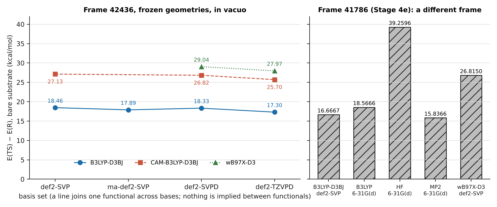
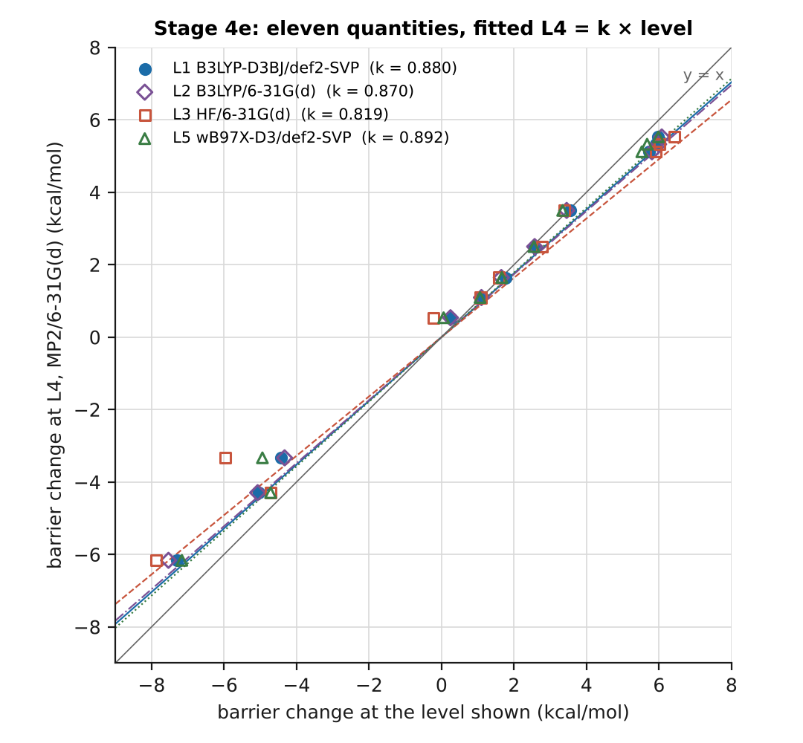
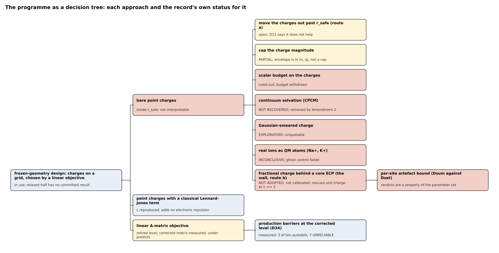
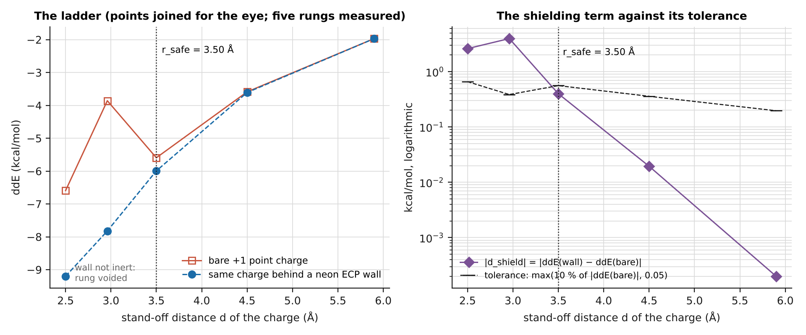
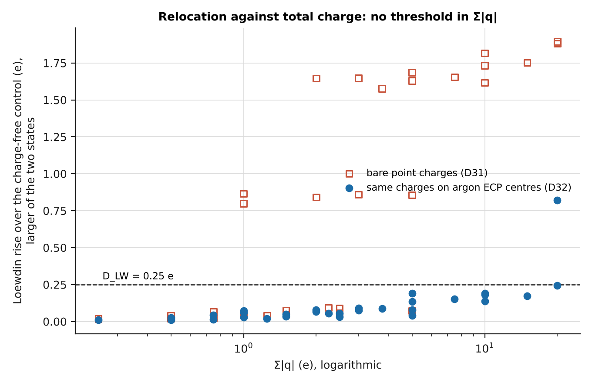
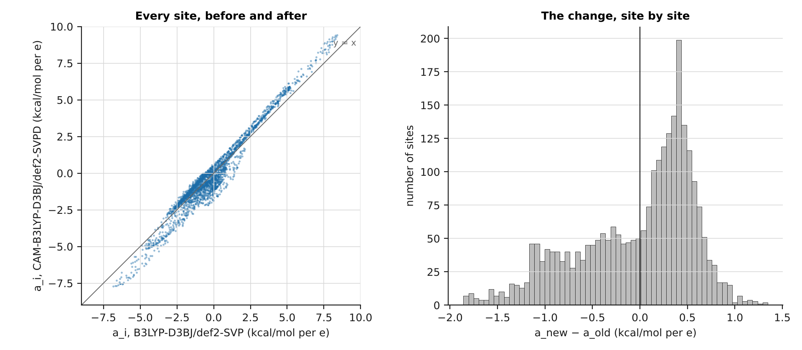
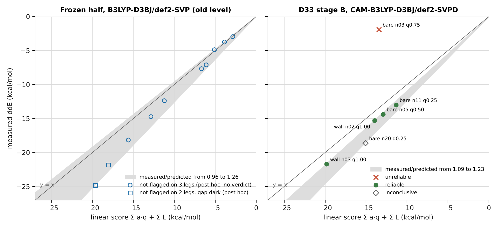
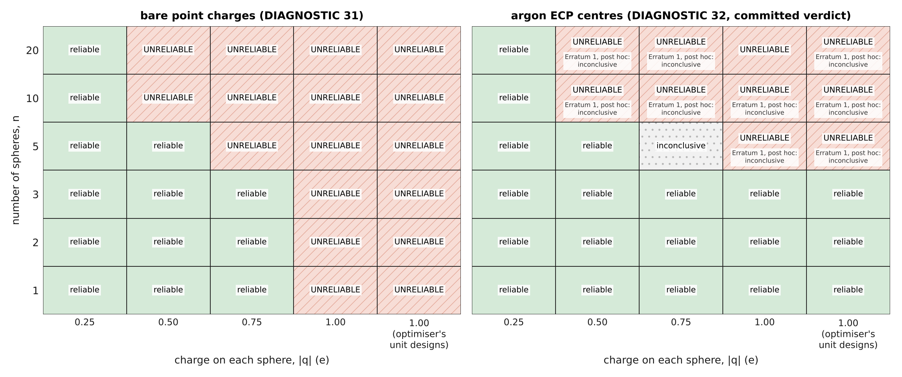
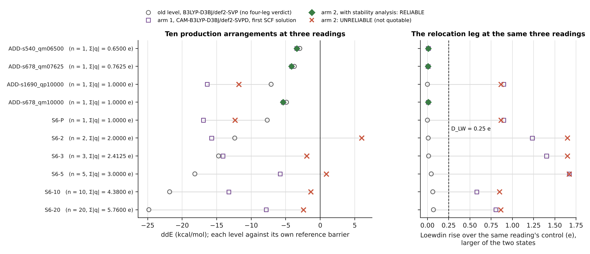

# The charged-sphere design work: a consolidated account

11 November 2026. Written from the committed record only. This is a revision of a first draft of 10 November 2026, made before either was committed, to take in D34, which ran in between.

| repository | branch | HEAD this document refers to |
|---|---|---|
| chorismate-thesis-results | main | `f461bd1a9daeef0366de7c2a9f81fff4ccac479b` |
| chorismate-thesis-code | tier1-realism | `23c2500fed83e1f1ddec33e3f42e54038cd2937d` |

**How to read the numbers.** Every paragraph or table that carries a number ends with a tag. `[src: KEY]` names the committed file or files in which each number of that paragraph is printed; the keys are resolved in Appendix C. A number under a `[src:]` tag is *measured*, as printed by that source, unless the sentence says otherwise. `[dv: DVnn]` marks a number that is *derived* or *recomputed* here; `figures/derived.tsv` gives its arithmetic and the files its inputs came from. *Post hoc* is said in the sentence wherever the source says it of itself. Nothing in this document is *estimated*. Text inside curly quotation marks is verbatim from a tagged source. `phase2.2/cs_writeup_check.py` in the code repository tests all of this mechanically; its output is Appendix B.

**What this document is not.** It quotes no activation free energy and makes no claim that any design is catalytic. Every design measured so far sits inside r_safe (section 4.6), on one frame, at frozen geometries, in vacuo.

**A limit on the reading behind it.** The three completeness passes of Appendix A were run. The by-question pass did not read every committed document in full; Appendix A.3 lists what was read in full, what at verdict level, and what not at all.

## 1. The question and the system

Chorismate mutase catalyses the Claisen rearrangement of chorismate to prephenate. The project asks whether a small set of point-like charges placed around the substrate, with no protein, can lower the barrier of that rearrangement, and whether an optimiser can find such a set. The substrate is the chorismate dianion: 24 atoms, charge -2, singlet, 118 electrons. All Stage 6 work uses the reactant and transition-state geometries of one frame, 42436, taken from the QM/MM ensemble and held frozen. [src: CRIT, D34P]

The design idea is first-order electrostatics. For a site i on a grid around the substrate, a_i is the difference between the bare substrate's electrostatic potential at the transition state and at the reactant. A charge q_i at that site changes the barrier by about a_i q_i, so an optimiser chooses sites and charges to make the sum of a_i q_i, plus a classical Lennard-Jones term L_i, as negative as possible, subject to a minimum spacing of 3.25 A between sites. The grid of frame 42436 has 2626 sites. The quantity every diagnostic reports is ddE: the barrier with the charges minus the barrier without them, negative when the charges lower it. [src: D33P, D25, AREP]

## 2. The reference barrier, at every level it exists at

A lowering is only meaningful against the barrier of the bare substrate at the same level of theory and the same geometries. Table 1 gives that barrier, E(TS) - E(R), wherever a charge-free pair of single points is committed. All rows are frozen geometries, no charges, no wall.

| frame | functional | basis | solvation | barrier (kcal/mol) | label | printed by the record as |
|---|---|---|---|---|---|---|
| 42436 | B3LYP-D3BJ | def2-SVP | none | 18.461014 | measured; recomputed, agrees | 18.461014 (D27), 18.4610 (A matrix report, frozen report) |
| 42436 | B3LYP-D3BJ | ma-def2-SVP | none | 17.8938 | measured; recomputed, agrees | 17.8938 (D1) |
| 42436 | B3LYP-D3BJ | def2-SVPD | none | 18.332256 | measured; recomputed, agrees | 18.332256 (D27) |
| 42436 | B3LYP-D3BJ | def2-TZVPD | none | 17.304571 | measured; recomputed, agrees | 17.304571 (D27) |
| 42436 | CAM-B3LYP-D3BJ | def2-SVP | none | 27.1255 | recomputed from raw outputs | not found in a result document |
| 42436 | CAM-B3LYP-D3BJ | def2-SVPD | none | 26.8248 | measured; recomputed, agrees | 26.8248 (D33 stage A, D30) |
| 42436 | CAM-B3LYP-D3BJ | def2-TZVPD | none | 25.7003 | recomputed from raw outputs | not found in a result document |
| 42436 | wB97X-D3 | def2-SVPD | none | 29.0441 | recomputed from raw outputs | not found in a result document |
| 42436 | wB97X-D3 | def2-TZVPD | none | 27.9689 | recomputed from raw outputs | not found in a result document |
| 42436 | B3LYP-D3BJ | ma-def2-SVP | CPCM | 17.4369 | recomputed from raw outputs | not found in a result document |
| 41786 | B3LYP-D3BJ | def2-SVP | none | 16.6667 | recomputed from raw outputs | Stage 4e level L1 |
| 41786 | B3LYP | 6-31G(d) | none | 18.5666 | recomputed from raw outputs | Stage 4e level L2 |
| 41786 | HF | 6-31G(d) | none | 39.2596 | recomputed from raw outputs | Stage 4e level L3 |
| 41786 | MP2 | 6-31G(d) | none | 15.8366 | recomputed from raw outputs | Stage 4e level L4 |
| 41786 | wB97X-D3 | def2-SVP | none | 26.8150 | recomputed from raw outputs | Stage 4e level L5 |

Sources for Table 1: [src: D27, D1, D33A, D30, AREP, FROZ, F1T, F1B] [dv: DV20, DV21, DV22, DV23, DV24, DV30, DV31, DV32, DV33, DV34]

"Not found in a result document" means I searched the D27, D28, D30 and D33 result documents for the value and did not find it; it does not mean no committed file prints it. The recomputation reads every charge-free single point under `phase2.2/cs_stage6`, recognises the geometry by its interatomic distances rather than by directory name, and reports the spread where several runs give the same quantity. For the two rows the production work rests on, 7 reactant and 7 transition-state runs give the def2-SVP value and 7 and 6 give the CAM-B3LYP/def2-SVPD value; the largest disagreement among them is 1.0e-09 Eh. [src: F1T]



**Figure F1.** Barrier of the bare substrate at each functional and basis. Left: frame 42436, frozen geometries, in vacuo, ten charge-free pairs of single points (the CPCM row of Table 1 is not drawn). A line joins one functional across basis sets; no trend is drawn or implied between functionals. Right: frame 41786, the five Stage 4e levels, which is a different frame and must not be compared bar for bar with the left panel. Data: `figures/F1_reference_barrier.tsv`, `figures/F1b_stage4e_bare_barrier.tsv`. [src: F1T, F1B, S4E]

**Which reference matters, and by how much.** The frozen-half lowerings were first measured against 18.4610, at B3LYP-D3BJ/def2-SVP, and D34 has since measured the same arrangements at the corrected level (section 6). The corrected level, CAM-B3LYP-D3BJ/def2-SVPD, gives 26.8248. The difference is 8.3638 kcal/mol (derived: 26.8248 - 18.461014). Of that, the basis alone accounts for -0.1288 (derived: 18.332256 - 18.461014) and the functional for 8.4925 (derived: 26.8248 - 18.332256). D34's pre-registration prints the same three differences. A lowering measured against one reference may not be subtracted from the other: ddE is a difference of two energies and both move. [src: D27, D33A, FROZ, D34P] [dv: DV01, DV02, DV03]

**Why the functional was changed.** D28 found the highest occupied orbital of the bare dianion at +1.2307 eV under B3LYP, -0.5918 eV under CAM-B3LYP and -1.3424 eV under wB97X-D3, at def2-SVPD, reactant geometry, against a detachment energy of +0.5123 eV measured by Probe 3, which puts the target near -0.5123 eV. B3LYP therefore sits 1.7430 eV too high and CAM-B3LYP 0.0795 eV too low (both derived; D33's pre-registration prints the same two differences). D28 states that “the production functional is NOT changed by this document”. I could not find an amendment that changes it. D30 to D34 nevertheless all use CAM-B3LYP-D3BJ/def2-SVPD. [src: D28, D33P] [dv: DV04, DV05]

## 3. Levels of theory and basis sets

Table 2 is the by-file census of pass 1, collapsed to method and basis. A run is one distinct normally-terminated ORCA output; an output committed both loose and inside an archive counts once. Outputs that did not terminate normally are counted separately and are not evidence.

| method | basis | runs | not normal | used for | what validated it |
|---|---|---|---|---|---|
| B3LYP | def2-SVP | 1559 | 49 | Phase 1 QM/MM; Phases 2 and 2b; Stages 1 to 4e; the A matrix; the frozen half; D1 to D27 | Stage 4e against MP2: “S4e verdict (L1 against L4): SIGN ROBUST” (frame 41786). Retired for the dianion's frontier orbital by D28 |
| B3LYP | def2-SVPD | 821 | 0 | Phase 2b; Stages 4 to 4c; D14 to D27 | D27: converged against def2-TZVPD at 1.3000 e only |
| MM only | none | 648 | 0 | Lennard-Jones combining-rule test (wp1) | Stage 1, S1.4 |
| B3LYP | ma-def2-SVP | 500 | 0 | D1, D2, D10 to D13, the probes | none found |
| CAM-B3LYP | def2-SVPD | 220 | 0 | D28, D30 to D34 | D28 (frontier orbital); D30 (basis, to 2.8800 e) |
| r2SCAN-3c | own | 144 | 1 | s10 benchmark; one Phase 2b test | none found |
| HF-3c | own | 141 | 0 | s10 benchmark; smoke test | none found |
| B97-3c | own | 140 | 0 | s10 benchmark | none found |
| XTB2 (GFN2-xTB) | own | 140 | 0 | s10 benchmark | none found |
| B3LYP | def2-TZVPD | 38 | 0 | Stage 4c; D27 | it is the reference |
| wB97X-D3 | def2-SVP | 35 | 0 | Stage 4e; D28 | Stage 4e against MP2 |
| B3LYP | 6-31G(d) | 34 | 0 | Stage 4e | Stage 4e against MP2 |
| HF | 6-31G(d) | 34 | 0 | Stage 4e | Stage 4e against MP2 |
| MP2 | 6-31G(d) | 34 | 0 | Stage 4e | it is Stage 4e's reference |
| none named (FOD) | none named | 10 | 0 | D19 | not applicable |
| CAM-B3LYP | def2-SVP | 9 | 0 | D28, D30 | not applicable |
| CAM-B3LYP | def2-TZVPD | 8 | 0 | D28, D30 | it is the reference |
| wB97X-D3 | def2-SVPD | 8 | 0 | D28 | not applicable |
| wB97X-D3 | def2-TZVPD | 2 | 0 | D28 | not applicable |

Sources for Table 2: [src: T1C, S4E, S1, D27, D30]

Three of the diagnostics this section names label their own results, and the label travels with them: D3 is INCONCLUSIVE and withdrawn, D13 is PARTIAL, and D24 is EXPLORATORY. [src: D3, D13, D24]

The full table, 98 distinct combinations of method, basis, dispersion, solvation, embedding and job type, is `figures/T1_levels_of_theory.tsv`. The scan read 11927 input and output files, of which 11155 are ORCA; the rest are job logs, potential files and Amber outputs. [src: T1E, T1L, T1D]

Three things the keyword lines do not show, found by pass 2. First, the ten FOD runs of D19 name no functional or basis; D19's result records what ORCA used: “TPSS/def2-TZVP, 5000 K”. That is the only use of TPSS and of plain def2-TZVP in the record, and neither was used for any energy. Second, two pieces of work ran in pyscf 2.14.0 and committed no inputs or outputs, only a result or a log: Experiment 0, restricted Hartree-Fock on isolated He, Ne and Ar atoms in aug-cc-pV5Z, aug-cc-pwCV5Z and aug-cc-pV(5+d)Z, and D24, B3LYP with Gaussian-smeared charges. Third, the Na and Mg centres of the Phase 2 test `09_mmtest` name their core potential in an input block, not on a keyword line. [src: D19, EXP0, D24, T2N]

**Not tested.** Each name below occurs somewhere in committed text, in a parser's list of names, in a literature discussion, or in ORCA's credits banner, and on no keyword line in either repository. None was run on this system.

<!-- not-tested-begin -->
Functionals: `M06-2X`, `PBE0`, `PBE`, `BP86`, `BLYP`, `TPSSh`, `revPBE`, `B97-D3`, `wB97X-V`, `PBEh-3c`, `wB97X-3c`.
Wavefunction methods: `CCSD(T)`, `DLPNO-CCSD(T)`, `DLPNO-CCSD`, `DLPNO-MP2`, `RI-MP2`, `MP3`, `CASSCF`, `CASPT2`, `NEVPT2`.
Semi-empirical methods: `PM3`, `PM7`, `SCC-DFTB`.
Basis sets: `def2-TZVPP`, `def2-TZVPPD`, `def2-QZVPP`, `aug-cc-pVDZ`, `aug-cc-pVTZ`, `cc-pVDZ`, `cc-pVTZ`, `6-31+G(d)`, `6-311+G(2d,p)`, `STO-3G`.
Solvation and dispersion: `SMD`, `COSMO`, `D4`, `VV10`.
<!-- not-tested-end -->

The banner-only names, those that occur in output files and nowhere else, are `DLPNO-CCSD`, `DLPNO-MP2`, `CASPT2`, `MP3`, `VV10`, `wB97X-3c`, `MBIS`, `NBO`, `ONIOM` and `ROHF`. Three names need a caution rather than a place on the list: `TPSS` and `def2-TZVP` were used, as the FOD default only; `aug-cc-pV5Z` was used, in pyscf, on a helium atom only. [src: T2N, T1B]



**Figure F2.** Stage 4e: eleven barrier-change quantities (six residues alone, five first-order site coefficients) at four levels against the same quantity at MP2/6-31G(d), frame 41786, in vacuo, 170 single points. Each line is the report's fit L4 = k x level through the origin; nothing is interpolated. Data: `figures/F2_stage4e.tsv`, parsed from the Stage 4e report. [src: S4E] [dv: DV93]

## 4. The approaches taken, and the verdict on each

Figure F9 is the map. Each box carries the record's own status; the words behind each status are verbatim in `figures/F9_decision_tree.tsv`.



**Figure F9.** The programme as a decision tree. No numerical data; thirteen nodes, each tied to a quoted sentence of a committed document. The D34 node, shown as pre-registered in the first draft, now carries its committed result.

### 4.1 Bare point charges

*Meant to fix:* nothing; it is the starting representation, a charge with no size. *Measured by:* the frozen half (22 single points, B3LYP-D3BJ/def2-SVP), D11, D12, D13, D31, D33 stage B and D34. *Cost:* the distance ladder alone is 52 runs, the (n, q) grid 62. *Finding:* D11 measured the distance inside which a bare charge and the same charge behind a Pauli wall disagree, and returned r_safe = 3.50 A, with the consequence “No design measured inside r_safe is interpretable.” The committed arrangements sit at 2.85-2.96 A. At CAM-B3LYP-D3BJ/def2-SVPD, D31 found every design carrying a unit charge UNRELIABLE at every n from 1 to 20, and reliable envelopes of 0.75 e to n = 3, 0.5 e to n = 5 and 0.25 e to n = 20; of those envelopes D31 says “They are not a rule a new design must obey”. D33 stage B then measured a design inside the envelope, three spheres at 0.75 e, UNRELIABLE. *Status:* in use, not adopted by any amendment as valid, and uninterpretable inside r_safe on D11's own reading. [src: D11, D31, D33B, D33P] [dv: DV94, DV75, DV71]

D34 then lifted the ten production arrangements, which are point charges with a Lennard-Jones term and no wall, to the same level: 7 are UNRELIABLE and 3 RELIABLE, and the 3 are the only arrangements with no positive charge (derived). The sign matters to how D31 is read. Each of D31's 12 unit-charge conditions carries a positive unit charge and none of its 30 conditions is without a positive charge (derived), so D31 measured positive and mixed sets; D34's single sphere at -1.0000 e, RELIABLE, does not contradict it. Reading the sign across diagnostics in this way is post hoc; it is a hypothesis, not a finding (section 11, H2). [src: D34R, D34T, T3D] [dv: DV127, DV126, DV128, DV129, DV148, DV145, DV149]

**Verdict.** A bare point charge at the committed distances is not a reliable instrument, and no committed rule says in advance which arrangements fail.

### 4.2 Point charges with a classical Lennard-Jones term

*Meant to fix:* collapse of a charge onto the substrate when geometry is relaxed, by giving the charge a classical size. *Measured by:* Stage 1 (the QM/MM Lennard-Jones energy is reproduced from the force-field file to 2.0e-10 Eh) and the frozen half, where the measured Lennard-Jones contribution equals the optimiser's L for all nine sphere arrangements. *Finding:* at fixed geometry the term is a classical energy added to the total. The frozen report says the agreement “is a check of the grid's own arithmetic and of the force field it was handed, not of any physics.” It adds no repulsion that the electrons feel, so it cannot stop the density relocation of section 4.1. Its value lies at relaxed geometry, and D33's pre-registration records that “Stage 6's relaxed half has no committed result”. *Status:* in use for L; its purpose is untested because the relaxation has no committed result. [src: S1, FROZ, D33P, INV]

D34 holds a controlled pair for this term. S6-P and ADD-s1690_qp10000 are the same charge of +1.0000 e at the same site, the first as a bare point charge and the second with the Lennard-Jones term. Their QM energies agree to 4.1e-12 Eh or better at all three readings and both states (recomputed), they differ only in the classical term, and they receive the same verdict. The ten production arrangements are therefore 9 distinct electronic systems (derived). [src: T4W, T3D] [dv: DV132, DV131]

**Verdict.** The Lennard-Jones term is implemented correctly, leaves the electronic result untouched at fixed geometry, and has not yet been shown to do the job it was added for.

### 4.3 Real ions as QM atoms

*Meant to fix:* the missing Pauli repulsion, by replacing the point charge with Na+ or K+ in the QM region. *Measured by:* D3. *Finding:* the ghost-atom control gave 0.9461 kcal/mol against a limit of 0.30, and the verdict was “VERDICT PER D3.3: INCONCLUSIVE”, with a counterpoise treatment named as required. Erratum 3 went further: “E3.2 DIAGNOSTIC 3 IS WITHDRAWN”. Separately, Phase 2's `09_mmtest` placed Na and Mg centres carrying a core potential near a test system; ten such runs are committed and I could not find a recorded verdict for them. *Status:* INCONCLUSIVE and withdrawn; the counterpoise run it calls for is not in the record. [src: D3, E3, T1L]

**Verdict.** Whether a real ion behaves differently from a point charge has not been answered.

### 4.4 A fractional charge behind a core ECP: the wall

*Meant to fix:* the same missing repulsion, while keeping an adjustable charge: the charge sits on a centre that carries a full noble-gas core potential and no electrons or basis functions. *Measured by:* Stages 4b and 4c, D11 to D13, D16 to D18, D20, D23, D26, D32 and D33 stage B. *Cost:* D23 alone is 50 runs, D32 is 66. *Findings.* (i) The wall is not always inert: with zero charge it moved ddE by +1.3105 kcal/mol at 2.50 A in D11, and D12 voided 13 of 36 sites and D13 two of eight on the same control. (ii) Its size depends on the species: D23 re-ran four committed verdicts with helium and argon in place of neon and three of them changed on helium, under the verdict “A PROPERTY OF THE PARAMETER SET”. (iii) The parameter sets are not equally validated: Experiment 0 reproduced the published fitting target to 1.381e-06 Eh for helium and 7.670e-07 Eh for neon, and to only 3.067e-03 Eh for argon, which it marks NOT VALIDATED. D32 and D33 use argon. (iv) At def2-SVP the wall changes nothing (D18: “VERDICT: NEITHER ARM MOVES”) because that basis shows no relocation to remove. (v) At CAM-B3LYP-D3BJ/def2-SVPD, D32 found the wall rescues the unit charge for n = 1, 2 and 3 on both site families, and the Loewdin rise falls below the 0.25 e threshold in 29 of the 30 charged conditions. The verdict at n = 5 and above is discussed in section 5. *Status:* NOT ADOPTED. D33's pre-registration: “THE WALL IS NOT ADOPTED AND IS NOT CALIBRATED.” Route (b) has no amendment. [src: D11, D12, D13, D23, EXP0, D18, D32, D33P] [dv: DV67, DV72, DV97, DV98]

**Verdict.** The wall removes the relocation it was built to remove, at one species that is itself not validated, and no production number may rest on it until it is adopted and calibrated.

### 4.5 Gaussian-smeared charge

*Meant to fix:* spill-out, by spreading each charge over a finite width. *Measured by:* D24, twelve cells in pyscf, three charge vectors at four widths. *Finding:* the def2-SVP to def2-SVPD gap fell by 7.3 per cent at the weakest vector and did not fall at 2.8800 e. *Status:* D24 says of itself “It is therefore EXPLORATORY and its status is a scoping measurement, not a result.” D27 re-ran its three point-charge cells in ORCA and left the smeared cells inadmissible. *Not adopted.* [src: D24, D24N, D27]

**Verdict.** On an EXPLORATORY measurement that may not be quoted, smearing did not help; the question is formally unanswered.

### 4.6 Moving the charges out past r_safe

*Meant to fix:* the artefact of section 4.1, by distance alone. This is route (a) of D11's Erratum 1. *Measured by:* D11 (the ladder, five rungs from 2.50 to 5.90 A, plus controls) and D12 (36 grid sites, 282 runs). *Cost recorded:* the classical estimate of a unit charge's effect falls from -4.23 kcal/mol at 2.96 A to -3.16 at 3.50 A, “about 25 per cent less field per charge”; the grid must be rebuilt and every a coefficient recomputed. *Finding:* the two documents do not agree. D11's Erratum 1 says “The choice between (a) and (b) is a scientific decision, not a correction, and it is recorded here as open.” D12 says “Moving the grid outward does not help, because what fails is the prediction, not the distance.” D33 and D34, two weeks later, both still describe the choice as open. Erratum 1 also says what r_safe is: “r_safe = 3.50 A BOUNDS THE VALIDITY OF A MODEL. IT IS NOT A STATEMENT ABOUT WHERE A CATALYTIC CHARGE MAY SIT.” *Status:* open. No design of more than one charge has been measured outside r_safe. Single unit charges have: 4 of D12's 36 sites lie beyond 3.50 A from the nearest substrate atom, and 3 of them fail D11's tolerance, with a shielding term of up to +8.0656 kcal/mol at 3.676 A (derived counts; B3LYP-D3BJ/ma-def2-SVP, a retired level). [src: D11, D11E, D12, D33P, D34P] [dv: DV76, DV161, DV162]



**Figure F5.** D11's distance ladder: one +1 charge at five stand-off distances, bare and behind a neon wall, B3LYP-D3BJ/ma-def2-SVP, frame 42436, in vacuo; five rungs, 52 runs in the directory including the sign, basis and far-field controls. Left: ddE for each arm; the points are joined for the eye only. Right: the shielding term |d_shield| against its tolerance, with r_safe = 3.50 A marked. The 2.50 A rung is voided because the wall alone was not inert there. Data: `figures/F5_distance_ladder.tsv`. [src: D11, F5T] [dv: DV75]

**Verdict.** The record conflicts on whether distance can repair the model, and the decision is the researcher's (section 8.1).

### 4.7 Capping the charge magnitude

*Meant to fix:* the same artefact, by limiting the charge on any one sphere. *Measured by:* D2 and its Amendment 1 (one site), D13 (eight sites, three magnitudes, 114 runs), D17, D31. *Findings:* the first cap, from D2's Amendment 1, is withdrawn (section 7). D13's verdict is PARTIAL: three of six live sites that fail at unit charge pass at 0.25, the fitted exponents run from 0.61 to 4.49, and “A single cap cannot be stated from this sample; the screen would have to be per-site, which the grid cannot carry.” D31's envelopes are in (n, q) and D33 stage B found a failure inside one of them. *Status:* not adopted as a rule. [src: D13, D31, D33B] [dv: DV77]

**Verdict.** Magnitude matters, but no single cap is supported; D13's own verdict is PARTIAL.

### 4.8 A scalar budget on the charges

*Meant to fix:* the same artefact, by one constraint the optimiser could carry, such as a ceiling on the sum of q squared. *Measured by:* D9 (no new runs) and D29 (no new runs; 182 committed conditions read). *Finding:* D9: “No scalar on the charge vector proposed so far survives contact with the corrected corpus.” D29: “NO SCALAR IN THE SET ORDERS RELOCATION.” D29's decisive case is one pair of runs with the same ten charges on the same ten sites, differing only in substrate geometry: the density relocates at the reactant (Loewdin rise +0.3181) and not at the transition state (+0.1136). “THE TWO CHARGE VECTORS ARE IDENTICAL.” D31 confirmed it on purpose-built families: two of ten iso-total families disagree. *Earlier attempts of the same kind:* D4's divergence was first read as a total-field effect bounded at the sum of |q|; Erratum 3 records “That reading was not supported”, and that a single electrostatic scalar proposed next was “TESTED AND FAILED”. What survived was a domain and not a predictor: D5 found the two bases agree to within 1.0 kcal/mol up to 2.880 e on one design, and D7 found that domain to transfer to a second design only in part, “PARTIAL: the domain rests on ONE criterion for S6-10 where it rested on two for S6-20.” *Status:* ruled out. The one budget figure that had been stated is withdrawn (section 7). The Stage 6 criteria placed the two- and three-sphere arrangements under a budget of 2.0 e^2, which they call “a code-test value and not the calibrated B”; I could not find a calibrated value. [src: D9, D29, D31, CRIT, D4, D5, D7, E3]



**Figure F4.** Loewdin relocation against total charge for every charged condition of D31 (bare) and D32 (walled): 30 conditions per arm, two states each, CAM-B3LYP-D3BJ/def2-SVPD, frame 42436, in vacuo; the larger of the two states' rises is plotted. The dashed line is the committed threshold D_LW = 0.25 e. Recomputed from the 128 raw outputs through the committed classifier; the twelve unit-charge rows reproduce D32's printed table. Nothing is interpolated. Data: `figures/F4_relocation.tsv`. [src: F4T, AUD, D32E1]

**Verdict.** No function of the charge vector alone can order relocation, so no scalar budget can screen it.

### 4.9 Continuum solvation

*Meant to fix:* the unbound highest occupied orbital of the gas-phase dianion, by binding the density with a dielectric. *Measured by:* D10, 16 single points with and without CPCM at ma-def2-SVP. *Finding:* the continuum did bind the density (control HOMO from +1.2269 to -4.3036 eV) and did not restore the design numbers: for the twenty-sphere design ddE went from the committed -24.8261, a number Erratum 3 classes STRAINED and D20 holds PROVISIONAL, to 20.6967, a sign reversal. “VERDICT PER D10.3: NOT RECOVERED”. *Status:* removed by Amendment 2: “No continuum appears alongside designed charges again without a further amendment.” [src: D10, A2] [dv: DV78]

**Verdict.** A continuum does not repair the frozen design numbers and is out of the evaluation condition by amendment.

### 4.10 The linear A-matrix objective

*Meant to fix:* the cost of the search; it lets an exact solver choose among 2626 sites. *Measured by:* Stage 1b and Stage 5's own checks, Stage 4d, D1, the frozen half, D25 and D33. *Findings.* (i) The matrix is what it claims to be: finite-difference checks at three sites pass at both levels. (ii) It under-predicts. At B3LYP-D3BJ/def2-SVP the measured ddE is 0.96 to 1.26 times the score over the ten frozen arrangements (derived), and the record's own two ratios are 1.10 for the two-sphere and 1.26 for the twenty-sphere design. At CAM-B3LYP-D3BJ/def2-SVPD the ratio is 1.09 to 1.23 over the five stage B designs not flagged, and 0.14 for the one that is UNRELIABLE. (iii) The matrix moves with the level of theory: Pearson 0.977520 between old and new a_i, the twenty largest overlap in 17, the largest single change -1.8590 kcal/mol per e. The result prints “rank 0.863979”; the committed reader computes that on the magnitudes |a_i|, and the rank correlation of the signed a_i, recomputed here, is 0.928979. (iv) The objective discards the reactant term: D25 pre-registered a test of whether predicted lowerings come from raising the reactant, and I could not find a committed result for D25. (v) Stage 4d: “PC1 FAIL: frozen values rank designs only and are never compared with an enzyme number”. D1's verdict on the def2-SVP findings was “VERDICT PER D1.3: THE FINDINGS NOT USABLE AS THEY STAND”. *Status:* in use; the committed designs were chosen with the old matrix. [src: AREP, D33A, D33B, FROZ, RD33A, D25, S4D, D1] [dv: DV50, DV51, DV52, DV53, DV54, DV92]



**Figure F8.** The A matrix before and after the change of level: a_i at each of the 2626 sites of frame 42436, B3LYP-D3BJ/def2-SVP against CAM-B3LYP-D3BJ/def2-SVPD, bare substrate in vacuo; each matrix rests on three single points and one potential evaluation per geometry. Left: every site. Right: the change site by site. Data: `figures/F8_A_matrix.tsv`. [src: F8T, D33A] [dv: DV92]



**Figure F6.** The optimiser's linear score against the measured ddE, frame 42436, frozen geometries. Left: the ten frozen-half arrangements, B3LYP-D3BJ/def2-SVP QM/MM single points, 22 runs; their only classification at this level is D34 stage A's post hoc reading of the readable legs, which flags none and is not a verdict. Right: the six D33 stage B designs, CAM-B3LYP-D3BJ/def2-SVPD, 16 runs, with the committed verdict of each. The two panels are different levels of theory and no line joins them. The grey band is the range of measured over predicted in each panel. Data: `figures/F6_predicted_vs_measured.tsv`. [src: F6T, D33B, FTSV] [dv: DV94, DV74, DV50, DV51, DV52, DV53]

**Verdict.** The linear objective ranks and under-predicts by roughly a tenth to a quarter where the density is reliable, and says nothing about where it is not.

### 4.11 The per-site artefact bound

*Meant to fix:* the cost of checking a whole design, by asking whether the sum of each site's own artefact (Dsum) bounds the artefact of the set (Dset). *Measured by:* D14, its Amendment 1, D15, D16, D17 and D23. *Findings:* D14 stopped without a verdict: “THE n6neg CONTROL FAILED.” D15 returned NOT BOUNDED for the mixed-sign ten-sphere design at def2-SVPD (Dset 0.4140 against Dsum 0.3521) and BOUNDED for its positive-only subsets. D16 found the twenty-sphere design BOUNDED. D23 then showed that the D15 verdict and two D16 readings reverse when the wall's species is changed. D27 marks the D16 ladder and D23's walled arms provisional. *Status:* not established. [src: D14, D15, D16, D23, D27]

**Verdict.** Whether per-site artefacts bound a design depends on which pseudopotential defines the artefact, so the bound is not a usable screen.

## 5. The reliability criterion

**The four legs.** From D31 onward a run's numbers may be used only if it passes a criterion with four legs, read against the charge-free control at the same level and state. The thresholds are constants of the committed classifier `phase2.2/cs6_audit.py`.

| leg | fires when | threshold | what it cannot see |
|---|---|---|---|
| Loewdin relocation | the largest atomic Loewdin charge rises over the control's | D_LW = 0.25 e | anything in a basis without diffuse functions |
| dipole | the dipole magnitude over the control's | R_DIP = 2.0 | anything on a walled arm, where ORCA counts each ECP centre as a nucleus |
| gap | the HOMO-LUMO gap is below GAP_ABS = 1.0 eV and below R_GAP = 0.5 of the control's | both | anything in a run where a level shift or TRAH was engaged |
| stability | the last stability analysis of the run is unstable | none; a verdict | anything in a run that carried no stability analysis |

Sources for the table: [src: AUD, D33P, D34P, A5]

**Where they came from.** The thresholds were written for D6's audit of the whole record and have been inherited unchanged; D31, D32 and D33 read them from the file at read time. D6 says of them that they “were chosen AFTER the Stage 6 outputs had been inspected” and that the classification “is not a blind test”; it anchored them to in-corpus controls, of which 0 of 352 are classified anything but CLEAN. A first construction on the Loewdin leg alone was abandoned: Erratum 3 records that it called 616 of 832 def2-SVP runs collapsed. The stability leg was added by D19 and D20 and re-defined by Amendment 5: until D31 the first analysis was the production solution; once the stability analysis was switched on by default the reported numbers come from the reconverged solution, so the last analysis is the one that judges them. “A first-pass instability that was then corrected is NOT a reliability flag.” [src: A5, D31, D6, E3]

**A dark leg is not a pass.** Two statements in the record fix this. D32: “a condition whose gap cannot be read is never called RELIABLE”. D34: “no document may upgrade "NOT FLAGGED (3 LEGS)" to RELIABLE”. A run whose gap leg is unreadable is INCONCLUSIVE at best. A run with no stability analysis has three legs, not four, and cannot be called reliable. None of the 22 frozen-half outputs carries a stability analysis. [src: D32P, D34P]

**Cases on record where the legs disagree.**

1. Loewdin against dipole. Of the fifteen conditions D29 found moved, one moved on the Loewdin leg alone: rise +0.3181, dipole ratio 1.4769. [src: D29]
2. Stability against everything else. D32's committed result marks nine conditions STILL UNRELIABLE. Erratum 1 found that all nine were flagged on the stability leg alone, read on the first analysis, with the Loewdin rise below threshold in each. Of the 66 runs of D32, 21 had an unstable first solution and none ends unstable; of the 62 of D31, 34 and none. I recomputed all four counts from the raw outputs and they agree. Erratum 1's re-reading, in which the nine become INCONCLUSIVE because each needed a level shift, is labelled by its source: “THIS RECOMPUTATION IS POST HOC AND IS NOT A REPLACEMENT VERDICT.” [src: D32, D32E1] [dv: DV72, DV952, DV962, DV71, DV951, DV961]
3. Gap against relocation, across functionals. D28 found the gap at 2.8800 e to be 0.4934 eV under B3LYP and 2.8223 eV under CAM-B3LYP: a condition flagged on the gap under one functional is not flagged under the other. [src: D28]
4. Two indicators of the same thing. D19 compared the fractional-occupation measure with the stability analysis at full field: “VERDICT: DISAGREE”. [src: D19]
5. Inside the envelope. D33 stage B's three-sphere design at 0.75 e sits inside D31's envelope and fires both relocation legs at both states (rises +0.9186 and +0.8430). [src: D33B]

6. One level against another. D34's stage A read the three readable legs on the 22 frozen outputs at B3LYP-D3BJ/def2-SVP and flagged none of the ten arrangements; that reading is post hoc by its own words, and 2 of the ten had a dark gap leg. Arm 2, the four-leg verdict at CAM-B3LYP-D3BJ/def2-SVPD, finds 7 of the ten UNRELIABLE, and D34's own comparison marks those 7 DISAGREE: “They are different levels of theory, so a disagreement is a finding and not an error.” [src: D34R, D34E1] [dv: DV127, DV133]

**What D34 shows about the legs.** The committed result reports arm 2's legs only. Read from the raw outputs with the same classifier, arm 1, which is the same level without the stability analysis, already has the Loewdin rise at or over the threshold in the same 7 arrangements, with a largest rise of 1.6692 e. At the old level 0 of the ten reach it and the largest rise is 0.0711 e, on the same arrangements, charges and geometries (all recomputed; the old-level figures agree with D34's stage A). So the relocation is not produced by the stability correction, and the old level looked clean because it could not see the relocation, not because a fourth leg was missing. D34 changes functional and basis together and cannot say which of the two is responsible. In D34 the stability leg adds no arrangement to those the relocation leg already flags, whereas in D32 it was the only leg that fired in nine conditions. [src: T3D, D34R, D34T] [dv: DV113, DV116, DV117, DV115, DV118]

Two earlier results point to the basis. D18 found no relocation in either arm at def2-SVP, and D29 calls def2-SVP “the basis DIAGNOSTIC 27 showed to be blind to relocation for want of diffuse functions”; D29's own relocations were read from conditions in a diffuse basis, most of them under B3LYP. [src: D18, D29]



**Figure F3.** Verdict per (n, q) cell, bare (D31, 62 runs) beside walled (D32, 66 runs), CAM-B3LYP-D3BJ/def2-SVPD, frame 42436, frozen geometries, in vacuo. The right panel shows D32's committed verdict; the nine cells Erratum 1 re-read are marked, and that re-reading is post hoc. The one INCONCLUSIVE cell is five spheres at 0.75 e. Verdicts are parsed from the two result documents and the erratum, not re-judged. Data: `figures/F3_nq_grid.tsv`. [src: D31, D32, D32E1, F3T] [dv: DV71, DV72]

## 6. What is actually established

Each item states its level of theory, its run count where it has one, and its frame. All are frozen geometries, frame 42436, in vacuo, unless said otherwise. [src: CRIT]

1. **The bare-substrate barrier is 18.461014 kcal/mol at B3LYP-D3BJ/def2-SVP and 26.8248 at CAM-B3LYP-D3BJ/def2-SVPD.** Measured, and recomputed here from every committed charge-free pair. [src: D27, D33A, F1T]
2. **B3LYP places the dianion's highest occupied orbital above the vacuum level; CAM-B3LYP and wB97X-D3 bind it.** Measured, D28, 22 runs, and monotone in the long-range exchange fraction at two bases and both states. [src: D28] [dv: DV69]
3. **r_safe = 3.50 A for a bare unit charge on one axis from one site, at B3LYP-D3BJ/ma-def2-SVP.** Measured, D11. The wall arm it is defined against is neon, used outside its published assumption. [src: D11, D33P]
4. **No scalar function of the charges orders density relocation.** Measured, D29, from one pair of committed runs with identical charge vectors and opposite outcomes; B3LYP-D3BJ/def2-SVPD. [src: D29]
5. **A bare design carrying a positive unit charge is unreliable at every n tested; reliable envelopes exist only in partial charges and are not transferable.** Measured, D31, 62 runs, and D33 stage B, CAM-B3LYP-D3BJ/def2-SVPD. [src: D31, D33B] [dv: DV71]
6. **An argon wall brings the Loewdin rise below threshold in 29 of 30 charged conditions and rescues the unit charge at n = 1, 2 and 3.** Measured, D32, 66 runs; the count of 29 is recomputed here. The wall is NOT ADOPTED and argon is not validated. [src: D32, D33P, EXP0] [dv: DV72, DV97, DV98]
7. **def2-SVPD is converged against def2-TZVPD under CAM-B3LYP at 1.3000 e and 2.8800 e, and is not at 5.6433 e.** Measured, D30: “def2-SVPD is not sufficient under CAM-B3LYP at 5.6433e_n20.” Three vectors. [src: D30]
8. **At the corrected level, two bare designs chosen with the corrected matrix are both reliable and inside the confirmed basis window: five spheres at 0.50 e, ddE -14.3612, and eleven at 0.25 e, ddE -13.0007.** Measured, D33 stage B, 16 runs. Erratum 2 restricts production claims from that diagnostic to these two. Both sit inside r_safe; D33's first limitation is “NOTHING HERE ESCAPES r_safe.” [src: D33B, D33E2, D33P] [dv: DV74]
9. **The linear score under-predicts the measured ddE by a factor of 1.09 to 1.23 over the five stage B designs not flagged.** Derived from the stage B result and the committed designs file. [src: D33B] [dv: DV50, DV51]

10. **The frozen-half lowerings are reproducible at the old level, and 7 of the ten arrangements are UNRELIABLE at the corrected one.** Old level: ten arrangements, from -2.958960 to -24.826057 kcal/mol, B3LYP-D3BJ/def2-SVP, 22 runs, each recomputed here to the sixth decimal; the largest is S6-20's, which Erratum 3 classes STRAINED at that level and D20 holds PROVISIONAL, and Erratum 3 classes S6-10 STRAINED as well. Corrected level, D34 arm 2, CAM-B3LYP-D3BJ/def2-SVPD with the stability analysis, 22 runs: 3 arrangements are RELIABLE and quotable, at -3.3985, -4.1567 and -5.3701 kcal/mol against a reference of 26.8248, and 7 are UNRELIABLE. The 3 are single spheres carrying -0.6500, -0.7625 and -1.0000 e. All ten sit inside r_safe. Measured; every ddE of both arms is recomputed here from the 44 raw outputs and matches, and the charge-free control barrier of each arm is 26.8248 kcal/mol. [src: D34R, D34T, T3D, CTL, E3, D20] [dv: DV94, DV126, DV127]

11. **The prediction that the frozen half was measured on unreliable densities was tested and not falsified.** The first draft of this document carried it as a hypothesis, to be given up if D34's classified arm returned RELIABLE for every arrangement at or below 2.88 e. Of the 7 such arrangements, 4 are UNRELIABLE and 3 RELIABLE (derived from the committed table). The 3 arrangements above 2.88 e are UNRELIABLE as well. That draft was never committed, so the record cannot show that the test was fixed before the result; this is reported as a finding, not as a passed pre-registered test. [src: D34R, D34T] [dv: DV110, DV111, DV112, DV138]

12. **The old level could not see the relocation.** At B3LYP-D3BJ/def2-SVP, 0 of the ten arrangements has a Loewdin rise at or over 0.25 e and the largest is 0.0711 e. At CAM-B3LYP-D3BJ/def2-SVPD without the stability analysis, arm 1, 7 of the ten do and the largest is 1.6692 e: the same arrangements, the same charges, the same geometries, 22 runs each. Recomputed from raw outputs; the old-level reading is D34's stage A, which is post hoc by its own words. D34 does not separate functional from basis. [src: T3D, D34R, D34T] [dv: DV115, DV118, DV113, DV117]

13. **In D34, every arrangement that relocates carries a positive charge, and the 3 that carry none do not relocate.** The 3 RELIABLE arrangements are the 3 with no positive charge, with a largest arm 2 rise of 0.0098 e; all 7 that carry a positive charge are UNRELIABLE. This is an observation on ten arrangements in which sign is confounded with site, it is post hoc, and it is not a rule (section 11, H2). [src: T3D, D34T] [dv: DV129, DV128, DV130, DV127]

14. **The stability correction is large enough to change the sign of ddE.** In 7 of the ten arrangements, 14 of 20 runs, arm 2's first SCF solution is unstable with 3 negative eigenvalues, and the reconverged energy is lower by up to 0.085840877 Eh, which is 53.8660 kcal/mol (S6-20, reactant). ddE changes sign between arm 1 and arm 2 for 2 arrangements, S6-2 and S6-5, and moves by up to 21.7176 kcal/mol. The 3 RELIABLE arrangements are stable at the first solution and their two arms agree exactly. All recomputed; the per-state corrections match D34's printed table. [src: T3D, D34R] [dv: DV119, DV120, DV121, DV123, DV122, DV124, DV125]

This is not the first stability correction in the record. D20 measured corrections of 9.5558 and 3.3164 kcal/mol on ddE for S6-20 under B3LYP at def2-SVPD, and said of them “every correction above is a LOWER BOUND on the correction, not the correction.” D34 is the first to measure it with a separate arm, at the corrected level, across all ten arrangements. [src: D20]



**Figure F7.** The ten production arrangements at three readings, frozen geometries, QM/MM single points with the Lennard-Jones term. Left: ddE at the old level (B3LYP-D3BJ/def2-SVP, 22 runs; D6 classed S6-10 and S6-20 STRAINED there and the other designs it covered CLEAN, and no four-leg verdict exists), at D34 arm 1 (CAM-B3LYP-D3BJ/def2-SVPD, first SCF solution, 22 runs) and at D34 arm 2 (the same with the stability analysis, 22 runs); arm 2's marker shows its committed verdict, 3 RELIABLE and 7 UNRELIABLE. Each ddE is against its own level's reference barrier, 18.4610 and 26.8248. The grey bar joins one arrangement's three readings; it is not a trend. Right: the Loewdin rise at the same three readings against the threshold of 0.25 e. Rows are ordered by total charge. Of the old-level numbers the frozen report says “NOTHING HERE IS A BARRIER.” Data: `figures/F7_production_designs.tsv`, `figures/T3_d34_arms.tsv`. [src: F7T, T3D, D34R, D34T, FROZ, E3] [dv: DV126, DV127]

## 7. What has been withdrawn, and why

| withdrawn | by | what replaced it |
|---|---|---|
| The charge budget Sigma q^2 <= 0.58 e^2, and the claim that the optimiser's budget is about 3.4 times too high | D29's pre-registration: “NEITHER FIGURE IS QUOTABLE AND THIS DIAGNOSTIC DOES NOT ASSUME EITHER.” | Nothing. D29: no scalar orders relocation |
| “+0.093 e” as the walled Loewdin rise attributed to D23, and the factor of nine built on it | D32 Erratum 2: “Both are WITHDRAWN.” “+0.093 e IS IN NO OUTPUT AND NO RESULT.” | D32's own measured factors, 7.8 to 20.7 in eleven of twelve conditions and 2.3 in the twelfth |
| The per-site cap q_quad = 0.80 e | Erratum 3: “E3.1 q_quad = 0.80 e IS WITHDRAWN” | D13 (PARTIAL), then D31's envelopes |
| The conclusion of D3 (itself INCONCLUSIVE) that a real ion saturates like a point charge | Erratum 3: “E3.2 DIAGNOSTIC 3 IS WITHDRAWN” | Nothing; the counterpoise run is outstanding |
| D29's statement that no committed run measures relocation for a unit charge | D29 Erratum 2: “R29.4's claim that nothing in the record measures relocation for a +-1 e design is withdrawn.” | 132 unit-charge conditions exist at ma-def2-SVP and have not been read |
| D29's availability counts of 110 conditions and 16 controls | D29 Erratum 1 | 182 and 26 |
| The 5.6433 e vector, in every quantity | D27: “the 5.6433 e vector is WITHDRAWN from every quantity until a larger basis is run” | Nothing yet |
| D26's def2-SVP input, the pyscf value -5.6165 | D27 R27.4, superseded | The ORCA value -5.614783 |
| D32's verdict STILL UNRELIABLE at n = 5 and 10, as evidence that the wall fails there | D32 Erratum 1; the verdict stands, its use is restricted | Amendment 5 for future readers |
| D33 stage B's “largest quotable lowering”, a walled design; the wall is NOT ADOPTED | D33 Erratum 2; the number stands, its use is restricted | The bare five-sphere design, -14.3612 |

Sources for the table: [src: D29P, D29, D29E1, D29E2, D32E1, D32E2, D32, E3, D13, D27, D33E2, D33B]

**D34 withdraws nothing.** Its result says so: “Nothing is withdrawn here; withdrawal of a committed number needs its own dated erratum.” What it does is narrower. It marks 7 of the ten corrected numbers not quotable, and it leaves the ten old-level numbers standing as committed, at a retired level and now known to belong, in 7 cases, to arrangements whose density is unreliable at the corrected one. Whether they are withdrawn is the decision of section 8.5. [src: D34R] [dv: DV127]

The record also holds an earlier do-not-quote list covering Phase 1 and Phase 2 figures; it is section 5 of the committed attempt inventory and is not repeated here. That inventory describes itself as hand-written and as stopping at an earlier commit. [src: INV]

## 8. Open decisions

These are the researcher's to make. For each: what depends on it, and what each branch costs according to the record.

### 8.1 Route (a) or route (b) on r_safe

*Depends on it:* the grid, and through the grid every a coefficient and every design. *Route (a)*, bare charges moved out to 3.50 A or more: the grid is rebuilt and the A matrix recomputed; the record's own figure is about a quarter less first-order effect per charge; D12 says distance does not fix the prediction. *Route (b)*, keep the distances and adopt a charge model with Pauli repulsion: needs a dated amendment and a calibrated wall; D23 found the wall's size depends on the species, and the species now in use is not validated. Until one is taken, D34's wording applies to every number: “A corrected barrier for a design inside r_safe is a corrected number for an uninterpretable design”. [src: D11E, D12, D23, D34P]

### 8.2 The Sigma q_i = 0 amendment

*Depends on it:* whether any committed number survives. The optimiser enforces no charge neutrality; D25 records that its source method does, and that net charge is the lever that moves the reactant. D25 also says “ADDING EITHER CONSTRAINT IS NOT DONE BY THIS DIAGNOSTIC AND IS NOT AUTHORISED BY IT.” D34: “The Sigma qi = 0 decision is untaken and D34 does not take it.” [src: D25, D34P]

*If taken:* of the ten production arrangements one has charges summing to zero (derived), S6-2, and D34 finds it UNRELIABLE; 0 of the neutral arrangements is RELIABLE (derived), and the 3 quotable ones carry net charges of -0.6500, -0.7625 and -1.0000 e. [src: D34R, D34T, T3D] [dv: DV47, DV137, DV126]

Of the six stage B designs one is neutral (derived), the twenty-sphere design, which is INCONCLUSIVE and outside the basis window. The two designs of section 6, item 8 carry net charges of -0.50 and -0.25 e (derived) and would be voided. Taking the amendment as it stands therefore leaves no quotable number in the record. *If not taken:* the question D25 raised stays open. [src: D25, D33B] [dv: DV46, DV41, DV42]

### 8.3 The sign of Loss

*Depends on it:* whether Stage 6's tolerance can fail. The criteria define Loss as ddE(frozen) - ddE(relaxed) and require “LOSS MUST BE BELOW 15 % OF |ddE(frozen)|.” The finding of 3 November records that the tolerance “cannot fail as the criteria write it”, because the formula and the clause beside it differ in sign. It proposes no correction. *Cost of either branch:* an amendment; no committed number changes, because no relaxation result is committed. [src: CRIT, LOSS]

### 8.4 A criterion for a relocated pose

I could not find the phrase "relocated pose" in either repository; I searched all tracked text for it and for close variants. What the record holds is this. The criteria define two failures of a relaxation: a sphere within 1.2 A of a substrate atom, and a bond moving by more than 0.15 A. D25 records a relaxation in which the reactant moved its centroid 8.8567 A while the transition state moved 0.6536 A, and concludes “The relaxed reactant and the relaxed transition state are therefore no longer the same complex.” Neither committed failure definition covers that case. *Depends on it:* every future relaxation. *Cost:* an amendment defining when a relaxed reactant no longer belongs to the same complex; no committed result changes. [src: CRIT, D25]

### 8.5 What becomes of the old-level production numbers

The first draft's open item here was the scope of D34; D34 has run as registered. What remains is the decision its result leaves to a dated erratum: whether the ten frozen-half lowerings at B3LYP-D3BJ/def2-SVP, 7 of which belong to arrangements D34 finds UNRELIABLE at the corrected level, are withdrawn, restricted, or left as committed. *Depends on it:* whether any later document may quote the old numbers, including the two-sphere and twenty-sphere figures that earlier diagnostics use as baselines. *Cost of either branch:* no compute; one erratum. D34 also says what it is not: “D34 re-reads the record; it designs nothing.” The arrangements were placed with the old A matrix, so new production numbers have to come from designs chosen with the corrected one, which D33 stage B began with six. D34's own reading of the old outputs, its stage A, is post hoc by its own words and decides nothing here. [src: D34R] [dv: DV127]

## 9. Untested variables and approaches

**The only geometric variable ever varied is the radial stand-off distance**, in D11, on one axis from one site. **No angular or orientational variable has been scanned.** I walked every diagnostic's question and varied variable and found none whose variable is an angle or an orientation. D12 varies the site, which changes direction and distance together and holds neither fixed.

Also absent from that walk, each stated as "I could not find", not as "there is none":

- any design of more than one charge, at any level, outside r_safe (D12 measured single unit charges beyond it, at a retired level);
- a second frame: every Stage 6 number is frame 42436, Stage 4e is frame 41786, and the s10 benchmark's 35 frames have no recorded conclusion;
- the valence axis of the basis: every basis test moves along the diffuse axis, and plain triple-zeta without diffuse functions was never used for an energy;
- a triple-zeta arm for any walled design;
- a counterpoise-corrected ion comparison, which D3 names as required;
- a multireference calculation, which D19 says its result licenses and does not replace;
- any wall species from a second published source;
- detachment energies at the transition-state geometry: both probes are at the reactant;
- a committed result for D25 or for the relaxed half of Stage 6;
- a reading of the 132 committed unit-charge conditions at ma-def2-SVP;
- the audit Erratum 3 asks of the earlier point-charge record, where D6 found COLLAPSED single points in three sets of runs: it “needs the same audit before it is carried into the write-up”. I could not find a later document that performs it (both repositories searched for the three directory names), and this document draws no conclusion from those runs;
- a sign-swapped control at the corrected level: no site has been measured there with both a positive and a negative charge (D2 and D11 measured both at site 1690 and D12 at ten more sites, at the retired functional only), and none of D31's 30 conditions is without a positive charge (derived); the observation that prompts this is post hoc (section 11, H2);
- free energies, sampling, or explicit solvent with a designed charge present. [src: CRIT, S4E, INV, D29E2, D11, D12, D3, D19, P3, D33P, T5W, E3, D6] [dv: DV145, DV149]

**The deliberate checks.**

- *Tried and abandoned:* continuum solvation (Amendment 2); Gaussian smearing (EXPLORATORY); real ions (INCONCLUSIVE, withdrawn); the scalar budget (D29).
- *Proposed and never adopted:* the wall, route (b), NOT ADOPTED; the neutrality constraint; CAM-B3LYP as the production functional, which D28 declines to change.
- *Withdrawn numbers:* section 7.
- *Self-labelled PARTIAL or INCONCLUSIVE:* D13 (PARTIAL); D3 (INCONCLUSIVE); D33 stage B's twenty-sphere design (INCONCLUSIVE); one D32 cell (INCONCLUSIVE); D27 and D30, which form no single verdict.
- *At only one level of theory:* r_safe (B3LYP-D3BJ/ma-def2-SVP); the (n, q) envelope and the wall's rescue (CAM-B3LYP-D3BJ/def2-SVPD); the old-level production lowerings (B3LYP-D3BJ/def2-SVP), which D34 has now re-measured at a second level with a different outcome for most.
- *For only one frame:* everything in Stage 6.
- *Never had a negative control:* I could not find a random-design or scrambled-charge control for any measured ddE; the wall-only and charge-free controls test the instrument, not the design.

## 10. Conclusions

1. **The reference barrier depends on the functional by 8.4925 kcal/mol and on the basis by -0.1288.** Both are derived from D27 and D33 stage A at frame 42436, frozen, in vacuo. Scope: bare substrate only; any lowering must be quoted against the reference of its own level. [src: D27, D33A] [dv: DV03, DV02]

2. **Of the ten production arrangements, 3 are reliable at the corrected level and 7 are not.** D34 arm 2, CAM-B3LYP-D3BJ/def2-SVPD with the stability analysis, 44 runs over two arms, one frame, frozen. Scope: all ten sit inside r_safe and were placed with the old A matrix; a verdict does not transfer to another arrangement. [src: D34R, D34T] [dv: DV126, DV127]

3. **The largest quotable lowering for a production arrangement is -5.3701 kcal/mol, one sphere of -1.0000 e, against a reference of 26.8248.** D34 lists three quotable corrected numbers, -3.3985, -4.1567 and -5.3701, all single negative spheres. Scope: inside r_safe; not a catalytic claim; no arrangement of more than one sphere that the optimiser placed is quotable. [src: D34R, D34T]

4. **The old level could not see the relocation.** 0 of ten arrangements reach the Loewdin threshold at B3LYP-D3BJ/def2-SVP and 7 of ten do at CAM-B3LYP-D3BJ/def2-SVPD before any stability correction, on identical arrangements and geometries, 22 raw outputs each, recomputed here. Scope: functional and basis changed together; the old-level reading is post hoc. The old level was not silent on everything: Erratum 3 classes S6-10 and S6-20 STRAINED there, and D20 holds S6-20's number PROVISIONAL after its solution was found unstable. [src: T3D, D34R, E3, D20] [dv: DV115, DV113]

5. **Where the density is reliable the lowering barely moves with the level of theory; where it is not, the corrected number is not quotable.** For the 3 reliable arrangements ddE changes by -0.4036 to -0.4829 kcal/mol between the old level and arm 1 (derived); for the 7 unreliable ones arm 2 gives values from -12.3629 to +5.9806 that D34 marks not quotable. Scope: three single negative spheres on one frame; too few to call a rule. [src: T3D, D34R] [dv: DV136, DV135, DV126, DV127]

6. **The stability correction can exceed the effect being measured.** Up to 53.8660 kcal/mol per state, and a change of sign in ddE for 2 of the ten arrangements, between D34's two arms. Scope: only the 7 arrangements whose first solution is unstable; the 3 reliable ones are untouched; D20 saw the same in kind at the old functional. [src: T3D, D34R] [dv: DV122, DV124, DV119, DV126]

7. **A bare positive charge is not a reliable model at the committed distances.** D11 gives r_safe = 3.50 A against arrangements at 2.85-2.96 A, and D31 finds every design carrying a positive unit charge unreliable in 62 runs at CAM-B3LYP-D3BJ/def2-SVPD. Scope: one frame; r_safe is one axis from one site. [src: D11, D31] [dv: DV71]

8. **Whether a given arrangement is reliable cannot be predicted from its charges.** D29 shows it with one charge vector at two geometries, and D33 stage B with a failure inside D31's envelope. Scope: it rules out scalar budgets and caps; it does not rule out a screen that uses geometry, which D12 tested and found inadequate for five descriptors. [src: D29, D33B, D12]

9. **An argon ECP wall removes the Loewdin relocation in 29 of 30 charged conditions, and is not adopted.** D32, 66 runs, CAM-B3LYP-D3BJ/def2-SVPD, frame 42436; the count is recomputed. Scope: one species, not validated; nothing above n = 3 at unit charge is certified. [src: D32, D33P] [dv: DV97, DV98, DV72]

10. **The largest reliable lowering at the corrected level is -14.3612 kcal/mol, five bare spheres at 0.50 e chosen with the corrected matrix, against a reference of 26.8248.** D33 stage B and its Erratum 2, 16 runs, CAM-B3LYP-D3BJ/def2-SVPD, frame 42436, frozen, in vacuo. Scope: it is not one of the ten production arrangements; it sits inside r_safe, where D11 holds that no design is interpretable; it is not a catalytic claim. [src: D33B, D33E2, D33A, D11] [dv: DV74]

11. **The record conflicts on route (a).** D11's Erratum 1 records the choice as open and D12 says moving the grid outward does not help. Scope: the conclusion is that they conflict. No design of more than one charge has been measured outside r_safe; D12's evidence is 4 single-charge sites beyond it, 3 of which fail, at a retired level. [src: D11E, D12] [dv: DV161, DV162]

12. **The linear objective under-predicts and is at the wrong level for the committed designs.** Ratios of 1.09 to 1.23 over five stage B designs, and a corrected matrix that shares 17 of its twenty largest sites with the old one. Scope: frame 42436; the corrected matrix has selected six designs and no optimisation. [src: D33A, D33B] [dv: DV50, DV51]

13. **Stage 6's own purpose, the relaxation, has no committed result and two open amendments in front of it.** D33's pre-registration and the Loss finding. Scope: nothing about relaxed geometries is established. [src: D33P, LOSS]

## 11. Hypotheses

Ranked by what each unblocks. Run counts are counts of single points and are stated as arithmetic in `figures/derived.tsv` where they are not already a committed diagnostic's own. The first draft's leading hypothesis, that the frozen half was measured on unreliable densities, was tested by D34 and not falsified; it is section 6, item 11, and the rest are renumbered.

**H1. The reliability of an arrangement is decided by the potential it puts on the reactant, not by its charges.** *Unblocks:* a screen, which sections 4.7 and 4.8 show charges alone cannot give, and without which every new design has to be classified after the fact. *Falsified if:* over the committed D31, D32, D33 and D34 conditions, the first-order reactant term does not separate reliable from unreliable any better than total charge does. *Cheapest test:* no new runs; a pre-registered reading of committed potentials and the 128 committed outputs of D31 and D32, the 16 of D33 stage B and the 44 of D34. *Bears on it:* D29's decisive pair differs only in geometry, which a potential-based quantity can see and a charge-based one cannot; D25 measured nothing yet. [src: D29, D25, D32E1] [dv: DV74, DV91]

**H2. Relocation is onto the positive charges: an arrangement with no positive charge does not relocate, at any magnitude up to one.** This is post hoc as a reading of D31, D33 stage B and D34, whose verdicts were known when it was written; the sign itself had been measured before (below). *Unblocks:* whether routes (a) and (b) have to act on every charge or only on the positive ones. *Falsified if:* any arrangement with no positive charge fires a leg of the criterion at CAM-B3LYP-D3BJ/def2-SVPD with the stability analysis. *Cheapest test:* the controlled pair the record lacks at the corrected level, a sign swap at two sites: site 1690 at -1.0000 e and site 678 at +1.0000 e, both states, 4 runs (derived), pre-registered, the control being committed already. *For:* in D34 the 3 arrangements with no positive charge are the 3 RELIABLE ones, with a largest rise of 0.0098 e. [src: T3D, D34T] [dv: DV150, DV129, DV130]

*Also for, from a different level and a different observable, and likewise post hoc as support:* D11's sign control repeated two rungs of the ladder with q = -1 and found a shielding term of -0.0926 kcal/mol at the reference distance and +0.0002 at rung d450, against +3.9642 and +0.0195 on the q = +1 arm. Both arms are recomputed here from D11's raw outputs and agree. [src: D11]

*Also for, and measured before any of this: the record's own sign arm.* D12 repeated ten of its sites at q = -1 and reported the arm without scoring it, because “ten sites in one layer cannot separate sign from position”. At all 10 the shielding term is larger in magnitude at +1 than at -1; the largest is 8.0656 kcal/mol at +1 and 0.0285 at -1 (derived). The level is B3LYP-D3BJ/ma-def2-SVP and the observable is not one of the criterion's legs. D12 reads D11's sign control as having “found the artefact specific to positive charges”. So the sign is not a new observation. What is post hoc is using it to read the verdicts of D31, D33 stage B and D34. [src: D12] [dv: DV160, DV163, DV159, DV158]

*Also for, from D2's outputs; post hoc.* D2 scanned both signs of a bare point charge at site 1690, where D34's single positive sphere sits, and reported energies. Its committed outputs also carry the Loewdin charges and the dipole. D6's audit had classed two runs of that scan COLLAPSED without naming them; read by sign here, they are the pair at +1.0000 e. At B3LYP-D3BJ/def2-SVPD in vacuo the charge of +1.0000 e fires the Loewdin leg in both states (larger rise 1.1358 e, dipole ratio up to 3.03) and the charge of -1.0000 e at the same site fires neither (larger rise 0.0302 e, ratio up to 1.30). Of the 24 negative-charge runs in D2's three in-vacuo conditions, 0 fire either leg; the 2 positive-charge runs that do are that pair. Limits: the retired functional, no stability analysis, a bare charge and not a Lennard-Jones sphere, and two legs of four. [src: T6W, D2, D6] [dv: DV151, DV153, DV152, DV154, DV155, DV156, DV157]

*Against, and limiting; this paragraph too is post hoc.* In the D34 sample sign is confounded with site: the negative spheres sit at sites 540 and 678 and the positive one at 1690, so no site carries both signs there. The same-site swaps in the record, D11's, D12's and D2's, are all at the retired functional. None of D31's 30 conditions is without a positive charge. The two pairs that are controlled test other things: the two spheres at site 678 vary magnitude at a fixed negative sign, and S6-P with ADD-s1690_qp10000 varies only the Lennard-Jones term. [src: T5W, F7T] [dv: DV145, DV149]

*What does not survive, post hoc or otherwise, is a magnitude threshold.* Across D33 stage B and D34 together, the 6 non-walled designs whose largest positive charge is at most 0.5000 e are all RELIABLE or INCONCLUSIVE and the 8 at 0.5500 e or more are all UNRELIABLE. But D31, at the same level on the same frame and the only series that holds the sites fixed while the magnitude changes, has 3 RELIABLE conditions whose largest positive charge is 0.7500 e and 2 UNRELIABLE ones at 0.5000 e. No threshold in the largest positive charge holds across the three diagnostics, which is what D29 found for every other scalar. [src: T5W, D29] [dv: DV141, DV143, DV146, DV147, DV142, DV144]

**H3. Outside r_safe a bare charge is reliable at every magnitude up to one.** *Unblocks:* route (a). *Falsified if:* a unit charge at 3.50 A or beyond fires any leg of the criterion at CAM-B3LYP-D3BJ/def2-SVPD. *Cheapest test:* D11's five rungs repeated at the corrected level with the stability analysis, both signs, both states: 20 charged runs (derived). *Bears on it:* for: D11's shielding term falls from 0.3994 at 3.50 A to 0.0195 at 4.50 A; against: D12, where 3 of the 4 sites beyond 3.50 A fail D11's tolerance at B3LYP-D3BJ/ma-def2-SVP, with a shielding term of up to +8.0656 kcal/mol, and D11's far-field control failed as written. [src: D11, D12, D11E] [dv: DV101, DV161, DV162]

**H4. The wall's rescue at n = 5 and above is real and is hidden by the unreadable gap leg.** *Unblocks:* route (b) for designs larger than three spheres. *Falsified if:* the nine conditions, converged without a level shift, show a collapsed gap or end unstable. *Cheapest test:* those nine conditions, two states each, 18 runs (derived), with a convergence route that does not shift; this is the new diagnostic Amendment 5 says is needed. *Bears on it:* for: the Loewdin rise is below threshold in all nine; against: nothing certifies them, the re-reading that calls them inconclusive is post hoc, and the wall is not adopted. [src: D32E1, A5] [dv: DV102]

**H5. The barrier lowering of a reliable design survives a triple-zeta basis.** *Unblocks:* quoting any number above 2.88 e. *Falsified if:* a reliable stage B design changes by more than 1.0 kcal/mol between def2-SVPD and def2-TZVPD. *Cheapest test:* the two section 6 designs at def2-TZVPD, both states: 4 new runs (derived), the def2-TZVPD control being committed already. *Bears on it:* D30 confirmed 1.3000 e and 2.8800 e on a different arrangement; D33 found reliability does not transfer between arrangements, so basis convergence may not either. [src: D30, D33B, D33P] [dv: DV103]

**H6. The predicted lowering of the neutral, on-mechanism designs is smaller than that of the committed ones.** *Unblocks:* the Sigma q_i = 0 decision. *Falsified if:* a re-solve with the neutrality row gives scores within 15 per cent of the committed ones. *Cheapest test:* no QM; one re-solve per n with the corrected matrix. *Bears on it:* D25's direction statement says the restriction can only make the score worse; by how much is not known. [src: D25]

**What the current grid cannot test at all.** Any hypothesis about orientation; and any hypothesis about relaxed geometries, until sections 8.3 and 8.4 are decided. Designs outside r_safe are testable only at the grid sites that lie there: D12 found some among its 36, and I have not counted how many the grid holds. [src: D12]

**Open questions that are not hypotheses**, because I cannot specify an experiment that would falsify them: whether a point-like model of any kind can represent a residue; and whether the frozen-path approach can reach catalytic lowerings at all, which the criteria list as something Stage 6 cannot settle.

## Appendix A. The completeness sweep

### A.1 Pass 1, by file

`figures/sweep_pass1.py` read every committed input and output in both repositories, loose, compressed, or inside one of the tar archives, and took the keyword line from each input and from each output's echo. *Added by this pass:* the four s10 benchmark methods, which exist only inside one archive; the MM-only runs; the FOD runs; the Na and Mg centres. *Corrected by this pass:* a first aggregate counted inputs by distinct content, which undercounts runs that share one input and differ in the charge file; runs are now counted by distinct normally-terminated outputs. [src: T1L, T1D]

### A.2 Pass 2, by name

`figures/sweep_pass2.py` searched all committed text for 308 names. *Added by this pass:* the two pieces of pyscf work that committed no inputs (Experiment 0 and D24), which no file census can see; the functional and basis behind the FOD runs; the core potential named in an input block. *Corrected by this pass:* my own first list of banner names. The brief's examples of banner-only names did not all hold for this tree: `M06-2X`, `PBE0` and `BP86` occur in a committed parser's list of names and not in any output, and `aug-cc-pV5Z` was in fact used, in pyscf. [src: T2N]

### A.3 Pass 3, by question

*Read in full:* the Stage 6 criteria; Amendment 5; D25; D32, D33 and D34 with every erratum; the results of D1, D2 with its Amendment 1, D3, D4, D5, D7, D10, D11 with its erratum, D12, D13, D17 to D23 and D26 to D31 with the errata of D28 and D29; the third, fourth and fifth items of Erratum 3; the frozen report, the A matrix report, the Stage 4e report; the attempt inventory of 4 November 2026. *Read in part:* D6's result, in full apart from the rows of its table of flagged runs. *Read at verdict level only* (title, verdict lines, closing limitations): the results of D8, D9, D14 with its Amendment 1, D15 and D16; the three probes; Experiment 0; the Stage 1 to 4d reports; the opening of Amendments 1 to 4 and of Errata 1, 2 and 4 to 7, and the headings of the first two items of Erratum 3. *Not read:* the pre-registrations of D1 to D24 and D26 to D31 beyond what their results quote; the two work logs and two assessments in the Stage 6 directory; the citation-integrity, literature-position and ECP-convention notes; the Stage 1 to 5 criteria; the charge-model, optimiser and plan documents. Section 4's statements about D8, D9, D14, D15 and D16 therefore still rest on verdict lines, and section 9's list of untested variables rests on a walk that did not open every pre-registration.

*Changed by the reading of 11 November 2026.* D2's and D12's results carry sign arms that the first draft missed: section 11's hypothesis on the sign, and two entries of section 9, were rewritten for them. D12 measured single charges beyond r_safe: section 4.6, the conclusion on route (a) and the hypothesis on charges outside r_safe no longer say that nothing has been measured there. D4, D5 and D7 with Erratum 3 gave section 4.8 its earlier attempts. D6 and Erratum 3 gave section 5 the provenance of the thresholds, and with D20 they show that the old level had already marked S6-10 and S6-20: the caption of Figure F7, the item on the frozen half in section 6 and the conclusion on the old level said otherwise and were corrected. Erratum 3's open audit of the earlier record was added to section 9.

*Added by this pass:* the four s10 benchmark methods, which exist only inside one archive; the MM-only runs; the FOD runs; the Na and Mg centres. *Corrected by this pass:* a first aggregate counted inputs by distinct content, which undercounts runs that share one input and differ in the charge file; runs are now counted by distinct normally-terminated outputs. [src: T1L, T1D]

### A.2 Pass 2, by name

`figures/sweep_pass2.py` searched all committed text for 308 names. *Added by this pass:* the two pieces of pyscf work that committed no inputs (Experiment 0 and D24), which no file census can see; the functional and basis behind the FOD runs; the core potential named in an input block. *Corrected by this pass:* my own first list of banner names. The brief's examples of banner-only names did not all hold for this tree: `M06-2X`, `PBE0` and `BP86` occur in a committed parser's list of names and not in any output, and `aug-cc-pV5Z` was in fact used, in pyscf. [src: T2N]

### A.3 Pass 3, by question

*Read in full:* the Stage 6 criteria; Amendment 5; D25; D32, D33 and D34 with every erratum; the results of D1, D3, D10, D11 with its erratum, D13, D18, D19, D23 and D26 to D31 with the errata of D28 and D29; the frozen report, the A matrix report, the Stage 4e report; the attempt inventory of 4 November 2026. *Read at verdict level only* (title, verdict lines, closing limitations): the results of D2, D4 to D9, D12, D14 to D17, D20 to D22; the three probes; Experiment 0; the Stage 1 to 4d reports; the opening of Amendments 1 to 4 and Errata 1 to 7. *Not read:* the pre-registrations of D1 to D24 and D26 to D31 beyond what their results quote; the two work logs and two assessments in the Stage 6 directory; the citation-integrity, literature-position and ECP-convention notes; the Stage 1 to 5 criteria; the charge-model, optimiser and plan documents. Section 4's statements about D4 to D9, D14, D16, D17, D20 to D22 therefore rest on verdict lines, and section 9's list of untested variables rests on a walk that did not open every pre-registration.

*Added by this pass:* the conflict between D11's Erratum 1 and D12 on route (a); the absence of a committed D25 result; the status of the argon parameters. *Found while recomputing:* the stage A result's “rank 0.863979” is a rank correlation of magnitudes (section 4.10). [src: D33A]

### A.4 Figures proposed and what became of them

All nine proposed figures were drawn. F7 was first drawn at the old level only, because D34 had not run; it now carries the old level and both of D34's arms, with a second panel for the relocation leg. F1 gained a second panel for frame 41786 so that the Stage 4e barriers are not read against frame 42436. No figure was dropped. [src: F1T, F1B, S4E]

### A.5 The revision of 11 November 2026

D34 ran between the first draft and this one, and neither draft was committed in between. Changed for it: sections 2, 3, 4.1, 4.2, 5, 6, 7, 8.2, 8.5, 9, 10 and 11. In the section on the legs, D34 is a sixth case and the old level's blindness is set out. In the section on what is established, items 10 to 14 are new or rewritten. The section on withdrawn figures says that D34 withdraws nothing. In the conclusions, those on the production arrangements, on the old level and on the stability correction are new, and those on bare positive charges and on the largest reliable lowering are restated. In the hypotheses, the first draft's leading one became a finding and the post hoc one on the sign of the charge is new. Three tables were added, each recomputed from raw outputs through the committed readers: `figures/T3_d34_arms.tsv` (every leg at three readings; D34's result prints arm 2's only), `figures/T4_twin_arrangements.tsv` and `figures/T5_positive_charge_vs_verdict.tsv`. A fourth, `figures/T6_d2_both_signs_site_1690.tsv`, came from the reading recorded in A.3, as did six rows of `figures/derived.tsv` read from D12's tables. The decision tree's D34 node now carries its result.

## Appendix B. Provenance

The record below is `figures/PROVENANCE.txt` as the validation script wrote it on the staged copies: the two HEAD hashes, the sha256 of every script used, the sixteen checks and the negative tests. The run reproduced here included the slow regeneration of the name table. The committed readers' hashes can be compared with the ones the record itself prints for them.

```
PROVENANCE of WRITEUP_CONSOLIDATED_20261111.md

chorismate-thesis-results  main           HEAD f461bd1a9daeef0366de7c2a9f81fff4ccac479b
chorismate-thesis-code     tier1-realism  HEAD 23c2500fed83e1f1ddec33e3f42e54038cd2937d

sha256 of every script used
   8f6f8587726795d11c1fb3ddadc686551ffce80331d56529e7a7f63157d2a475  figures/make_figures.py
   ea269b1eb1effd20197a2f45d4294a69f3b892d15236695c8750e746d49628c4  figures/sweep_pass1.py
   f5e37414d97e7cd475ff6eb8ee606de9d47c5fcd63ae849ab50101ae658229f1  figures/sweep_pass2.py
   b5a6a3f02255b5ee587aa870e98bf7da3c31cebd3c6ec208062add8dca8bc145  code: phase2.2/cs_writeup_check.py
   6e0d0f90e0e7ab3f2f9da7c527e192c1686a6c77a885df6ccc4caf560665052a  code: phase2.2/cs6_analyse.py  (committed reader, imported)
   1dda394a134b3c7265df1898c9b5dc507d01c41d73aa5e59274495a1e7005dea  code: phase2.2/cs6_audit.py  (committed reader, imported)
   c6a8c3958a4e7532c9e28082b6d8f25c51549c0ea70f06fcf95d1370b3cde2f6  code: phase2.2/cs6_d33b.py  (committed reader, imported)

validation output

    1 numbers      PASS   (363 sourced in a named committed file, 155 derived (figures/derived.tsv), 0 estimated; 917 items not treated as numerals)
    2 quotes       PASS   (65 quotations)
    3 citations    PASS   (78 files in Appendix C)
    4 withdrawn    PASS   (7 registry entries)
    5 selflabels   PASS   (8 registry entries)
    6 controls     PASS   (161 recomputed; worst: C13.01 ddE bare_n03_q0.75 (D33 stage B): |diff| 4.89e-05 against a tolerance of 5.0e-05)
    7 counts       PASS   (29 run counts)
    8 not_tested   PASS   (37 names)
    9 regeneration PASS   (22 tables regenerated)
   10 heads        PASS   (two repositories)
      -- added 11 November 2026 for DIAGNOSTIC 34
   11 exp_heads    PASS   (results f461bd1, code 23c2500)
   12 d34_numbers  PASS   (19 blocks cite D34: 52 numerals in its result or d34.tsv, 66 derived)
   13 d34_controls PASS   (arm 1 26.8248, arm 2 26.8248; 10 frozen ddE, worst |diff| 4.8e-07)
   14 arm1_legs    PASS   (63 values recomputed from d34/a1_*)
   15 claims       PASS   (40 numbers behind C1 to C6 recomputed)
   16 posthoc      PASS   (8 blocks discuss C3)
   RESULT: ALL SIXTEEN CHECKS PASS

   NEGATIVE TESTS
      a number                                     -> check 'numbers' FIRED: section '6. What is actually established': 26.8348 is in no [src:] file of its block (D27, D33A, F1T, D28, D11
      a quotation (full stop to comma)             -> check 'quotes' FIRED: section '4. The approaches taken, and the verdict on each': not verbatim in any [src:] file of its block (D11,
      a run count in the text                      -> check 'numbers' FIRED: section '4. The approaches taken, and the verdict on each': 67 is in no [src:] file of its block (D11, D12, D1
      a run count in derived.tsv                   -> check 'counts' FIRED: DV72: derived.tsv says 67, git ls-files gives 66 (number of committed job.out files under phase2.2/cs_stage6/d
      a citation                                   -> check 'citations' FIRED: D27: phase2.2/cs_stage6/STAGE6_DIAGNOSTIC27_RESULT_20261106.txt is not tracked by git in the results repositor
      a withdrawn figure used as evidence          -> check 'withdrawn' FIRED: the withdrawn figure '0.58' appears in section '6. What is actually established', outside the withdrawal secti
      a self-label                                 -> check 'selflabels' FIRED: section '4. The approaches taken, and the verdict on each' uses D13 (matched /\bD13\b/) and does not carry its
      a figure's tsv                               -> check 'regeneration' FIRED: F5_distance_ladder.tsv differs from the file regenerated from committed sources
      a HEAD hash                                  -> check 'heads' FIRED: chorismate-thesis-code: the document records 33c2500fed83e1f1ddec33e3f42e54038cd2937d and HEAD is 23c2500fed83
      the not-tested list                          -> check 'not_tested' FIRED: CAM-B3LYP is listed as not tested and stands on 474 keyword line(s)
      the commit the revision was built from       -> check 'exp_heads' FIRED: the document does not state f461bd1 as the HEAD of chorismate-thesis-results (it states e461bd1a9dae)
      a D34 number that another cited file holds   -> check 'd34_numbers' FIRED: section '10. Conclusions': 14.3612 is in neither the D34 result nor d34.tsv and is no [dv:] value of its block  [check 'numbers' passed it]
      a raw control output of d34/                 -> check 'd34_controls' FIRED: arm 1 control barrier recomputed from d34/ is 26.8875, not 26.8248
      a recorded frozen ddE                        -> check 'd34_controls' FIRED: figures/controls.tsv records -7.675815 (PASS) for the frozen ddE of S6-P (C07.01); recomputed here: -7.675715
      an arm 1 leg                                 -> check 'arm1_legs' FIRED: S6-5 a1_rise_R: figures/T3_d34_arms.tsv says 1.7692; recomputed here from d34/a1_S6-5_*: 1.6692
      the number behind a claim                    -> check 'claims' FIRED: C6 (the size of the stability correction): DV124 is 3 in figures/derived.tsv and 2 recomputed here
      a claim the recomputation rejected           -> check 'claims' FIRED: C6 (the size of the stability correction): a form of the claim that the recomputation rejected appears: '8 of 
      C3 stated as a conclusion                    -> check 'claims' FIRED: C3 is post hoc and appears in the Conclusions: ...7. **A bare positive charge is not a reliable model at the c
      the post hoc label                           -> check 'posthoc' FIRED: section '11. Hypotheses': a block discusses C3 (matched /without a positive charge/) without the words post ho
      19 of 19 negative tests fired
```

## Appendix C. Sources

R is chorismate-thesis-results at the HEAD above; C is chorismate-thesis-code; W is this write-up's own `figures/` directory, whose files are produced by the committed scripts beside them.

| key | repo | path |
|---|---|---|
| CRIT | R | phase2.2/cs_stage6/STAGE6_CRITERIA.txt |
| A2 | R | phase2.2/cs_stage6/STAGE6_AMENDMENT2_20261027.txt |
| A5 | R | phase2.2/cs_stage6/STAGE6_AMENDMENT5_20261109.txt |
| E3 | R | phase2.2/cs_stage6/STAGE6_ERRATUM3_20261026.txt |
| D1 | R | phase2.2/cs_stage6/diffuse/DIAGNOSTIC1_RESULT.txt |
| D3 | R | phase2.2/cs_stage6/pauli/DIAGNOSTIC3_RESULT.txt |
| D9 | R | phase2.2/cs_stage6/DIAGNOSTIC9_RESULT.txt |
| D10 | R | phase2.2/cs_stage6/cpcm/DIAGNOSTIC10_RESULT.txt |
| D11 | R | phase2.2/cs_stage6/standoff/DIAGNOSTIC11_RESULT.txt |
| D11E | R | phase2.2/cs_stage6/STAGE6_DIAGNOSTIC11_ERRATUM1_20261027.txt |
| D12 | R | phase2.2/cs_stage6/sitescan/DIAGNOSTIC12_RESULT.txt |
| D13 | R | phase2.2/cs_stage6/qscale/DIAGNOSTIC13_RESULT.txt |
| D14 | R | phase2.2/cs_stage6/additivity/DIAGNOSTIC14_RESULT.txt |
| D15 | R | phase2.2/cs_stage6/negatives_armA/DIAGNOSTIC15_RESULT.txt |
| D16 | R | phase2.2/cs_stage6/d16/DIAGNOSTIC16_RESULT.txt |
| D18 | R | phase2.2/cs_stage6/d18/DIAGNOSTIC18_RESULT.txt |
| D19 | R | phase2.2/cs_stage6/d19/DIAGNOSTIC19_RESULT.txt |
| D23 | R | phase2.2/cs_stage6/d23/DIAGNOSTIC23_RESULT.txt |
| D24 | R | phase2.2/cs_stage6/STAGE6_DIAGNOSTIC24_EXPLORATORY_20261103.txt |
| D24N | R | phase2.2/cs_stage6/STAGE6_DIAGNOSTIC24_NOTE1_20261103.txt |
| D25 | R | phase2.2/cs_stage6/STAGE6_DIAGNOSTIC25_20261104.txt |
| D27 | R | phase2.2/cs_stage6/STAGE6_DIAGNOSTIC27_RESULT_20261105.txt |
| D28 | R | phase2.2/cs_stage6/STAGE6_DIAGNOSTIC28_RESULT_20261105.txt |
| D29P | R | phase2.2/cs_stage6/STAGE6_DIAGNOSTIC29_20261105.txt |
| D29 | R | phase2.2/cs_stage6/STAGE6_DIAGNOSTIC29_RESULT_20261105.txt |
| D29E1 | R | phase2.2/cs_stage6/STAGE6_DIAGNOSTIC29_ERRATUM1_20261105.txt |
| D29E2 | R | phase2.2/cs_stage6/STAGE6_DIAGNOSTIC29_ERRATUM2_20261105.txt |
| D30 | R | phase2.2/cs_stage6/STAGE6_DIAGNOSTIC30_RESULT_20261106.txt |
| D31 | R | phase2.2/cs_stage6/STAGE6_DIAGNOSTIC31_RESULT_20261107.txt |
| D32P | R | phase2.2/cs_stage6/STAGE6_DIAGNOSTIC32_20261108.txt |
| D32 | R | phase2.2/cs_stage6/STAGE6_DIAGNOSTIC32_RESULT_20261109.txt |
| D32E1 | R | phase2.2/cs_stage6/STAGE6_DIAGNOSTIC32_ERRATUM1_20261109.txt |
| D32E2 | R | phase2.2/cs_stage6/STAGE6_DIAGNOSTIC32_ERRATUM2_20261109.txt |
| D33P | R | phase2.2/cs_stage6/STAGE6_DIAGNOSTIC33_20261109.txt |
| D33E2 | R | phase2.2/cs_stage6/STAGE6_DIAGNOSTIC33_ERRATUM2_20261109.txt |
| D33A | R | phase2.2/cs_stage6/STAGE6_DIAGNOSTIC33_STAGEA_RESULT_20261109.txt |
| D33B | R | phase2.2/cs_stage6/STAGE6_DIAGNOSTIC33_STAGEB_RESULT_20261109.txt |
| D34P | R | phase2.2/cs_stage6/STAGE6_DIAGNOSTIC34_20261110.txt |
| D34R | R | phase2.2/cs_stage6/STAGE6_DIAGNOSTIC34_RESULT_20261110.txt |
| D34E1 | R | phase2.2/cs_stage6/STAGE6_DIAGNOSTIC34_ERRATUM1_20261110.txt |
| D34T | R | phase2.2/cs_stage6/d34.tsv |
| D20 | R | phase2.2/cs_stage6/d20/DIAGNOSTIC20_RESULT.txt |
| D2 | R | phase2.2/cs_stage6/qscan/DIAGNOSTIC2_RESULT.txt |
| D4 | R | phase2.2/cs_stage6/field/DIAGNOSTIC4_RESULT.txt |
| D5 | R | phase2.2/cs_stage6/field/DIAGNOSTIC5_RESULT.txt |
| D6 | R | phase2.2/cs_stage6/DIAGNOSTIC6_RESULT.txt |
| D7 | R | phase2.2/cs_stage6/transfer/DIAGNOSTIC7_RESULT.txt |
| EXP0 | R | phase2.2/cs_stage6/exp0/EXPERIMENT0_RESULT.txt |
| P3 | R | phase2.2/cs_stage6/vde_designs/PROBE3_RESULT.txt |
| FROZ | R | phase2.2/cs_stage6/frozen/FROZEN_REPORT.txt |
| FTSV | R | phase2.2/cs_stage6/frozen/frozen.tsv |
| AREP | R | phase2.2/cs_stage6/A_REPORT.txt |
| LOSS | R | phase2.2/cs_stage6/STAGE6_LOSS_SIGN_FINDING_20261103.txt |
| INV | R | phase2.2/ATTEMPT_INVENTORY_20261104.md |
| S1 | R | phase2.2/cs_stage1/STAGE1_REPORT.txt |
| S4D | R | phase2.2/cs_stage4d/STAGE4D_REPORT.txt |
| S4E | R | phase2.2/cs_stage4e/STAGE4E_REPORT.txt |
| AUD | C | phase2.2/cs6_audit.py |
| RD33A | C | phase2.2/cs6_d33a.py |
| F1T | W | F1_reference_barrier.tsv |
| F1B | W | F1b_stage4e_bare_barrier.tsv |
| F3T | W | F3_nq_grid.tsv |
| F4T | W | F4_relocation.tsv |
| F5T | W | F5_distance_ladder.tsv |
| F6T | W | F6_predicted_vs_measured.tsv |
| F7T | W | F7_production_designs.tsv |
| F8T | W | F8_A_matrix.tsv |
| CTL | W | controls.tsv |
| T1L | W | T1_levels_of_theory.tsv |
| T1B | W | T1b_keyword_tokens.tsv |
| T1C | W | T1c_levels_summary.tsv |
| T1D | W | T1d_file_census.tsv |
| T1E | W | T1e_totals.tsv |
| T2N | W | T2_names.tsv |
| T3D | W | T3_d34_arms.tsv |
| T4W | W | T4_twin_arrangements.tsv |
| T5W | W | T5_positive_charge_vs_verdict.tsv |
| T6W | W | T6_d2_both_signs_site_1690.tsv |
