# The charged-sphere design work: a consolidated account

15 November 2026, evening; first committed on 11 November 2026. Written from the committed record only. The first committed text was a revision of a draft of 10 November 2026, made to take in D34. A second revision, committed on the morning of 15 November 2026, took in D35 to D38 and D39's pre-registration, together with the changes that were prepared on 11 November 2026 and held until D36 had reported. This third revision takes in the three results committed since: D41, D37's Amendment 1 and D40. D39's result is also committed. At Jessica's instruction it is NOT ENTERED in this revision: questions were raised about it on reading, they are open, and nothing here rests on it. Appendix A.6, A.7 and A.8 say what changed.

| repository | branch | HEAD this document refers to |
|---|---|---|
| chorismate-thesis-results | main | `21d631b005c65174e791bbc4a464c89f2e5f5433` |
| chorismate-thesis-code | tier1-realism | `512eead964a4b8d953bf5e14adad0935834500d1` |

**How to read the numbers.** Every paragraph or table that carries a number ends with a tag. `[src: KEY]` names the committed file or files in which each number of that paragraph is printed; the keys are resolved in Appendix C. A number under a `[src:]` tag is *measured*, as printed by that source, unless the sentence says otherwise. `[dv: DVnn]` marks a number that is *derived* or *recomputed* here; `figures/derived.tsv` gives its arithmetic and the files its inputs came from. *Post hoc* is said in the sentence wherever the source says it of itself. Nothing in this document is *estimated*. Text inside curly quotation marks is verbatim from a tagged source. `phase2.2/cs_writeup_check.py` in the code repository tests all of this mechanically; its output is Appendix B.

**What this document is not.** It quotes no activation free energy and makes no claim that any design is catalytic. Every design measured so far sits inside r_safe (section 4.6), on one frame, at frozen geometries, in vacuo. The two correlated barriers of section 2 are electronic energies on frozen gas-phase geometries; neither is the experimental number and neither is compared with it. And since this revision it must be read with one more thing in mind: D40 measured the dianion METASTABLE, at both states, with the charges present, for each of the five arrangements whose lowering the record had held quotable. What the record's own rule then makes of those five lowerings is in section 5, and what is left to decide is in section 8.8.

**A companion document.** `phase2.2/cs_stage6/WRITEUP_SCOPED_20261111.md`, committed on 11 November 2026, is a shorter report scoped to D34 and written conditional on D36. It has not been revised for D36's result. Where the two differ, this document is the later one.

**A limit on the reading behind it.** The three completeness passes of Appendix A were run. The by-question pass did not read every committed document in full; Appendix A.3 lists what was read in full, what at verdict level, and what not at all.

## 1. The question and the system

Chorismate mutase catalyses the Claisen rearrangement of chorismate to prephenate. The project asks whether a small set of point-like charges placed around the substrate, with no protein, can lower the barrier of that rearrangement, and whether an optimiser can find such a set. The substrate is the chorismate dianion: 24 atoms, charge -2, singlet, 118 electrons. All Stage 6 work uses the reactant and transition-state geometries of one frame, 42436, taken from the QM/MM ensemble and held frozen. [src: CRIT, D34P]

The design idea is first-order electrostatics, on a grid of sites around the substrate. For each site i, a_i is the electrostatic potential that the bare substrate creates at grid site i when it is in its transition-state geometry, minus the potential it creates at that same site when it is in its reactant geometry (in kcal/mol per unit charge), so a charge q_i placed at site i is predicted to change the barrier by a_i × q_i. An optimiser therefore chooses sites and charges to make the sum of a_i q_i, plus a classical Lennard-Jones term L_i, as negative as possible, subject to a minimum spacing of 3.25 A between sites. The grid of frame 42436 has 2626 sites. The quantity every diagnostic reports is ddE: the barrier with the charges minus the barrier without them, negative when the charges lower it. [src: D33P, D25, AREP]

## 2. The reference barrier, at every level it exists at

A lowering is only meaningful against the barrier of the bare substrate at the same level of theory and the same geometries. Table 1 gives that barrier, E(TS) - E(R), wherever a charge-free pair of single points is committed. All rows are frozen geometries, no charges, no wall.

| frame | method | basis | solvation | barrier (kcal/mol) | label | printed by the record as |
|---|---|---|---|---|---|---|
| 42436 | B3LYP-D3BJ | def2-SVP | none | 18.461014 | measured; recomputed, agrees | 18.461014 (D27; D35 as level L1), 18.4610 (A matrix report, frozen report) |
| 42436 | B3LYP-D3BJ | ma-def2-SVP | none | 17.8938 | measured; recomputed, agrees | 17.8938 (D1) |
| 42436 | B3LYP-D3BJ | def2-SVPD | none | 18.332256 | measured; recomputed, agrees | 18.332256 (D27) |
| 42436 | B3LYP-D3BJ | def2-TZVPD | none | 17.304571 | measured; recomputed, agrees | 17.304571 (D27) |
| 42436 | B3LYP | 6-31G(d) | none | 20.0658 | measured; recomputed, agrees | 20.0658 (D35, level L2) |
| 42436 | CAM-B3LYP-D3BJ | def2-SVP | none | 27.1255 | recomputed from raw outputs | not found in a result document |
| 42436 | CAM-B3LYP-D3BJ | def2-SVPD | none | 26.8248 | measured; recomputed, agrees | 26.8248 (D33 stage A, D30, D37) |
| 42436 | CAM-B3LYP-D3BJ | def2-TZVPD | none | 25.7003 | measured; recomputed, agrees | 25.7003 (D36, D37) |
| 42436 | wB97X-D3 | def2-SVP | none | 29.2021 | measured; recomputed, agrees | 29.2021 (D35, level L5) |
| 42436 | wB97X-D3 | def2-SVPD | none | 29.0441 | measured; recomputed, agrees | 29.0441 (D37) |
| 42436 | wB97X-D3 | def2-TZVPD | none | 27.9689 | measured; recomputed, agrees | 27.9689 (D36, D37) |
| 42436 | PW6B95-D3BJ | def2-SVPD | none | 22.1571 | measured; recomputed, agrees | 22.1571 (D37) |
| 42436 | PW6B95-D3BJ | def2-TZVPD | none | 20.9595 | measured; recomputed, agrees | 20.9595 (D37) |
| 42436 | PWPB95-D3BJ | def2-SVPD | none | 22.2031 | measured; recomputed, agrees | 22.2031 (D37) |
| 42436 | PWPB95-D3BJ | def2-TZVPD | none | 21.3407 | measured; recomputed, agrees | 21.3407 (D37) |
| 42436 | revDSD-PBEP86-D4 | def2-SVPD | none | 21.8414 | measured; recomputed, agrees | 21.8414 (D37 Amendment 1, arm RI) |
| 42436 | revDSD-PBEP86-D4 | def2-TZVPD | none | 21.4957 | measured; recomputed, agrees | 21.4957 (D37 Amendment 1, arm RI) |
| 42436 | wB97M-V | def2-SVPD | none | 28.6953 | measured; recomputed, agrees | 28.6953 (D37) |
| 42436 | wB97M-V | def2-TZVPD | none | 27.3924 | measured; recomputed, agrees | 27.3924 (D37) |
| 42436 | M06-2X-D3(0) | def2-SVPD | none | 29.4427 | measured; recomputed, agrees | 29.4427 (D37) |
| 42436 | M06-2X-D3(0) | def2-TZVPD | none | 28.4003 | measured; recomputed, agrees | 28.4003 (D37) |
| 42436 | wB97X-V | def2-SVPD | none | 30.7479 | measured; recomputed, agrees | 30.7479 (D37) |
| 42436 | wB97X-V | def2-TZVPD | none | 29.7565 | measured; recomputed, agrees | 29.7565 (D37) |
| 42436 | HF | 6-31G(d) | none | 41.7416 | measured; recomputed, agrees | 41.7416 (D35, level L3) |
| 42436 | HF | def2-TZVPD | none | 41.7466 | measured; recomputed, agrees | 41.7466 (D36, arm H) |
| 42436 | MP2 | 6-31G(d) | none | 19.4390 | measured; recomputed, agrees | 19.4390 (D35, level L4) |
| 42436 | DLPNO-CCSD(T) | def2-SVPD | none | 22.8968 | measured; recomputed, agrees | 22.8968 (D41; the reactant leg is D38's run N) |
| 42436 | DLPNO-CCSD(T) | def2-TZVPD | none | 23.8603 | measured; recomputed, agrees | 23.8603 (D36, arm B) |
| 42436 | B3LYP-D3BJ | ma-def2-SVP | CPCM | 17.4369 | recomputed from raw outputs | not found in a result document |
| 41786 | B3LYP-D3BJ | def2-SVP | none | 16.6667 | measured; recomputed, agrees | 16.6667 (D35; Stage 4e level L1) |
| 41786 | B3LYP | 6-31G(d) | none | 18.5666 | measured; recomputed, agrees | 18.5666 (D35; Stage 4e level L2) |
| 41786 | HF | 6-31G(d) | none | 39.2596 | measured; recomputed, agrees | 39.2596 (D35; Stage 4e level L3) |
| 41786 | MP2 | 6-31G(d) | none | 15.8366 | measured; recomputed, agrees | 15.8366 (D35; Stage 4e level L4) |
| 41786 | wB97X-D3 | def2-SVP | none | 26.8150 | measured; recomputed, agrees | 26.8150 (D35; Stage 4e level L5) |

Sources for Table 1: [src: D27, D1, D33A, D30, AREP, FROZ, F1T, F1B, D35R, D36R, D37R, D37A1R, D41R] [dv: DV20, DV24]

Every row is a pair of single points at the method named; HF, MP2 and DLPNO-CCSD(T) are not functionals. "Not found in a result document" means I searched the D27, D28, D30, D33, D35, D36 and D37 result documents for the value and did not find it; it does not mean no committed file prints it. The recomputation reads every charge-free single point under `phase2.2/cs_stage6`, recognises the geometry by its interatomic distances rather than by directory name, and reports the spread where several runs give the same quantity. For the two rows the production work rests on, 8 reactant and 8 transition-state runs give the def2-SVP value and 10 and 8 give the CAM-B3LYP/def2-SVPD value; the largest disagreement among them is 1.0e-09 Eh. Only runs that ORCA reports as total charge -2 and multiplicity 1 are pooled. D39 and D40 committed monoanion single points on these same geometries at the same keyword lines; a monoanion is another species, and none of them is in Table 1. [src: F1T]

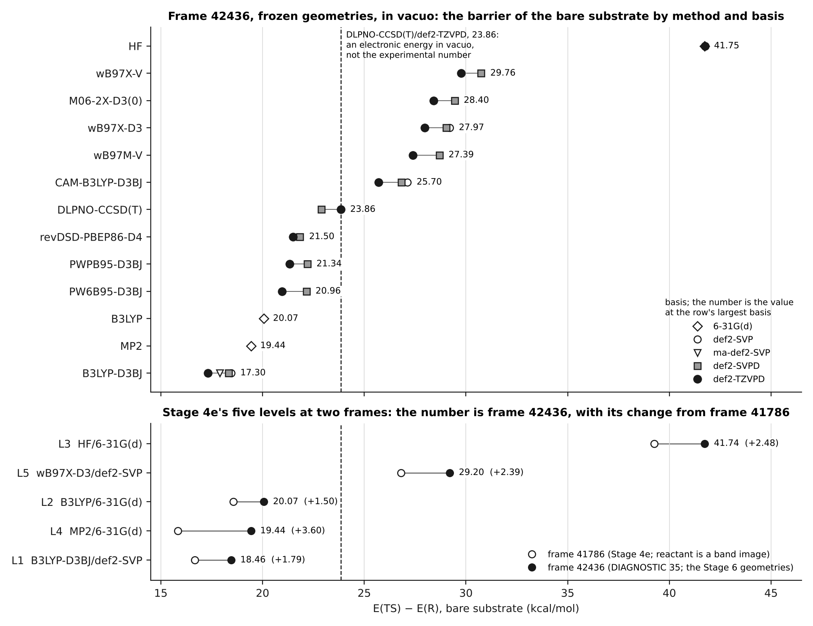

**Figure F1.** Barrier of the bare substrate by method and basis; frozen geometries, in vacuo. Top: frame 42436, the 28 charge-free pairs of single points of Table 1 (the CPCM row is not drawn). One row is one method and one marker one basis; the rows are ordered by the barrier at each row's largest basis, which is the number printed. A grey line joins one method across its bases; nothing is drawn or implied between methods. The dashed line is D36's DLPNO-CCSD(T)/def2-TZVPD barrier, an electronic energy on frozen gas-phase geometries and not the experimental number; the square on the same row is D41's value at def2-SVPD. Bottom: Stage 4e's five levels at frame 41786 (open) and, from D35, at frame 42436 (filled), with the change between them. Data: `figures/F1_reference_barrier.tsv`, `figures/F1b_stage4e_bare_barrier.tsv`. [src: F1T, F1B, S4E, D35R, D36R, D41R] [dv: DV266]

**The two frames, measured: D35.** D35 ran Stage 4e's five levels on frame 42436's geometries with Stage 4e's own input files: 10 inputs and 10 outputs (derived counts). Its control reproduces the committed 18.461014 kcal/mol. Every level gives a higher barrier at frame 42436 than at frame 41786, by +1.4992 to +3.6023 kcal/mol, a spread of 2.1031 (derived), and the order of the levels by barrier is “NOT PRESERVED”: MP2/6-31G(d) is the lowest at frame 41786 and B3LYP-D3BJ/def2-SVP the lowest at frame 42436. The two frames' geometries are of different kinds. The Stage 6 criteria and D35's pre-registration say that frame 42436's reactant and transition state are optimised stationary points, taken from the solvated QM/MM system, and that frame 41786's are a band image and a climbing image. D35 says what follows and what does not. Of Stage 4e: “a method comparison made at band image 0 does not carry over to the stationary points unchanged”. Of Stage 4e's reference, MP2/6-31G(d): “It is not a benchmark: 6-31G(d) carries no diffuse functions, and this is a dianion.” Stage 4e's own conclusion rests on eleven residues at frame 41786, and “D35 does not transfer it.” [src: D35R, D35P, CRIT] [dv: DV180, DV181, DV192]

**Which reference matters, and by how much.** The frozen-half lowerings were first measured against 18.4610, at B3LYP-D3BJ/def2-SVP, and D34 has since measured the same arrangements at the corrected level (section 6). The corrected level, CAM-B3LYP-D3BJ/def2-SVPD, gives 26.8248. The difference is 8.3638 kcal/mol (derived: 26.8248 - 18.461014). Of that, the basis alone accounts for -0.1288 (derived: 18.332256 - 18.461014) and the functional for 8.4925 (derived: 26.8248 - 18.332256). D34's pre-registration prints the same three differences. A lowering measured against one reference may not be subtracted from the other: ddE is a difference of two energies and both move. [src: D27, D33A, FROZ, D34P] [dv: DV01, DV02, DV03]

**Why the functional was changed.** D28 found the highest occupied orbital of the bare dianion at +1.2307 eV under B3LYP, -0.5918 eV under CAM-B3LYP and -1.3424 eV under wB97X-D3, at def2-SVPD, reactant geometry, against a detachment energy of +0.5123 eV measured by Probe 3, which puts the target near -0.5123 eV. B3LYP therefore sits 1.7430 eV too high and CAM-B3LYP 0.0795 eV too low (both derived; D33's pre-registration prints the same two differences). D28 states that “the production functional is NOT changed by this document”. I could not find an amendment that changes it, and D36's pre-registration says the same: “The production level of theory was never adopted by an amendment.” D30 to D34 nevertheless all use CAM-B3LYP-D3BJ/def2-SVPD. The test is of the functional and not of the species: by its detachment energy the bare dianion is bound, and D28 asks whether a functional's orbital energy agrees with that (section 5 returns to the difference). [src: D28, D33P, D36P] [dv: DV04, DV05]

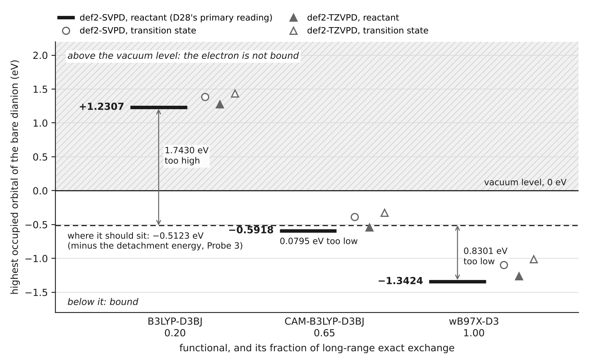

**Figure F10.** Why B3LYP was retired for the dianion: the highest occupied orbital of the bare substrate under three functionals, in order of their fraction of long-range exact exchange. No charges, frame 42436, frozen geometries, in vacuo. The thick bar is D28's primary reading (def2-SVPD, reactant); the markers are the transition state and def2-TZVPD. The detachment energy says the dianion is bound, so a functional that puts this orbital above the vacuum level is wrong about it: all 4 B3LYP-D3BJ values lie there, and all 8 values of the other two functionals lie below it. The dashed line is minus Probe 3's detachment energy, which is itself a computed energy difference, at B3LYP-D3BJ/ma-def2-SVP and at the reactant, and not an experiment. Against it B3LYP-D3BJ sits 1.7430 eV too high, CAM-B3LYP-D3BJ 0.0795 eV too low and wB97X-D3 0.8301 eV too low (derived; reactant only, because Probe 3 says nothing about the transition state). The 12 orbital energies are recomputed here from the raw outputs and agree with D28's table. D28 limits itself: “It does not establish which functional is correct”, and “It compares orbital energies across functionals, which is weaker than within one.” Data: `figures/F10_homo_by_functional.tsv`. [src: F10T, D28, P3] [dv: DV174, DV175, DV170, DV171, DV172, DV173]

**A benchmark that does not choose a functional: D36.** D36 computed the same quantity, the barrier of the bare substrate on frame 42436's frozen geometries, with a correlated wavefunction method: DLPNO-CCSD(T)/def2-TZVPD with TightPNO. The barrier is 23.8603 kcal/mol. Hartree-Fock alone gives 41.7429, correlation at the CCSD level brings that to 30.4140, and the triples correction takes off a further 6.5537, which is 27.5 per cent of the final barrier (D36's table; recomputed here from the two raw outputs). Its control, D28's CAM-B3LYP-D3BJ/def2-TZVPD calculation run again, returns 25.7003. A separate Hartree-Fock run gives 41.7466, within 0.0038 of the reference inside the coupled-cluster run. The T1 diagnostic is 0.015649748 at the reactant and 0.018809319 at the transition state; of the conventional guide of 0.02, D36 says it “IS NOT THIS PROJECT'S AND WAS NOT PRE-REGISTERED”. [src: D36R, T7W] [dv: DV220, DV221, DV222, DV223, DV224, DV226, DV227]

**How it was obtained.** The coupled-cluster arm needed three attempts, and the two that failed are recorded in dated amendments and committed no output: 2 outputs stand under the third attempt's directory and 0 under the first two (derived counts). The first attempt was killed at its walltime during the triples step. The second ended while writing its intermediates to a shared home volume that was 97 per cent full. Amendment 2 gives that as the reading its measurements support and says plainly that it “is not a message either job printed”; it changes where the integrals are stored and nothing in the method, and it corrects a statement of Amendment 1 about scratch space. The reactant leg of the first attempt had left two converged energies behind, and the third attempt reproduces both to every printed digit, which is the measurement that the change of storage did not move the answer. D36 states the limit of that check itself: “THERE IS NO SUCH CONTROL FOR THE TRANSITION STATE.” [src: D36R, D36A1, D36A2] [dv: DV228, DV229]

**What D36 ranks.** Its pre-registration fixed three functionals to be read against the benchmark at the same basis and the same geometries. CAM-B3LYP-D3BJ lies +1.8400 kcal/mol above it, wB97X-D3 +4.1086 above, and B3LYP-D3BJ -6.5557 below. “Of the three, CAM-B3LYP-D3BJ is closest, at +1.8400 kcal/mol.” And: “that makes it the closest here and nothing more.” [src: D36R, D36P]

**What the number is not.** D36 lists the limits, and each travels with the number wherever it is used. It is not a converged absolute barrier: def2-TZVPD was chosen to match the density-functional arm, and the number “must not be quoted as the true in vacuo barrier.” It is not the experimental number. The record's anchors are 24.5 kcal/mol, a free energy, and 20.7, an enthalpy, both in water; 23.8603 is an electronic energy difference between two frozen gas-phase geometries, with no zero-point, thermal, entropic or solvation term, and the two are not the same quantity: “ITS CLOSENESS TO 24.5 IS NOT AGREEMENT.” It is one frame, and D35 has just measured the barrier moving by up to +3.6023 kcal/mol between two frames at one level. DLPNO is an approximation whose residual error is not measured. D36 could not measure the method's own shift from def2-SVPD to def2-TZVPD; the 8 functionals it had at both basis sets move by -1.3028 to -0.8624 kcal/mol (recomputed), which is why D36 treats a def2-SVPD barrier as carrying “a basis uncertainty of roughly one kcal/mol”. D41 has since measured that shift, and it has the other sign (below). And it “DOES NOT ADOPT A PRODUCTION LEVEL OF THEORY”: that takes an amendment, and none exists. [src: D36R, D35R, E7] [dv: DV246, DV241, DV242]

**A conflict to settle by erratum.** D36's result describes its geometries as “committed band geometries, not an optimised transition state”. The Stage 6 criteria and D35's pre-registration say otherwise of frame 42436: its reactant and transition state are “the SP package's own optimised stationary points”, and it is the development set, not this frame, whose reactant “is NEB band image 0”. I take the criteria's description, because it names the files. The limit D36 draws from its sentence holds on grounds the criteria do give: the geometries were optimised inside the solvated QM/MM system at the production protocol, not for the bare substrate in vacuo and not at the level of these single points. A result is never edited, so the sentence needs a dated erratum. [src: D36R, D35P, CRIT]

**The benchmark at the production basis: D41.** Every design in this record is measured at def2-SVPD, and D36's benchmark is at def2-TZVPD. D41 computed the same DLPNO-CCSD(T) barrier at def2-SVPD from one new single point, the transition state. The reactant leg is D38's run N, as committed: D41's gates check that the two inputs are the same byte for byte and that the committed output is the file its own record names. The barrier is 22.8968 kcal/mol. Hartree-Fock alone gives 42.6071, correlation at the CCSD level brings that to 29.3585, and the triples take off a further 6.4617, which is 28.2 per cent of the final barrier (D41's table; recomputed here from the two raw outputs). The T1 diagnostic is 0.016726026 at the reactant and 0.019922376 at the transition state. D41 carries D36's limits and states its own: the number “is not a converged barrier and must not be quoted as the in vacuo barrier”, it is not the experimental number, the two legs were run in different jobs, and “There is no independent control for the transition state at this basis.” [src: D41R, D41P, T11W] [dv: DV300, DV301, DV302, DV303, DV311]

**The basis shift goes the other way.** From def2-SVPD to def2-TZVPD the correlated barrier rises, by +0.9635 kcal/mol. Each of the 8 functionals measured at both basis sets falls, by -0.8624 to -1.3028 (derived count). The correlated shift has a Hartree-Fock part of -0.8642, which is like the functionals', and a part from the correlation energy of +1.9197 at the CCSD level, which the functionals do not show; the triples add -0.0920. D41 fixed a rule before any of its output existed: if the correlated shift differed from -1.0 by more than 1.0 kcal/mol either way, D36's statement that a def2-SVPD barrier carries “a basis uncertainty of roughly one kcal/mol” would not be supported for the benchmark itself. It differs by 1.9635, and the result reads “D36'S STATEMENT IS NOT SUPPORTED FOR THE BENCHMARK ITSELF.” D36 made that statement on the functionals' evidence, and for the functionals D41 reproduces the numbers it rests on. What D41 adds is that the functionals' shift cannot stand in for the benchmark's own. D36's result is not edited; a dated erratum pointing from it to D41 is owed and is not written. And two points are not a limit: “Two basis sets do not make an extrapolation, and none is attempted.” [src: D41R, D41P, D36R, T11W] [dv: DV305, DV306, DV307, DV309, DV310, DV313, DV246]

**What the benchmark ranks at def2-SVPD.** D41 set the eight functionals' committed def2-SVPD barriers against 22.8968. It fixed that comparison when “THE EIGHT BARRIERS WERE KNOWN AND THE BENCHMARK WAS NOT”, and says of it “It is still not the comparison D36 pre-registered, which named three functionals at def2-TZVPD.” PWPB95-D3BJ lies -0.6937 kcal/mol from the benchmark and PW6B95-D3BJ -0.7397; CAM-B3LYP-D3BJ is +3.9280 above it, B3LYP-D3BJ -4.5645 below, wB97M-V +5.7985, wB97X-D3 +6.1473, M06-2X-D3(0) +6.5459 and wB97X-V +7.8511 above. “THE ORDER DIFFERS between the two basis sets.” At def2-TZVPD CAM-B3LYP-D3BJ is the nearest of the eight, at +1.8400; at def2-SVPD it is third, at +3.9280. The reason is the opposite signs of the two shifts: between the two basis sets each functional's distance from its own benchmark changes by +1.8259 to +2.2664 kcal/mol (derived). Of the three functionals D36 pre-registered, CAM-B3LYP-D3BJ is still the nearest at def2-SVPD, “at +3.9280 kcal/mol.” Neither diagnostic says which of the two comparisons a production level should be judged by, and D41 is explicit that “this adopts no production level of theory.” The decision is taken up in section 8.6. [src: D41R, D41P, F11T] [dv: DV325, DV326]

**Five more functionals: D37.** D37 was pre-registered and run while D36 was still running, on the same two geometries, with D28's inputs as its control. Six candidates were registered; 5 were measured and 1, revDSD-PBEP86-D4, is NOT MEASURED in D37, because ORCA rejected its keyword: each of its 4 runs “did not terminate normally: INPUT ERROR” (of 28 committed outputs, 24 terminated normally; derived counts). Amendment 1 has since measured it (next paragraph). The five measured are wB97M-V, wB97X-V, PW6B95-D3BJ, M06-2X-D3(0) and the double hybrid PWPB95-D3BJ; their barriers are in Table 1. On D28's orbital test, 6 of the 8 functionals D36 and D37 measured put the highest occupied orbital of the bare dianion below zero at def2-SVPD, reactant (derived count); B3LYP-D3BJ, at +1.2307 eV, and PW6B95-D3BJ, at +0.7296 eV, do not. PWPB95-D3BJ passes at the reactant only: at the transition state its orbital is at +0.0677 eV. D37's own second test, each barrier against D36's, reads “NOT EVALUATED. D36 has no committed result document.”, and the dated addendum it promises is not in the record. [src: D37R, D37P, D37T] [dv: DV247, DV248, DV267, DV264, DV265, DV245, DV246]

**The sixth candidate, measured: D37's Amendment 1.** The amendment ran revDSD-PBEP86-D4 under a keyword that ORCA accepts, `revDSD-PBEP86-D4/2021`, on the same two geometries at both basis sets, in two arms: arm RI asks for the RI approximation in the second-order part, and arm K gives the keyword alone. Its control, D28's CAM-B3LYP-D3BJ/def2-SVPD input run again, returns 26.8248, and all 10 of its outputs terminated normally (derived counts). The two arms turned out to be one calculation. Arm K's outputs say that RI was used there too, the two barriers differ by +0.0000 kcal/mol at each basis, and no two matching energies differ by more than 1.0e-12 Eh (recomputed); the amendment's result says of the difference that it “is not the effect of the RI approximation.” The entry is arm RI, chosen “by the rule and not by the numbers”. The barrier is 21.8414 kcal/mol at def2-SVPD and 21.4957 at def2-TZVPD, a shift of -0.3457 where D37's eight move by -0.8624 to -1.3028. On the orbital test it passes at both states: -1.1608 eV at def2-SVPD at the reactant, which is -0.6485 eV from the target, and -0.3981 eV at the transition state. On the second test its def2-TZVPD barrier is -2.3646 kcal/mol from D36's benchmark. That comparison is neither blind nor post hoc in D36's sense: “for this one functional, test 2 was fixed before its own number existed and after the benchmark's did.” The amendment “does not adopt a level of theory and bears on no design”. [src: D37A1R, D37A1, D37A1T, F11T] [dv: DV348, DV349, DV345, DV346, DV347, DV342, DV343, DV344, DV241, DV242]

**The two tests side by side.** D36's result, committed after D37's, sets D37's five beside its own three and heads the comparison “POST HOC. NOT PRE-REGISTERED IN D36.” Post hoc, then: the eight def2-TZVPD barriers span 12.45 kcal/mol and the benchmark lies 53 per cent of the way up that range. 3 of the 8 are within 3 kcal/mol of it: PW6B95-D3BJ at -2.9008, PWPB95-D3BJ at -2.5196 and CAM-B3LYP-D3BJ at +1.8400. wB97M-V is +3.5321 above, M06-2X-D3(0) +4.5400 and wB97X-V +5.8962. Of the 3, PW6B95-D3BJ fails the orbital test, which leaves 2 functionals, PWPB95-D3BJ and CAM-B3LYP-D3BJ, that are within 3 kcal/mol of the benchmark and also put the orbital below zero at the reactant (derived; post hoc). D36 adds a caution about the orbital test: the three functionals nearest its target give barriers from 21.3407 to 28.4003 kcal/mol, “so that test could not have discriminated between them.” No score combines the two tests, and neither D36 nor D37 adopts a level. [src: D36R, D37R, F11T] [dv: DV238, DV239, DV240, DV249, DV243, DV244]

With Amendment 1's entry there are 9 functionals at both basis sets. Counted the same way: at def2-TZVPD, 4 of the 9 are within 3 kcal/mol of D36's benchmark, the fourth being revDSD-PBEP86-D4 at -2.3646, and 3 of those 4 also put the orbital below zero at the reactant: PWPB95-D3BJ, revDSD-PBEP86-D4 and CAM-B3LYP-D3BJ. At def2-SVPD against D41's benchmark, 3 of the 9 are within 3 kcal/mol, PWPB95-D3BJ, PW6B95-D3BJ and revDSD-PBEP86-D4, and 2 of those also pass the orbital test, PWPB95-D3BJ and revDSD-PBEP86-D4; CAM-B3LYP-D3BJ is not among them. revDSD-PBEP86-D4's distance at def2-SVPD, -1.0554 kcal/mol, is post hoc, as are these counts: D41 named eight functionals and it is not one of them, and the limit of 3 kcal/mol is this document's and is in no pre-registration. [src: F11T, D37A1R, D41R] [dv: DV327, DV323, DV372, DV324, DV373, DV322]

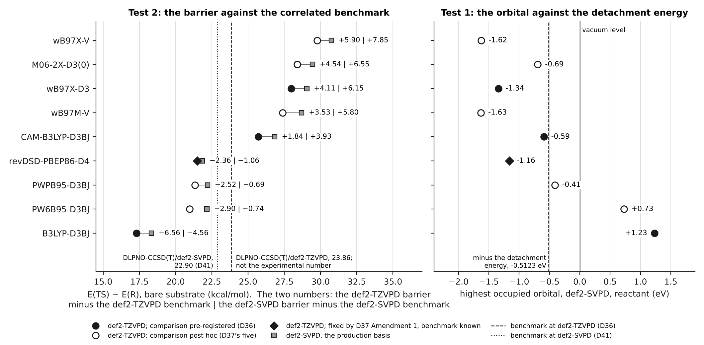

**Figure F11.** The two tests the record holds for a functional, for the 9 functionals measured at both basis sets on frame 42436; bare substrate, frozen geometries, in vacuo; rows in the order of the def2-TZVPD barrier. Left: the barrier at def2-TZVPD (circle or diamond) and at def2-SVPD (square), against D36's DLPNO-CCSD(T) barrier at def2-TZVPD (dashed) and D41's at def2-SVPD (dotted). The two numbers on each row are the distance of the def2-TZVPD barrier from the def2-TZVPD benchmark and of the def2-SVPD barrier from the def2-SVPD benchmark. A filled circle is one of the three comparisons D36 pre-registered; an open circle is post hoc; the diamond is revDSD-PBEP86-D4, whose comparison D37's Amendment 1 fixed after the benchmark was known. Right: the highest occupied orbital at def2-SVPD, reactant, against the vacuum level and against minus Probe 3's detachment energy, -0.5123 eV, which is a computed energy difference and not an experiment. D37's own table marks revDSD-PBEP86-D4 NOT MEASURED; its row here is Amendment 1's. Neither benchmark is the experimental number and neither is a converged absolute barrier. No score combines the panels. Data: `figures/F11_two_tests.tsv`. [src: F11T, D36R, D37R, D37A1R, D41R, P3] [dv: DV327]

## 3. Levels of theory and basis sets

Table 2 is the by-file census of pass 1, collapsed to method and basis. A run is one distinct normally-terminated ORCA output; an output committed both loose and inside an archive counts once. Outputs that did not terminate normally are counted separately and are not evidence.

| method | basis | runs | not normal | used for | what validated it |
|---|---|---|---|---|---|
| B3LYP | def2-SVP | 1561 | 49 | Phase 1 QM/MM; Phases 2 and 2b; Stages 1 to 4e; the A matrix; the frozen half; D1 to D27; D35 | Stage 4e against MP2: “S4e verdict (L1 against L4): SIGN ROBUST” (frame 41786). Retired for the dianion's frontier orbital by D28 |
| B3LYP | def2-SVPD | 822 | 0 | Phase 2b; Stages 4 to 4c; D14 to D27; D40 (one monoanion) | D27: converged against def2-TZVPD at 1.3000 e only |
| MM only | none | 648 | 0 | Lennard-Jones combining-rule test (wp1) | Stage 1, S1.4 |
| B3LYP | ma-def2-SVP | 500 | 0 | D1, D2, D10 to D13, the probes | none found |
| CAM-B3LYP | def2-SVPD | 238 | 0 | D28, D30 to D34; D37 and its Amendment 1 (control); D40 | D28 (frontier orbital); D30 (basis, to 2.8800 e); at def2-TZVPD, D36: closest of three to the correlated barrier; at def2-SVPD, D41: +3.9280 from the benchmark at that basis, third of eight |
| r2SCAN-3c | own | 144 | 1 | s10 benchmark; one Phase 2b test | none found |
| HF-3c | own | 141 | 0 | s10 benchmark; smoke test | none found |
| B97-3c | own | 140 | 0 | s10 benchmark | none found |
| XTB2 (GFN2-xTB) | own | 140 | 0 | s10 benchmark | none found |
| B3LYP | def2-TZVPD | 38 | 0 | Stage 4c; D27 | it is the reference |
| wB97X-D3 | def2-SVP | 37 | 0 | Stage 4e; D28; D35 | Stage 4e against MP2 |
| B3LYP | 6-31G(d) | 36 | 0 | Stage 4e; D35 | Stage 4e against MP2 |
| HF | 6-31G(d) | 36 | 0 | Stage 4e; D35 | Stage 4e against MP2 |
| MP2 | 6-31G(d) | 36 | 0 | Stage 4e; D35 | it is Stage 4e's reference; D35 says it is not a benchmark |
| CAM-B3LYP | def2-TZVPD | 12 | 0 | D28, D30; D36 and D37 (control) | it is the reference |
| none named (FOD) | none named | 10 | 0 | D19 | not applicable |
| CAM-B3LYP | def2-SVP | 9 | 0 | D28, D30 | not applicable |
| wB97X-D3 | def2-SVPD | 9 | 0 | D28; D40 (one monoanion) | not applicable |
| DLPNO-CCSD(T) | def2-SVPD | 9 | 0 | D38: reactant only, one point charge; D41: the transition state, no charge; D39: 3 monoanion runs, result not entered in this revision | D38's zero-charge runs; D41's gates; no independent control for the transition state |
| DLPNO-CCSD(T) | def2-TZVPD | 2 | 0 | D36 | D36's control arm; its reactant leg reproduced across two attempts; not a converged barrier |
| HF | def2-TZVPD | 2 | 0 | D36 | not applicable |
| wB97X-D3 | def2-TZVPD | 2 | 0 | D28 | not applicable |
| M06-2X, PW6B95, PWPB95, wB97M-V, wB97X-V | def2-SVPD and def2-TZVPD | 3 at def2-SVPD, 2 at def2-TZVPD | 0 | D37; D40 (one monoanion each, at def2-SVPD) | D37's control; against the correlated barrier at def2-TZVPD post hoc only; at def2-SVPD by D41 |
| revDSD-PBEP86-D4 | def2-SVPD and def2-TZVPD | 4 at each basis | 0 | D37 Amendment 1: two arms that ran one calculation. D37's own 2 inputs at each basis were rejected and are NOT MEASURED | Amendment 1's control; against the correlated barrier by a comparison fixed after the benchmark was known |
| IP-EOM-DLPNO-CCSD | def2-SVPD | 3 | 0 | D39; result not entered in this revision | not applicable |

Sources for Table 2: [src: T1C, S4E, S1, D27, D30, D35R, D36R, D37R, D37A1R, D41R, D39P]

Table 2 counts runs by the keyword line, which does not carry the charge of the species. The 20 monoanion single points of D40 and the 3 of D39 are therefore counted in the rows of their methods, beside the dianion runs. [src: T12W, T13W, T1C] [dv: DV352]

Three of the diagnostics this section names label their own results, and the label travels with them: D3 is INCONCLUSIVE and withdrawn, D13 is PARTIAL, and D24 is EXPLORATORY. [src: D3, D13, D24]

The full table, 118 distinct combinations of method, basis, dispersion, solvation, embedding and job type, is `figures/T1_levels_of_theory.tsv`. The scan read 12112 input and output files, of which 11333 are ORCA; the rest are job logs, potential files and Amber outputs. The outputs of the rejected keyword stopped at ORCA's input parser and echo no keyword line, so the census counts them among the 6 incomplete loose outputs and under no method. [src: T1E, T1L, T1D]

Three things the keyword lines do not show, found by pass 2. First, the ten FOD runs of D19 name no functional or basis; D19's result records what ORCA used: “TPSS/def2-TZVP, 5000 K”. That is the only use of TPSS and of plain def2-TZVP in the record, and neither was used for any energy. Second, two pieces of work ran in pyscf 2.14.0 and committed no inputs or outputs, only a result or a log: Experiment 0, restricted Hartree-Fock on isolated He, Ne and Ar atoms in aug-cc-pV5Z, aug-cc-pwCV5Z and aug-cc-pV(5+d)Z, and D24, B3LYP with Gaussian-smeared charges. Third, the Na and Mg centres of the Phase 2 test `09_mmtest` name their core potential in an input block, not on a keyword line. [src: D19, EXP0, D24, T2N]

**Not tested.** Each name below occurs somewhere in committed text, in a parser's list of names, in a literature discussion, or in ORCA's credits banner, and on no keyword line in either repository. None was run on this system.

<!-- not-tested-begin -->
Functionals: `PBE0`, `PBE`, `BP86`, `BLYP`, `TPSSh`, `revPBE`, `B97-D3`, `PBEh-3c`, `wB97X-3c`.
Wavefunction methods: `CCSD(T)`, `DLPNO-CCSD`, `DLPNO-MP2`, `RI-MP2`, `MP3`, `CASSCF`, `CASPT2`, `NEVPT2`.
Semi-empirical methods: `PM3`, `PM7`, `SCC-DFTB`.
Basis sets: `def2-TZVPP`, `def2-TZVPPD`, `def2-QZVPP`, `aug-cc-pVDZ`, `aug-cc-pVTZ`, `cc-pVDZ`, `cc-pVTZ`, `6-31+G(d)`, `6-311+G(2d,p)`, `STO-3G`.
Solvation and dispersion: `SMD`, `COSMO`.
<!-- not-tested-end -->

Five names have left this list since it was first written. D36, D37 and D38 ran three of them: `M06-2X`, under ORCA's keyword `M062X`, `wB97X-V` and `DLPNO-CCSD(T)`. `VV10` was used without being a keyword of its own, as the non-local part of wB97M-V and wB97X-V. `D4` first left the list without being computed, because it stood on 4 keyword lines inside the keyword that ORCA rejected; D37's Amendment 1 has since run revDSD-PBEP86-D4 under a keyword that carries it, on 8 further keyword lines. Three names stay with a caution: `CCSD(T)` stands for the canonical method, of which only the DLPNO approximation was run; `RI-MP2` stands for the method, although the second-order step of PWPB95 and of revDSD-PBEP86-D4 was run with that approximation; and `DLPNO-CCSD` was never a keyword of its own, although every DLPNO-CCSD(T) output prints its energy, which section 2 quotes as the barrier at the CCSD level, and the 3 IP-EOM-DLPNO-CCSD runs of D39 are built on it. [src: T2N, T1B]

The banner-only names, those that occur in output files and nowhere else, are `DLPNO-MP2`, `CASPT2`, `MP3`, `wB97X-3c`, `MBIS`, `NBO`, `ONIOM` and `ROHF`. Three names need a caution rather than a place on the list: `TPSS` and `def2-TZVP` were used, as the FOD default only; `aug-cc-pV5Z` was used, in pyscf, on a helium atom only. [src: T2N, T1B]

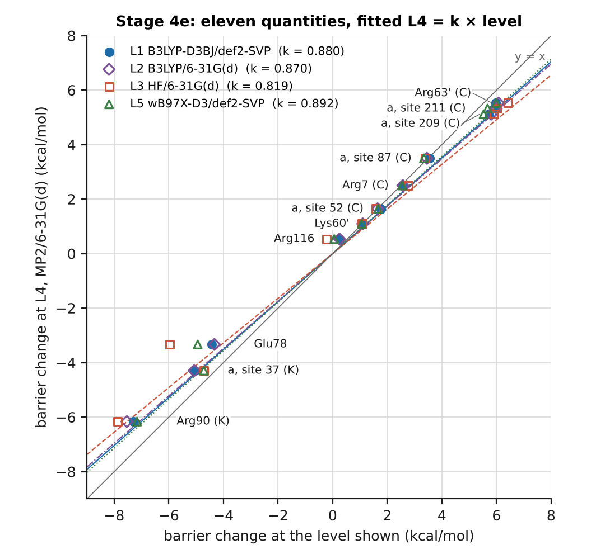

**Figure F2.** Stage 4e: eleven barrier-change quantities (six residues alone, five first-order site coefficients) at four levels against the same quantity at MP2/6-31G(d), frame 41786, in vacuo, 170 single points. Each group of markers at one height is one quantity, named beside it, and its height is its MP2 value. (C) marks the 6 quantities beside a carboxylate and (K) the 2 controls, as the report marks them; its sign test is on those. The grey diagonal is exact agreement with MP2. Each coloured line is the report's fit L4 = k x level through the origin; nothing is interpolated. Data: `figures/F2_stage4e.tsv`, parsed from the Stage 4e report. [src: S4E] [dv: DV93, DV182, DV183]

**Whether the benchmark method can be used with the charges present: D38.** D36 measured the bare barrier only, and what the record quotes is ddE. D38's pre-registration puts the gap in numbers: the +1.8400 kcal/mol by which CAM-B3LYP-D3BJ misses the benchmark on the bare barrier is 34 to 54 per cent of D34's three quotable lowerings, -3.3985, -4.1567 and -5.3701 kcal/mol (which D40 has since found METASTABLE; section 5), and of whether that error cancels between the bare and the charged system it says “NOTHING IN THIS RECORD MEASURES THAT.” A coupled-cluster ddE would measure it. D38 is the step before that, and by its own title it is “A mechanism probe, not a barrier”: 5 DLPNO-CCSD(T)/def2-SVPD single points at the reactant geometry only. One has no charge, two have a charge of zero as a check that the charge file is inert, one has +1.000000 e at site 1690 (run B1, the arrangement ADD-s1690_qp10000) and one has -1.000000 e at the site of ADD-s678_qm10000 (run A1), each as an external point charge. It asks one question: does the charge reach the correlation treatment, or only the Hartree-Fock reference? [src: D38P, D38R] [dv: DV257, DV258, DV263]

**What D38 found.** The zero charges change nothing, to 1.00e-09 Eh (recomputed). With the positive charge the Hartree-Fock energy moves by -0.204109274 Eh and the corrected correlation energy by -0.004901707 Eh, which is 4902 times the gate's threshold and -3.0759 kcal/mol (derived). The verdict: “THE EMBEDDING CHARGE REACHES THE CORRELATION TREATMENT.” It rests on run B1 alone. Run A1 is “NOT INTERPRETABLE” under a rule D38 fixed before any output existed: an arm whose highest occupied orbital at def2-SVPD is at or above zero is reported and not used, and A1's Hartree-Fock orbital is at +0.3539 eV, against -4.8267 eV for B1 and -2.0444 eV with no charge. A1's numbers are in `figures/T8_d38_probe.tsv` and are not evidence. The verdict licenses one thing: “The coupled-cluster test of ddE with the arrangement's charges present may be built.” D38 computes no barrier and no ddE, revisits no D34 verdict, and does not show that an external point charge reproduces the QM/MM module's electrostatics, which is a control the licensed test still needs. [src: D38R, D38P, T8W] [dv: DV259, DV250, DV251, DV256, DV260]

**Two things in D38's record, found while recomputing.** The result has one erratum already, on its scratch measurement (section 7); these are two other points. First, its result says “ORCA prints no point-charge count in these outputs”. The outputs do print one: each of the 4 runs that has a charge file carries the line “Reading point charge file ... ok (1 point charges)”, and the run with no charge file has no such line (recomputed; the committed classifier reads the same count). The result's reader looked for a different wording. The verdict does not depend on it; the sentence needs a dated erratum. Second, D38's pre-registration quotes Finding 8 of the findings of 22 October 2026, that a positive orbital energy “means the highest electrons are not bound”, as what the record says of these two arrangements. The record had withdrawn that reading. D2 found the bare dianion bound by its detachment energy despite a positive orbital energy, and said that Finding 8's second half “must be withdrawn as an artefact of reading Koopmans' theorem off a DFT orbital”. Probe 1's Erratum 1 repeats it: “The sign of a DFT HOMO is not the criterion for whether an anion is electronically bound.” Probe 2 heads its result “THE HOMO IS NOT THE TEST”. D38's own rule reads a Hartree-Fock orbital, not a density-functional one, and it was fixed in advance, so its label for A1 stands as the rule gives it. What does not follow is that the A1 species has been shown to be unbound: no detachment energy has been computed for it. D39's pre-registration, written the day after D38's, sets this right in substance: it calls the orbital energy “a Koopmans-style proxy” and says “The observable this project actually uses for boundedness is not the orbital energy.” [src: D38R, D38P, D38O, FIND, D2, P1E, P2, D39P] [dv: DV262]

**The detachment energy at the benchmark level: D39, committed and NOT ENTERED.** D39 was pre-registered on 15 November 2026 to compute the vertical detachment energy at DLPNO-CCSD(T)/def2-SVPD, at the reactant geometry only, for the three systems whose dianion D38 had already run, by two routes: the monoanion's energy minus the dianion's, and an IP-EOM-DLPNO-CCSD calculation on the dianion as a control on the first. Its result was committed the same evening, with an amendment committed beside it; 6 inputs and 6 outputs are in the repository (derived counts). At Jessica's instruction of 15 November 2026 the result is NOT ENTERED in this revision: no number of it appears in this document, no figure or table draws on it, and no statement here rests on it. Questions about it were raised on reading and are open; Appendix A.8 lists them, without its numbers. Two things follow for what is entered. D40's comparison of its functionals with a coupled-cluster value, R40.3, waits for D39 by D40's own pre-registration and is NOT EVALUATED. And D39's pre-registration stands as written, including that it runs no transition state, revisits no D34 verdict and “DOES NOT LICENSE THE ddE TEST”. [src: D39P, D40R] [dv: DV290, DV291]

## 4. The approaches taken, and the verdict on each

Figure F9 is the map. Each box carries the record's own status; the words behind each status are verbatim in `figures/F9_decision_tree.tsv`.

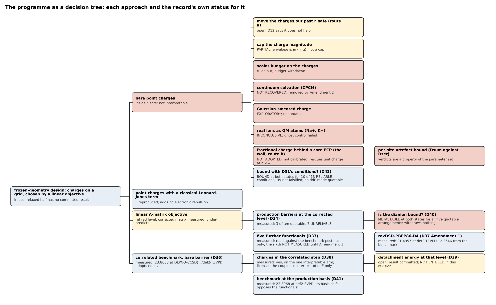

**Figure F9.** The programme as a decision tree. No numerical data; seventeen nodes, each tied to a quoted sentence of a committed document. The D34 node, shown as pre-registered in the first draft, carries its committed result, and four nodes were added on 15 November 2026 for the level of theory: D36, D37, D38, which is a mechanism probe, and D39, which is pre-registered.

### 4.1 Bare point charges

*Meant to fix:* nothing; it is the starting representation, a charge with no size. *Measured by:* the frozen half (22 single points, B3LYP-D3BJ/def2-SVP), D11, D12, D13, D31, D33 stage B and D34. *Cost:* the distance ladder alone is 52 runs, the (n, q) grid 62. *Finding:* D11 measured the distance inside which a bare charge and the same charge behind a Pauli wall disagree, and returned r_safe = 3.50 A, with the consequence “No design measured inside r_safe is interpretable.” The committed arrangements sit at 2.85-2.96 A. At CAM-B3LYP-D3BJ/def2-SVPD, D31 found every design carrying a unit charge UNRELIABLE at every n from 1 to 20, and reliable envelopes of 0.75 e to n = 3, 0.5 e to n = 5 and 0.25 e to n = 20; of those envelopes D31 says “They are not a rule a new design must obey”. D33 stage B then measured a design inside the envelope, three spheres at 0.75 e, UNRELIABLE. *Status:* in use, not adopted by any amendment as valid, and uninterpretable inside r_safe on D11's own reading. [src: D11, D31, D33B, D33P] [dv: DV94, DV75, DV71]

D34 then lifted the ten production arrangements, which are point charges with a Lennard-Jones term and no wall, to the same level: 7 are UNRELIABLE and 3 RELIABLE, and the 3 are the only arrangements with no positive charge (derived). The sign matters to how D31 is read. Each of D31's 12 unit-charge conditions carries a positive unit charge and none of its 30 conditions is without a positive charge (derived), so D31 measured positive and mixed sets; D34's single sphere at -1.0000 e, RELIABLE, does not contradict it. Reading the sign across diagnostics in this way is post hoc; it is a hypothesis, not a finding (section 11, H2). [src: D34R, D34T, T3D] [dv: DV127, DV126, DV128, DV129, DV148, DV145, DV149]

D38's pre-registration records a correction that limits this reading, and the correction is itself a post hoc tabulation. Across the 46 designs of `figures/T5_positive_charge_vs_verdict.tsv`, 43 carry a positive charge and 17 of those are RELIABLE (derived; the count is confirmed here), among them two walled designs at a full unit charge. In its words, “The sign of the charge does not set the verdict”. What survives is the one-way statement: no arrangement without a positive charge has relocated. It does not follow that an arrangement with one will. [src: D38P, T5W] [dv: DV200, DV201, DV202]

**Verdict.** A bare point charge at the committed distances is not a reliable instrument, and no committed rule says in advance which arrangements fail.

### 4.2 Point charges with a classical Lennard-Jones term

*Meant to fix:* collapse of a charge onto the substrate when geometry is relaxed, by giving the charge a classical size. *Measured by:* Stage 1 (the QM/MM Lennard-Jones energy is reproduced from the force-field file to 2.0e-10 Eh) and the frozen half, where the measured Lennard-Jones contribution equals the optimiser's L for all nine sphere arrangements. *Finding:* at fixed geometry the term is a classical energy added to the total. The frozen report says the agreement “is a check of the grid's own arithmetic and of the force field it was handed, not of any physics.” It adds no repulsion that the electrons feel, so it cannot stop the density relocation of section 4.1. Its value lies at relaxed geometry, and D33's pre-registration records that “Stage 6's relaxed half has no committed result”. *Status:* in use for L; its purpose is untested because the relaxation has no committed result. [src: S1, FROZ, D33P, INV]

D34 holds a controlled pair for this term. S6-P and ADD-s1690_qp10000 are the same charge of +1.0000 e at the same site, the first as a bare point charge and the second with the Lennard-Jones term. Their QM energies agree to 4.1e-12 Eh or better at all three readings and both states (recomputed), they differ only in the classical term, and they receive the same verdict. The ten production arrangements are therefore 9 distinct electronic systems (derived). [src: T4W, T3D] [dv: DV132, DV131]

**Verdict.** The Lennard-Jones term is implemented correctly, leaves the electronic result untouched at fixed geometry, and has not yet been shown to do the job it was added for.

### 4.3 Real ions as QM atoms

*Meant to fix:* the missing Pauli repulsion, by replacing the point charge with Na+ or K+ in the QM region. *Measured by:* D3. *Finding:* the ghost-atom control gave 0.9461 kcal/mol against a limit of 0.30, and the verdict was “VERDICT PER D3.3: INCONCLUSIVE”, with a counterpoise treatment named as required. Erratum 3 went further: “E3.2 DIAGNOSTIC 3 IS WITHDRAWN”. Separately, Phase 2's `09_mmtest` placed Na and Mg centres carrying a core potential near a test system; ten such runs are committed and I could not find a recorded verdict for them. *Status:* INCONCLUSIVE and withdrawn; the counterpoise run it calls for is not in the record. [src: D3, E3, T1L]

**Verdict.** Whether a real ion behaves differently from a point charge has not been answered.

### 4.4 A fractional charge behind a core ECP: the wall

*Meant to fix:* the same missing repulsion, while keeping an adjustable charge: the charge sits on a centre that carries a full noble-gas core potential and no electrons or basis functions. *Measured by:* Stages 4b and 4c, D11 to D13, D16 to D18, D20, D23, D26, D32 and D33 stage B. *Cost:* D23 alone is 50 runs, D32 is 66. *Findings.* (i) The wall is not always inert: with zero charge it moved ddE by +1.3105 kcal/mol at 2.50 A in D11, and D12 voided 13 of 36 sites and D13 two of eight on the same control. (ii) Its size depends on the species: D23 re-ran four committed verdicts with helium and argon in place of neon and three of them changed on helium, under the verdict “A PROPERTY OF THE PARAMETER SET”. (iii) The parameter sets are not equally validated: Experiment 0 reproduced the published fitting target to 1.381e-06 Eh for helium and 7.670e-07 Eh for neon, and to only 3.067e-03 Eh for argon, which it marks NOT VALIDATED. D32 and D33 use argon. (iv) At def2-SVP the wall changes nothing (D18: “VERDICT: NEITHER ARM MOVES”) because that basis shows no relocation to remove. (v) At CAM-B3LYP-D3BJ/def2-SVPD, D32 found the wall rescues the unit charge for n = 1, 2 and 3 on both site families, and the Loewdin rise falls below the 0.25 e threshold in 29 of the 30 charged conditions. The verdict at n = 5 and above is discussed in section 5. *Status:* NOT ADOPTED. D33's pre-registration: “THE WALL IS NOT ADOPTED AND IS NOT CALIBRATED.” Route (b) has no amendment. [src: D11, D12, D13, D23, EXP0, D18, D32, D33P] [dv: DV67, DV72, DV97, DV98]

**Verdict.** The wall removes the relocation it was built to remove, at one species that is itself not validated, and no production number may rest on it until it is adopted and calibrated.

### 4.5 Gaussian-smeared charge

*Meant to fix:* spill-out, by spreading each charge over a finite width. *Measured by:* D24, twelve cells in pyscf, three charge vectors at four widths. *Finding:* the def2-SVP to def2-SVPD gap fell by 7.3 per cent at the weakest vector and did not fall at 2.8800 e. *Status:* D24 says of itself “It is therefore EXPLORATORY and its status is a scoping measurement, not a result.” D27 re-ran its three point-charge cells in ORCA and left the smeared cells inadmissible. *Not adopted.* [src: D24, D24N, D27]

**Verdict.** On an EXPLORATORY measurement that may not be quoted, smearing did not help; the question is formally unanswered.

### 4.6 Moving the charges out past r_safe

*Meant to fix:* the artefact of section 4.1, by distance alone. This is route (a) of D11's Erratum 1. *Measured by:* D11 (the ladder, five rungs from 2.50 to 5.90 A, plus controls) and D12 (36 grid sites, 282 runs). *Cost recorded:* the classical estimate of a unit charge's effect falls from -4.23 kcal/mol at 2.96 A to -3.16 at 3.50 A, “about 25 per cent less field per charge”; the grid must be rebuilt and every a coefficient recomputed. *Finding:* the two documents do not agree. D11's Erratum 1 says “The choice between (a) and (b) is a scientific decision, not a correction, and it is recorded here as open.” D12 says “Moving the grid outward does not help, because what fails is the prediction, not the distance.” D33 and D34, two weeks later, both still describe the choice as open. Erratum 1 also says what r_safe is: “r_safe = 3.50 A BOUNDS THE VALIDITY OF A MODEL. IT IS NOT A STATEMENT ABOUT WHERE A CATALYTIC CHARGE MAY SIT.” *Status:* open. No design of more than one charge has been measured outside r_safe. Single unit charges have: 4 of D12's 36 sites lie beyond 3.50 A from the nearest substrate atom, and 3 of them fail D11's tolerance, with a shielding term of up to +8.0656 kcal/mol at 3.676 A (derived counts; B3LYP-D3BJ/ma-def2-SVP, a retired level). [src: D11, D11E, D12, D33P, D34P] [dv: DV76, DV161, DV162]

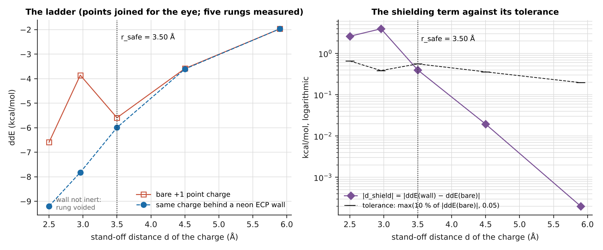

**Figure F5.** D11's distance ladder: one +1 charge at five stand-off distances, bare and behind a neon wall, B3LYP-D3BJ/ma-def2-SVP, frame 42436, in vacuo; five rungs, 52 runs in the directory including the sign, basis and far-field controls. Left: ddE for each arm; the points are joined for the eye only. Right: the shielding term |d_shield| against its tolerance, with r_safe = 3.50 A marked. The 2.50 A rung is voided because the wall alone was not inert there. Data: `figures/F5_distance_ladder.tsv`. [src: D11, F5T] [dv: DV75]

**Verdict.** The record conflicts on whether distance can repair the model, and the decision is the researcher's (section 8.1).

### 4.7 Capping the charge magnitude

*Meant to fix:* the same artefact, by limiting the charge on any one sphere. *Measured by:* D2 and its Amendment 1 (one site), D13 (eight sites, three magnitudes, 114 runs), D17, D31. *Findings:* the first cap, from D2's Amendment 1, is withdrawn (section 7). D13's verdict is PARTIAL: three of six live sites that fail at unit charge pass at 0.25, the fitted exponents run from 0.61 to 4.49, and “A single cap cannot be stated from this sample; the screen would have to be per-site, which the grid cannot carry.” D31's envelopes are in (n, q) and D33 stage B found a failure inside one of them. *Status:* not adopted as a rule. [src: D13, D31, D33B] [dv: DV77]

**Verdict.** Magnitude matters, but no single cap is supported; D13's own verdict is PARTIAL.

### 4.8 A scalar budget on the charges

*Meant to fix:* the same artefact, by one constraint the optimiser could carry, such as a ceiling on the sum of q squared. *Measured by:* D9 (no new runs) and D29 (no new runs; 182 committed conditions read). *Finding:* D9: “No scalar on the charge vector proposed so far survives contact with the corrected corpus.” D29: “NO SCALAR IN THE SET ORDERS RELOCATION.” D29's decisive case is one pair of runs with the same ten charges on the same ten sites, differing only in substrate geometry: the density relocates at the reactant (Loewdin rise +0.3181) and not at the transition state (+0.1136). “THE TWO CHARGE VECTORS ARE IDENTICAL.” D31 confirmed it on purpose-built families: two of ten iso-total families disagree. *Earlier attempts of the same kind:* D4's divergence was first read as a total-field effect bounded at the sum of |q|; Erratum 3 records “That reading was not supported”, and that a single electrostatic scalar proposed next was “TESTED AND FAILED”. What survived was a domain and not a predictor: D5 found the two bases agree to within 1.0 kcal/mol up to 2.880 e on one design, and D7 found that domain to transfer to a second design only in part, “PARTIAL: the domain rests on ONE criterion for S6-10 where it rested on two for S6-20.” *Status:* ruled out. The one budget figure that had been stated is withdrawn (section 7). The Stage 6 criteria placed the two- and three-sphere arrangements under a budget of 2.0 e^2, which they call “a code-test value and not the calibrated B”; I could not find a calibrated value. [src: D9, D29, D31, CRIT, D4, D5, D7, E3]

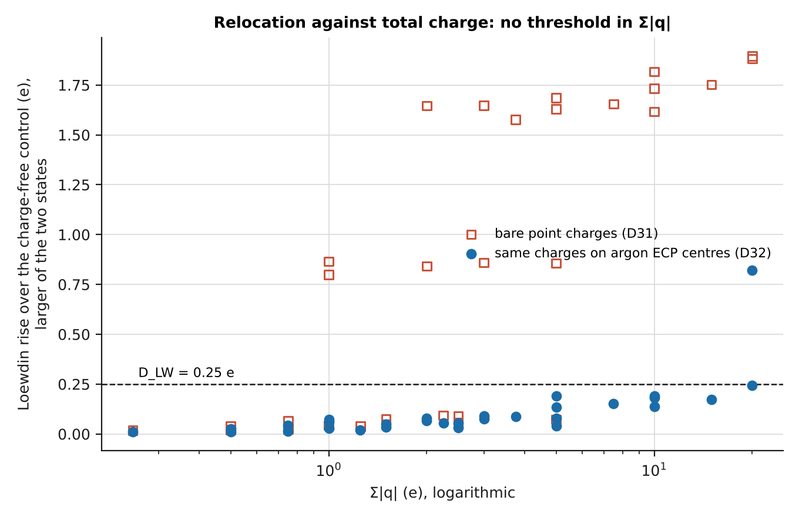

**Figure F4.** Loewdin relocation against total charge for every charged condition of D31 (bare) and D32 (walled): 30 conditions per arm, two states each, CAM-B3LYP-D3BJ/def2-SVPD, frame 42436, in vacuo; the larger of the two states' rises is plotted. The dashed line is the committed threshold D_LW = 0.25 e. Recomputed from the 128 raw outputs through the committed classifier; the twelve unit-charge rows reproduce D32's printed table. Nothing is interpolated. Data: `figures/F4_relocation.tsv`. [src: F4T, AUD, D32E1]

**Verdict.** No function of the charge vector alone can order relocation, so no scalar budget can screen it.

### 4.9 Continuum solvation

*Meant to fix:* the unbound highest occupied orbital of the gas-phase dianion, by binding the density with a dielectric. *Measured by:* D10, 16 single points with and without CPCM at ma-def2-SVP. *Finding:* the continuum did bind the density (control HOMO from +1.2269 to -4.3036 eV) and did not restore the design numbers: for the twenty-sphere design ddE went from the committed -24.8261, a number Erratum 3 classes STRAINED and D20 holds PROVISIONAL, to 20.6967, a sign reversal. “VERDICT PER D10.3: NOT RECOVERED”. *Status:* removed by Amendment 2: “No continuum appears alongside designed charges again without a further amendment.” [src: D10, A2] [dv: DV78]

**Verdict.** A continuum does not repair the frozen design numbers and is out of the evaluation condition by amendment.

### 4.10 The linear A-matrix objective

*Meant to fix:* the cost of the search; it lets an exact solver choose among 2626 sites. *Measured by:* Stage 1b and Stage 5's own checks, Stage 4d, D1, the frozen half, D25 and D33. *Findings.* (i) The matrix is what it claims to be: finite-difference checks at three sites pass at both levels. (ii) It under-predicts. At B3LYP-D3BJ/def2-SVP the measured ddE is 0.96 to 1.26 times the score over the ten frozen arrangements (derived), and the record's own two ratios are 1.10 for the two-sphere and 1.26 for the twenty-sphere design. At CAM-B3LYP-D3BJ/def2-SVPD the ratio is 1.09 to 1.23 over the five stage B designs not flagged, and 0.14 for the one that is UNRELIABLE. (iii) The matrix moves with the level of theory: Pearson 0.977520 between old and new a_i, the twenty largest overlap in 17, the largest single change -1.8590 kcal/mol per e. The result prints “rank 0.863979”; the committed reader computes that on the magnitudes |a_i|, and the rank correlation of the signed a_i, recomputed here, is 0.928979. (iv) The objective discards the reactant term: D25 pre-registered a test of whether predicted lowerings come from raising the reactant, and I could not find a committed result for D25. (v) Stage 4d: “PC1 FAIL: frozen values rank designs only and are never compared with an enzyme number”. D1's verdict on the def2-SVP findings was “VERDICT PER D1.3: THE FINDINGS NOT USABLE AS THEY STAND”. *Status:* in use; the committed designs were chosen with the old matrix. [src: AREP, D33A, D33B, FROZ, RD33A, D25, S4D, D1] [dv: DV50, DV51, DV52, DV53, DV54, DV92]

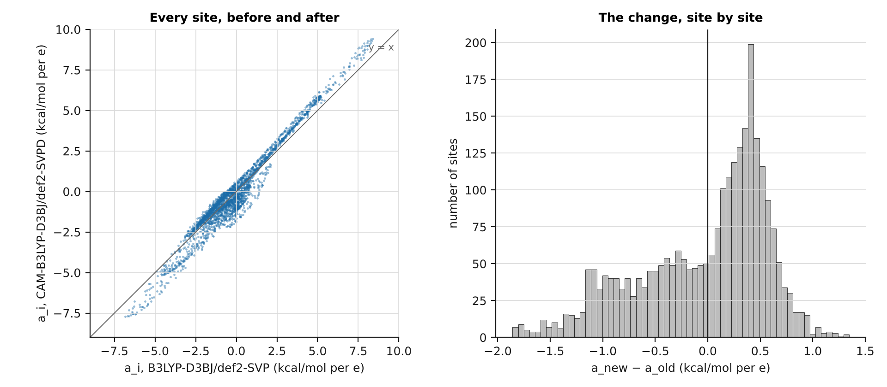

**Figure F8.** The A matrix before and after the change of level: a_i at each of the 2626 sites of frame 42436, B3LYP-D3BJ/def2-SVP against CAM-B3LYP-D3BJ/def2-SVPD, bare substrate in vacuo; each matrix rests on three single points and one potential evaluation per geometry. Left: every site. Right: the change site by site. Data: `figures/F8_A_matrix.tsv`. [src: F8T, D33A] [dv: DV92]

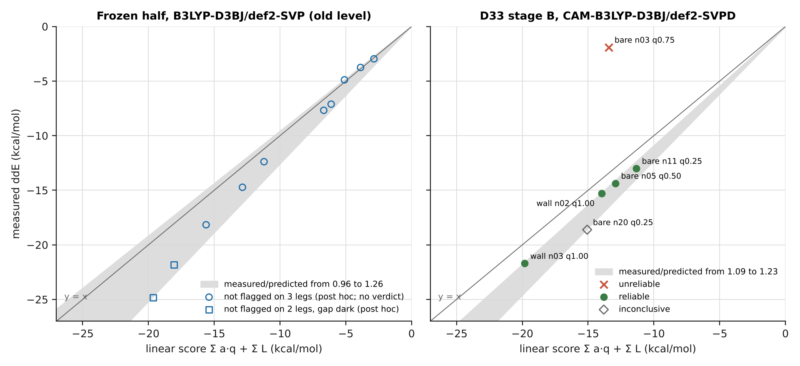

**Figure F6.** The optimiser's linear score against the measured ddE, frame 42436, frozen geometries. Left: the ten frozen-half arrangements, B3LYP-D3BJ/def2-SVP QM/MM single points, 22 runs; their only classification at this level is D34 stage A's post hoc reading of the readable legs, which flags none and is not a verdict. Right: the six D33 stage B designs, CAM-B3LYP-D3BJ/def2-SVPD, 16 runs, with the committed verdict of each. The two panels are different levels of theory and no line joins them. The grey band is the range of measured over predicted in each panel. Data: `figures/F6_predicted_vs_measured.tsv`. [src: F6T, D33B, FTSV] [dv: DV94, DV74, DV50, DV51, DV52, DV53]

**Verdict.** The linear objective ranks and under-predicts by roughly a tenth to a quarter where the density is reliable, and says nothing about where it is not.

### 4.11 The per-site artefact bound

*Meant to fix:* the cost of checking a whole design, by asking whether the sum of each site's own artefact (Dsum) bounds the artefact of the set (Dset). *Measured by:* D14, its Amendment 1, D15, D16, D17 and D23. *Findings:* D14 stopped without a verdict: “THE n6neg CONTROL FAILED.” D15 returned NOT BOUNDED for the mixed-sign ten-sphere design at def2-SVPD (Dset 0.4140 against Dsum 0.3521) and BOUNDED for its positive-only subsets. D16 found the twenty-sphere design BOUNDED. D23 then showed that the D15 verdict and two D16 readings reverse when the wall's species is changed. D27 marks the D16 ladder and D23's walled arms provisional. *Status:* not established. [src: D14, D15, D16, D23, D27]

**Verdict.** Whether per-site artefacts bound a design depends on which pseudopotential defines the artefact, so the bound is not a usable screen.

## 5. The reliability criterion

**The four legs.** From D31 onward a run's numbers may be used only if it passes a criterion with four legs, read against the charge-free control at the same level and state. The thresholds are constants of the committed classifier `phase2.2/cs6_audit.py`.

| leg | fires when | threshold | what it cannot see |
|---|---|---|---|
| Loewdin relocation | the largest atomic Loewdin charge rises over the control's | D_LW = 0.25 e | anything in a basis without diffuse functions |
| dipole | the dipole magnitude over the control's | R_DIP = 2.0 | anything on a walled arm, where ORCA counts each ECP centre as a nucleus |
| gap | the HOMO-LUMO gap is below GAP_ABS = 1.0 eV and below R_GAP = 0.5 of the control's | both | anything in a run where a level shift or TRAH was engaged |
| stability | the last stability analysis of the run is unstable | none; a verdict | anything in a run that carried no stability analysis |

Sources for the table: [src: AUD, D33P, D34P, A5]

**Where they came from.** The thresholds were written for D6's audit of the whole record and have been inherited unchanged; D31, D32 and D33 read them from the file at read time. D6 says of them that they “were chosen AFTER the Stage 6 outputs had been inspected” and that the classification “is not a blind test”; it anchored them to in-corpus controls, of which 0 of 352 are classified anything but CLEAN. A first construction on the Loewdin leg alone was abandoned: Erratum 3 records that it called 616 of 832 def2-SVP runs collapsed. The stability leg was added by D19 and D20 and re-defined by Amendment 5: until D31 the first analysis was the production solution; once the stability analysis was switched on by default the reported numbers come from the reconverged solution, so the last analysis is the one that judges them. “A first-pass instability that was then corrected is NOT a reliability flag.” Erratum 7 adds that the four indicators D6 started from “have no literature backing as diagnostics for the effect they were built to detect”, and that no paper in the project's library gives a distance or a size of charge at which the effect sets in. The threshold of 0.25 e is the project's own. [src: A5, D31, D6, E3, E7, AUD]

**How much rests on 0.25 e.** Post hoc, from the rises tabulated for Figure F4. Among the bare conditions of D31 no rise lies between 0.0931 and 0.7991 e, so every threshold in that gap flags the same 17 conditions. The walled conditions of D32 are not so placed: the largest rise below the threshold is 0.2441 e, which is 0.0059 e under it, and the 29 conditions below the threshold (section 4.4) would be 28 at 0.24 or 0.20 e, 23 at 0.15 e and 21 at 0.10 e (all derived). The bare verdicts do not turn on the number. The walled count does. [src: F4T, T10W, AUD] [dv: DV271, DV272, DV270, DV275, DV277, DV97, DV280, DV281, DV282, DV283]

**A dark leg is not a pass.** Two statements in the record fix this. D32: “a condition whose gap cannot be read is never called RELIABLE”. D34: “no document may upgrade "NOT FLAGGED (3 LEGS)" to RELIABLE”. A run whose gap leg is unreadable is INCONCLUSIVE at best. A run with no stability analysis has three legs, not four, and cannot be called reliable. None of the 22 frozen-half outputs carries a stability analysis. [src: D32P, D34P]

**Cases on record where the legs disagree.**

1. Loewdin against dipole. Of the fifteen conditions D29 found moved, one moved on the Loewdin leg alone: rise +0.3181, dipole ratio 1.4769. [src: D29]
2. Stability against everything else. D32's committed result marks nine conditions STILL UNRELIABLE. Erratum 1 found that all nine were flagged on the stability leg alone, read on the first analysis, with the Loewdin rise below threshold in each. Of the 66 runs of D32, 21 had an unstable first solution and none ends unstable; of the 62 of D31, 34 and none. I recomputed all four counts from the raw outputs and they agree. Erratum 1's re-reading, in which the nine become INCONCLUSIVE because each needed a level shift, is labelled by its source: “THIS RECOMPUTATION IS POST HOC AND IS NOT A REPLACEMENT VERDICT.” [src: D32, D32E1] [dv: DV72, DV952, DV962, DV71, DV951, DV961]
3. Gap against relocation, across functionals. D28 found the gap at 2.8800 e to be 0.4934 eV under B3LYP and 2.8223 eV under CAM-B3LYP: a condition flagged on the gap under one functional is not flagged under the other. [src: D28]
4. Two indicators of the same thing. D19 compared the fractional-occupation measure with the stability analysis at full field: “VERDICT: DISAGREE”. [src: D19]
5. Inside the envelope. D33 stage B's three-sphere design at 0.75 e sits inside D31's envelope and fires both relocation legs at both states (rises +0.9186 and +0.8430). [src: D33B]

6. One level against another. D34's stage A read the three readable legs on the 22 frozen outputs at B3LYP-D3BJ/def2-SVP and flagged none of the ten arrangements; that reading is post hoc by its own words, and 2 of the ten had a dark gap leg. Arm 2, the four-leg verdict at CAM-B3LYP-D3BJ/def2-SVPD, finds 7 of the ten UNRELIABLE, and D34's own comparison marks those 7 DISAGREE: “They are different levels of theory, so a disagreement is a finding and not an error.” [src: D34R, D34E1] [dv: DV127, DV133]

**What D34 shows about the legs.** The committed result reports arm 2's legs only. Read from the raw outputs with the same classifier, arm 1, which is the same level without the stability analysis, already has the Loewdin rise at or over the threshold in the same 7 arrangements, with a largest rise of 1.6692 e. At the old level 0 of the ten reach it and the largest rise is 0.0711 e, on the same arrangements, charges and geometries (all recomputed; the old-level figures agree with D34's stage A). So the relocation is not produced by the stability correction, and the old level looked clean because it could not see the relocation, not because a fourth leg was missing. D34 changes functional and basis together and cannot say which of the two is responsible. In D34 the stability leg adds no arrangement to those the relocation leg already flags, whereas in D32 it was the only leg that fired in nine conditions. [src: T3D, D34R, D34T] [dv: DV113, DV116, DV117, DV115, DV118]

7. The criterion against D38's rule. ADD-s678_qm10000 is RELIABLE on four legs in D34 and is the arrangement that run A1 of D38, a mechanism probe, marks NOT INTERPRETABLE. They are not the same calculation: D34's is a density-functional run in the QM/MM module with a Lennard-Jones sphere, and D38's is a Hartree-Fock reference with an external point charge. D38 says of itself that it “REVISITS NO D34 VERDICT”. [src: D38R, D34T]

Two earlier results point to the basis. D18 found no relocation in either arm at def2-SVP, and D29 calls def2-SVP “the basis DIAGNOSTIC 27 showed to be blind to relocation for want of diffuse functions”; D29's own relocations were read from conditions in a diffuse basis, most of them under B3LYP. [src: D18, D29]

**What the four legs do not read: whether the electron stays bound.** The criterion has no leg for whether the dianion still binds its second electron once the charges are present. The record's test for that is the detachment energy, the energy of the monoanion minus that of the dianion with the same charges present in both, and not the sign of an orbital energy (section 3). Before D40 it had been measured with charges twice, both times at B3LYP-D3BJ/ma-def2-SVP and at the reactant only. Probe 2 placed one unit charge 2.960 A from the substrate, at the position D38's pre-registration identifies as site 1690: with +1.0 e the detachment energy is +3.4366 eV, bound, and with -1.0 e it is -2.1005 eV, “METASTABLE”, of which Probe 2 says “Any ddE measured at such a condition is not a barrier effect and must not be reported as one.” Probe 3 found the three designs it tested, S6-P, S6-2 and S6-20, bound. [src: P2, P3, D38P]

**Measured at the corrected level: D40.** D40 measured the detachment energy at def2-SVPD on frame 42436 with 20 monoanion single points (derived count), each paired with the committed dianion output at the same geometry with the same charges, which was not run again. Both of its controls hold: D28's CAM-B3LYP-D3BJ/def2-SVPD dianion, run again, agrees to 3.68e-09 Eh, and Probe 1's own monoanion input returns Probe 1's +0.5013 eV. D40 says of its two words “METASTABLE is reported as plainly as BOUND, in the same table, by a rule fixed before any output existed.” Every number below is recomputed here from the raw outputs and agrees with D40's tables. [src: D40R, D40P, T12W, T13W] [dv: DV352]

**Part A: the bare dianion is bound under every functional.** At the reactant, with no charges, the detachment energy is positive under all 8 functionals of D36 and D37: +0.5013 eV under B3LYP-D3BJ, +0.7697 under PW6B95-D3BJ, +1.1565 under PWPB95-D3BJ, and +1.2486 to +1.3185 under the other five (Figure F12, bottom; `figures/T12_d40_bare_functionals.tsv`). The species the whole record starts from is therefore bound at every density-functional level measured, including the two whose highest occupied orbital lies above zero, which is Probe 1's point again: the sign of the orbital is not the test. D40 also prints, for each functional, the orbital energy plus the functional's own detachment energy, which would be zero if the one were minus the other. It runs from -0.3478 eV (wB97X-V) to +1.7320 eV (B3LYP-D3BJ) and is +0.6568 eV for CAM-B3LYP-D3BJ. That is not D28's comparison, which set every functional's orbital against one detachment energy computed at B3LYP-D3BJ/ma-def2-SVP. D40 reports the sums and draws nothing from them, and neither does this document. Two limits travel with part A: these monoanions were not analysed for stability, so each value is “an upper bound in that sense”, and the comparison with a coupled-cluster value is NOT EVALUATED (section 3). [src: D40R, T12W] [dv: DV357, DV355, DV356, DV369, DV370, DV368]

**Part B: with the charges present.** Table 3 is D40's part B, at CAM-B3LYP-D3BJ/def2-SVPD, the level at which the five lowerings were measured, with the stability analysis on each monoanion.

| arrangement | charges | state | detachment energy (eV) | D40's word | change from the bare substrate (eV) | lowering the record quotes (kcal/mol) |
|---|---|---|---|---|---|---|
| bare substrate | none | R | +1.2486 | BOUND | | |
| bare substrate | none | TS | +0.7681 | BOUND | | |
| ADD-s540_qm06500 | 1 sphere, -0.6500 e | R | -0.6414 | METASTABLE | -1.8899 | -3.3985 |
| ADD-s540_qm06500 | 1 sphere, -0.6500 e | TS | -0.8510 | METASTABLE | -1.6191 | -3.3985 |
| ADD-s678_qm07625 | 1 sphere, -0.7625 e | R | -0.9266 | METASTABLE | -2.1751 | -4.1567 |
| ADD-s678_qm07625 | 1 sphere, -0.7625 e | TS | -0.8058 | METASTABLE | -1.5739 | -4.1567 |
| ADD-s678_qm10000 | 1 sphere, -1.0000 e | R | -1.6998 | METASTABLE | -2.9483 | -5.3701 |
| ADD-s678_qm10000 | 1 sphere, -1.0000 e | TS | -1.3856 | METASTABLE | -2.1537 | -5.3701 |
| bare_n05_q0.50 | 5 point charges, sum -0.5000 e | R | -0.9919 | METASTABLE | -2.2404 | -14.3612 |
| bare_n05_q0.50 | 5 point charges, sum -0.5000 e | TS | -0.5606 | METASTABLE | -1.3287 | -14.3612 |
| bare_n11_q0.25 | 11 point charges, sum -0.2500 e | R | -0.6279 | METASTABLE | -1.8764 | -13.0007 |
| bare_n11_q0.25 | 11 point charges, sum -0.2500 e | TS | -0.1563 | METASTABLE | -0.9243 | -13.0007 |

Sources for Table 3: [src: D40R, T13W]

The bare dianion is BOUND at both states. With the charges of any of the five arrangements present it is METASTABLE at both states: all 10 detachment energies are negative, from -0.1563 to -1.6998 eV (recomputed). In D40's words a METASTABLE species “has no bound state to converge to”, so the sign is the reading and the size is not. As far as the record's own checks go, the monoanions are not the product of an unstable or a forced solution: all twelve are stable on their first and on their last stability analysis, and neither TRAH nor a level shift was engaged in any (0 and 0, recomputed). Spin contamination is small in eleven of the twelve, with <S**2> at most 0.794614 against an ideal 0.75, and is largest for ADD-s678_qm10000 at the transition state, 0.856748. D40 reports it and does not correct for it. [src: D40R, T13W] [dv: DV354, DV358, DV359, DV362, DV363, DV360]

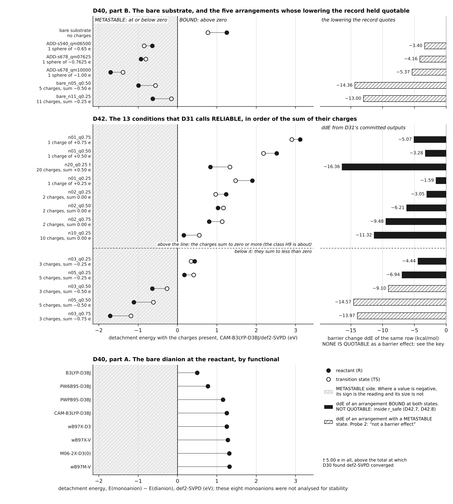

**Figure F12.** D40's detachment energies: the monoanion's energy minus the dianion's at the same geometry with the same charges, def2-SVPD, frame 42436, frozen geometries. Top, part B: CAM-B3LYP-D3BJ with each arrangement's charges present, reactant (filled) and transition state (open). The hatched side is METASTABLE, at or below zero; where a value is negative its sign is the reading and its size is not. Each of the five arrangements is labelled with the lowering the record quotes for it. Bottom, part A: the bare dianion at the reactant under eight functionals; these monoanions were not analysed for stability. D40 withdraws nothing and changes no verdict. Data: `figures/F12_detachment_energy.tsv`, `figures/T12_d40_bare_functionals.tsv`, `figures/T13_d40_arrangements.tsv`. [src: F12T, D40R]

**What the record's rule then reaches.** Probe 2's sentence was written for this case: “Any ddE measured at such a condition is not a barrier effect and must not be reported as one.” A lowering is a difference between a transition state and a reactant, so D40 applies the sentence to an arrangement's ddE if either of its states is METASTABLE, and for each of the five it prints the number the sentence reaches: -3.3985, -4.1567 and -5.3701 kcal/mol, which are D34's, and -14.3612 and -13.0007, which are D33 stage B's with its Erratum 2. Each is recomputed here from the committed dianion outputs and agrees. They are every lowering this document had called quotable at the corrected level: 5 of 5 (recomputed). D40 stops there, by its own limit: “It withdraws nothing and changes no verdict (D40.1): what becomes of a number that R40.7 reaches is a dated erratum and a decision for Jessica.” So the four-leg verdicts of D34 and D33 stage B stand as committed, and the five numbers stand as committed. What has changed is that the record's own rule says they may not be reported as barrier effects, and until the erratum is written this document quotes them only with METASTABLE said beside them. [src: D40R, P2, T13W] [dv: DV353, DV367]

**What D40 does not say.** It is one basis and one frame; the energies are vertical, not adiabatic; and all five arrangements sit inside r_safe, about which D40 says nothing. It “does not make binding a leg of the reliability criterion”. It does not say why the dianion is METASTABLE with these charges: the change in detachment energy from the bare substrate, -0.9243 to -2.9483 eV, is “Reported, not interpreted.” What the record does hold is the sign. Probe 2 found the same dependence at another level and another site (above): a positive unit charge raised the detachment energy and a negative one took it below zero. All five arrangements carry a net negative charge (Table 3). No arrangement of zero or positive net charge has been tested for binding at the corrected level. Among the ten production arrangements none of those is RELIABLE (section 8.2); D31 holds RELIABLE conditions that are, and H9 of section 11 proposes them as the test. And these are bare dianions in vacuo: nothing here says what a solvent or a protein would do to the binding of the second electron. [src: D40R, T13W, P2]

**The orbital energies, as data only.** Post hoc, and not the test: with the charges present, the highest occupied orbital of all 5 lies above zero in both states at CAM-B3LYP-D3BJ/def2-SVPD, between +0.7782 and +2.4036 eV, where the charge-free control is at -0.5918 eV at the reactant (recomputed from the raw outputs; no level shift was engaged in any of them). For these five the sign of the orbital and the sign of the detachment energy now agree. That is five cases, in a record that holds the orbital is not the test, and part A shows why: under two functionals the orbital is above zero for a dianion that is bound. Of the 20 RELIABLE designs of `figures/T5_positive_charge_vs_verdict.tsv`, 9 have the orbital below zero in both states and 11 do not (derived; post hoc; data only); only the 5 above have a detachment energy. The 2 RELIABLE walled designs of D33 stage B are among the 9, and the wall is NOT ADOPTED. Every row is in `figures/T9_orbital_with_charges.tsv`. [src: T9W, P2, P1E, D40R] [dv: DV207, DV208, DV209, DV210, DV203, DV204, DV205, DV215]

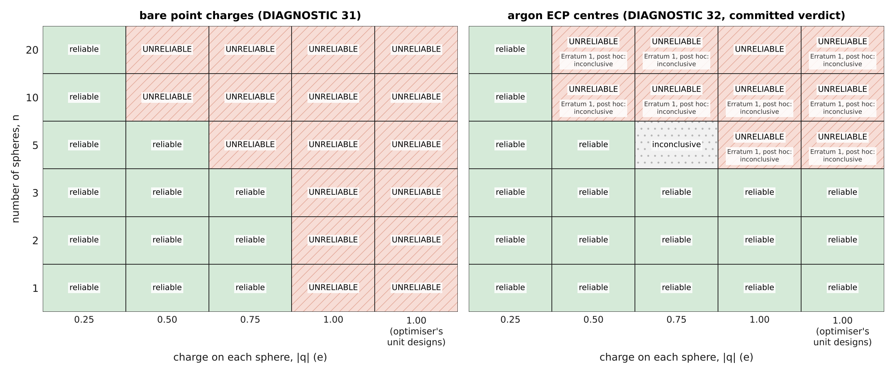

**Figure F3.** Verdict per (n, q) cell, bare (D31, 62 runs) beside walled (D32, 66 runs), CAM-B3LYP-D3BJ/def2-SVPD, frame 42436, frozen geometries, in vacuo. The right panel shows D32's committed verdict; the nine cells Erratum 1 re-read are marked, and that re-reading is post hoc. The one INCONCLUSIVE cell is five spheres at 0.75 e. Verdicts are parsed from the two result documents and the erratum, not re-judged. Data: `figures/F3_nq_grid.tsv`. [src: D31, D32, D32E1, F3T] [dv: DV71, DV72]

## 6. What is actually established

Each item states its level of theory, its run count where it has one, and its frame. All are frozen geometries, frame 42436, in vacuo, unless said otherwise. [src: CRIT]

1. **The bare-substrate barrier is 18.461014 kcal/mol at B3LYP-D3BJ/def2-SVP and 26.8248 at CAM-B3LYP-D3BJ/def2-SVPD.** Measured, and recomputed here from every committed charge-free pair. [src: D27, D33A, F1T]
2. **B3LYP places the dianion's highest occupied orbital above the vacuum level, where the detachment energy says it should not be; CAM-B3LYP and wB97X-D3 place it below.** Measured, D28, 22 runs, and monotone in the long-range exchange fraction at two bases and both states. [src: D28] [dv: DV69]
3. **r_safe = 3.50 A for a bare unit charge on one axis from one site, at B3LYP-D3BJ/ma-def2-SVP.** Measured, D11. The wall arm it is defined against is neon, used outside its published assumption. [src: D11, D33P]
4. **No scalar function of the charges orders density relocation.** Measured, D29, from one pair of committed runs with identical charge vectors and opposite outcomes; B3LYP-D3BJ/def2-SVPD. [src: D29]
5. **A bare design carrying a positive unit charge is unreliable at every n tested; reliable envelopes exist only in partial charges and are not transferable.** Measured, D31, 62 runs, and D33 stage B, CAM-B3LYP-D3BJ/def2-SVPD. [src: D31, D33B] [dv: DV71]
6. **An argon wall brings the Loewdin rise below threshold in 29 of 30 charged conditions and rescues the unit charge at n = 1, 2 and 3.** Measured, D32, 66 runs; the count of 29 is recomputed here. The wall is NOT ADOPTED and argon is not validated. [src: D32, D33P, EXP0] [dv: DV72, DV97, DV98]
7. **def2-SVPD is converged against def2-TZVPD under CAM-B3LYP at 1.3000 e and 2.8800 e, and is not at 5.6433 e.** Measured, D30: “def2-SVPD is not sufficient under CAM-B3LYP at 5.6433e_n20.” Three vectors. [src: D30]
8. **At the corrected level, two bare designs chosen with the corrected matrix are both reliable and inside the confirmed basis window: five spheres at 0.50 e, ddE -14.3612, and eleven at 0.25 e, ddE -13.0007.** Measured, D33 stage B, 16 runs. Erratum 2 restricts production claims from that diagnostic to these two. Both sit inside r_safe; D33's first limitation is “NOTHING HERE ESCAPES r_safe.” D40 has since measured the dianion METASTABLE with the charges of each, at both states (item 20). [src: D33B, D33E2, D33P] [dv: DV74]
9. **The linear score under-predicts the measured ddE by a factor of 1.09 to 1.23 over the five stage B designs not flagged.** Derived from the stage B result and the committed designs file. [src: D33B] [dv: DV50, DV51]

10. **The frozen-half lowerings are reproducible at the old level, and 7 of the ten arrangements are UNRELIABLE at the corrected one.** Old level: ten arrangements, from -2.958960 to -24.826057 kcal/mol, B3LYP-D3BJ/def2-SVP, 22 runs, each recomputed here to the sixth decimal; the largest is S6-20's, which Erratum 3 classes STRAINED at that level and D20 holds PROVISIONAL, and Erratum 3 classes S6-10 STRAINED as well. Corrected level, D34 arm 2, CAM-B3LYP-D3BJ/def2-SVPD with the stability analysis, 22 runs: 3 arrangements are RELIABLE and quotable, at -3.3985, -4.1567 and -5.3701 kcal/mol against a reference of 26.8248, and 7 are UNRELIABLE. The 3 are single spheres carrying -0.6500, -0.7625 and -1.0000 e. D40 has since measured the dianion METASTABLE with each of those three spheres present, at both states (item 20). All ten sit inside r_safe. Measured; every ddE of both arms is recomputed here from the 44 raw outputs and matches, and the charge-free control barrier of each arm is 26.8248 kcal/mol. [src: D34R, D34T, T3D, CTL, E3, D20] [dv: DV94, DV126, DV127]

11. **The prediction that the frozen half was measured on unreliable densities was tested and not falsified.** The first draft of this document carried it as a hypothesis, to be given up if D34's classified arm returned RELIABLE for every arrangement at or below 2.88 e. Of the 7 such arrangements, 4 are UNRELIABLE and 3 RELIABLE (derived from the committed table). The 3 arrangements above 2.88 e are UNRELIABLE as well. That draft was never committed, so the record cannot show that the test was fixed before the result; this is reported as a finding, not as a passed pre-registered test. [src: D34R, D34T] [dv: DV110, DV111, DV112, DV138]

12. **The old level could not see the relocation.** At B3LYP-D3BJ/def2-SVP, 0 of the ten arrangements has a Loewdin rise at or over 0.25 e and the largest is 0.0711 e. At CAM-B3LYP-D3BJ/def2-SVPD without the stability analysis, arm 1, 7 of the ten do and the largest is 1.6692 e: the same arrangements, the same charges, the same geometries, 22 runs each. Recomputed from raw outputs; the old-level reading is D34's stage A, which is post hoc by its own words. D34 does not separate functional from basis. [src: T3D, D34R, D34T] [dv: DV115, DV118, DV113, DV117]

13. **In D34, every arrangement that relocates carries a positive charge, and the 3 that carry none do not relocate.** The 3 RELIABLE arrangements are the 3 with no positive charge, with a largest arm 2 rise of 0.0098 e; all 7 that carry a positive charge are UNRELIABLE. This is an observation on ten arrangements in which sign is confounded with site, it is post hoc, and it is not a rule (section 11, H2). [src: T3D, D34T] [dv: DV129, DV128, DV130, DV127]

14. **The stability correction is large enough to change the sign of ddE.** In 7 of the ten arrangements, 14 of 20 runs, arm 2's first SCF solution is unstable with 3 negative eigenvalues, and the reconverged energy is lower by up to 0.085840877 Eh, which is 53.8660 kcal/mol (S6-20, reactant). ddE changes sign between arm 1 and arm 2 for 2 arrangements, S6-2 and S6-5, and moves by up to 21.7176 kcal/mol. The 3 RELIABLE arrangements are stable at the first solution and their two arms agree exactly. All recomputed; the per-state corrections match D34's printed table. [src: T3D, D34R] [dv: DV119, DV120, DV121, DV123, DV122, DV124, DV125]

This is not the first stability correction in the record. D20 measured corrections of 9.5558 and 3.3164 kcal/mol on ddE for S6-20 under B3LYP at def2-SVPD, and said of them “every correction above is a LOWER BOUND on the correction, not the correction.” D34 is the first to measure it with a separate arm, at the corrected level, across all ten arrangements. [src: D20]

15. **The correlated barrier of the bare substrate is 23.8603 kcal/mol at DLPNO-CCSD(T)/def2-TZVPD.** Measured, D36, frame 42436, frozen geometries, in vacuo; recomputed here from the two raw outputs. It is a reference for comparison at that basis and not a converged barrier. It is not the experimental number either: the record's 24.5 kcal/mol is a free energy in water, a different quantity, and D36 says “ITS CLOSENESS TO 24.5 IS NOT AGREEMENT.” [src: D36R, T7W] [dv: DV220]

16. **Of the three functionals D36 pre-registered, CAM-B3LYP-D3BJ is the closest to it, +1.8400 kcal/mol above; wB97X-D3 is +4.1086 above and B3LYP-D3BJ -6.5557 below.** Measured, def2-TZVPD, the same geometries. D36: “that makes it the closest here and nothing more.” At def2-SVPD, against D41's benchmark at that basis, it is still the nearest of those three and lies +3.9280 above (item 22). No amendment adopts a production level. [src: D36R, D36P, D41R]

17. **The geometry moves the bare barrier by more than the basis does.** Measured, D35: Stage 4e's five levels give barriers higher by +1.4992 to +3.6023 kcal/mol at frame 42436 than at frame 41786, and the order of the levels is not preserved. The eight functionals of D36 and D37 move by -1.3028 to -0.8624 kcal/mol from def2-SVPD to def2-TZVPD (recomputed), and the correlated barrier by +0.9635 (D41). [src: D35R, F11T, D41R] [dv: DV241, DV242]

18. **Five further functionals are measured on the same geometries, and at def2-TZVPD none is closer to the correlated barrier than CAM-B3LYP-D3BJ.** D37, def2-SVPD and def2-TZVPD, 24 normally terminated runs of 28 (derived counts); revDSD-PBEP86-D4 is NOT MEASURED in D37 and was measured by Amendment 1 (item 23). Set against the benchmark they are post hoc, by D36's own label: PWPB95-D3BJ -2.5196, PW6B95-D3BJ -2.9008, wB97M-V +3.5321, M06-2X-D3(0) +4.5400 and wB97X-V +5.8962 kcal/mol. [src: D37R, D36R] [dv: DV265, DV264]

19. **An embedding point charge reaches the correlation treatment in DLPNO-CCSD(T).** Measured, D38, a mechanism probe: def2-SVPD, the reactant geometry only, on the run with +1.000000 e, where the corrected correlation energy moves by -0.004901707 Eh. The run with -1.000000 e is NOT INTERPRETABLE by D38's pre-registered rule and is not evidence. No barrier and no ddE exists at this level. [src: D38R, D38P, T8W]

20. **With the charges of each of the five quotable arrangements present, the dianion is METASTABLE at both states.** Measured, D40 part B, CAM-B3LYP-D3BJ/def2-SVPD, twelve monoanion single points with the stability analysis, each against a committed dianion output: the detachment energy is +1.2486 eV at the reactant and +0.7681 eV at the transition state for the bare substrate, and negative in all 10 cases with charges, from -0.1563 to -1.6998 eV. The sign is the reading; the size is not. By Probe 2's sentence a ddE measured at such a condition “is not a barrier effect and must not be reported as one”, and D40 prints the five numbers that sentence reaches: -3.3985, -4.1567, -5.3701, -14.3612 and -13.0007 kcal/mol. D40 “withdraws nothing and changes no verdict”: the erratum and the decision are open (section 8.8). One basis, one frame, vertical, in vacuo, inside r_safe. [src: D40R, T13W, P2] [dv: DV354, DV358, DV359]

21. **The bare dianion is bound under all eight functionals.** Measured, D40 part A, def2-SVPD, the reactant, 8 monoanion single points without a stability analysis: +0.5013 eV under B3LYP-D3BJ and +0.7697 to +1.3185 eV under the other seven. Each is an upper bound in the sense that the monoanion was not analysed for stability. [src: D40R, T12W] [dv: DV357]

22. **The correlated barrier at the production basis is 22.8968 kcal/mol, and its basis shift has the sign opposite to the functionals'.** Measured, D41, DLPNO-CCSD(T)/def2-SVPD; the transition state is new and the reactant leg is D38's run N; recomputed here from the two raw outputs. From def2-SVPD to def2-TZVPD the correlated barrier rises by +0.9635 kcal/mol where each of the eight functionals falls, so D36's statement of a basis uncertainty of roughly one kcal/mol “IS NOT SUPPORTED FOR THE BENCHMARK ITSELF”. Of the eight functionals D41 sets against 22.8968, the nearest at def2-SVPD is PWPB95-D3BJ, at -0.6937, then PW6B95-D3BJ at -0.7397; CAM-B3LYP-D3BJ is third, at +3.9280. D41: “THE ORDER DIFFERS between the two basis sets.” Not a converged barrier, not the experimental number, one frame, no independent control for the transition state, and it adopts no level. [src: D41R, T11W] [dv: DV300, DV305]

23. **revDSD-PBEP86-D4, which D37 could not run, is measured.** D37 Amendment 1, 10 normally terminated runs (derived count), the entry being arm RI: 21.8414 kcal/mol at def2-SVPD and 21.4957 at def2-TZVPD, with the highest occupied orbital at -1.1608 eV at def2-SVPD, reactant. Its def2-TZVPD barrier is -2.3646 kcal/mol from D36's benchmark, by a comparison fixed after the benchmark was known and before its own number was. Its two arms ran the same calculation, so nothing is learned about the RI approximation. It adopts no level. [src: D37A1R, D37A1T] [dv: DV349]

24. **The prediction that the five quotable arrangements are bound dianions was tested and is falsified.** The revision of this document committed on the morning of 15 November 2026 (results `c0f44e24`) carried it as hypothesis H7: that each is a bound dianion at the corrected level at both geometries, to be given up if the detachment energy were zero or negative for any of the five at CAM-B3LYP-D3BJ/def2-SVPD at either geometry. It is negative for all 5, at both geometries (item 20). That revision was committed before D40's pre-registration and before its job was submitted, so here, unlike item 11, the record does show that the test was fixed before the result. [src: D40R] [dv: DV353]

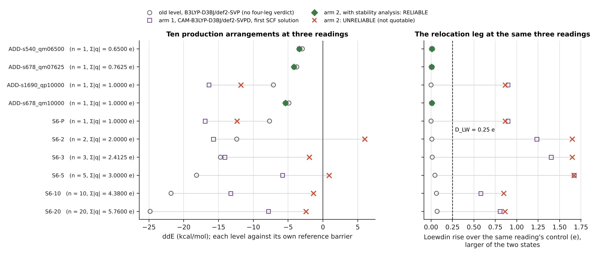

**Figure F7.** The ten production arrangements at three readings, frozen geometries, QM/MM single points with the Lennard-Jones term. Left: ddE at the old level (B3LYP-D3BJ/def2-SVP, 22 runs; D6 classed S6-10 and S6-20 STRAINED there and the other designs it covered CLEAN, and no four-leg verdict exists), at D34 arm 1 (CAM-B3LYP-D3BJ/def2-SVPD, first SCF solution, 22 runs) and at D34 arm 2 (the same with the stability analysis, 22 runs); arm 2's marker shows its committed verdict, 3 RELIABLE and 7 UNRELIABLE. Each ddE is against its own level's reference barrier, 18.4610 and 26.8248. The grey bar joins one arrangement's three readings; it is not a trend. Right: the Loewdin rise at the same three readings against the threshold of 0.25 e. Rows are ordered by total charge. Of the old-level numbers the frozen report says “NOTHING HERE IS A BARRIER.” Data: `figures/F7_production_designs.tsv`, `figures/T3_d34_arms.tsv`. [src: F7T, T3D, D34R, D34T, FROZ, E3] [dv: DV126, DV127]

## 7. What has been withdrawn, and why

| withdrawn | by | what replaced it |
|---|---|---|
| The charge budget Sigma q^2 <= 0.58 e^2, and the claim that the optimiser's budget is about 3.4 times too high | D29's pre-registration: “NEITHER FIGURE IS QUOTABLE AND THIS DIAGNOSTIC DOES NOT ASSUME EITHER.” | Nothing. D29: no scalar orders relocation |
| “+0.093 e” as the walled Loewdin rise attributed to D23, and the factor of nine built on it | D32 Erratum 2: “Both are WITHDRAWN.” “+0.093 e IS IN NO OUTPUT AND NO RESULT.” | D32's own measured factors, 7.8 to 20.7 in eleven of twelve conditions and 2.3 in the twelfth |
| The per-site cap q_quad = 0.80 e | Erratum 3: “E3.1 q_quad = 0.80 e IS WITHDRAWN” | D13 (PARTIAL), then D31's envelopes |
| The conclusion of D3 (itself INCONCLUSIVE) that a real ion saturates like a point charge | Erratum 3: “E3.2 DIAGNOSTIC 3 IS WITHDRAWN” | Nothing; the counterpoise run is outstanding |
| D29's statement that no committed run measures relocation for a unit charge | D29 Erratum 2: “R29.4's claim that nothing in the record measures relocation for a +-1 e design is withdrawn.” | 132 unit-charge conditions exist at ma-def2-SVP and have not been read |
| D29's availability counts of 110 conditions and 16 controls | D29 Erratum 1 | 182 and 26 |
| The 5.6433 e vector, in every quantity | D27: “the 5.6433 e vector is WITHDRAWN from every quantity until a larger basis is run” | Nothing yet |
| D26's def2-SVP input, the pyscf value -5.6165 | D27 R27.4, superseded | The ORCA value -5.614783 |
| D32's verdict STILL UNRELIABLE at n = 5 and 10, as evidence that the wall fails there | D32 Erratum 1; the verdict stands, its use is restricted | Amendment 5 for future readers |
| D33 stage B's “largest quotable lowering”, a walled design; the wall is NOT ADOPTED | D33 Erratum 2; the number stands, its use is restricted | The bare five-sphere design, -14.3612, which D40 has since found METASTABLE (section 5) |
| D38's scratch figure of 11 MB, as the peak of its runs and as what a later job should use | Erratum 1 of D38's result: “11 MB must not be used to size anything.” | “31 GB <= true peak < 43 GB, per run”; the 11 MB is the residue a finished run leaves |

Sources for the table: [src: D29P, D29, D29E1, D29E2, D32E1, D32E2, D32, E3, D13, D27, D33E2, D33B, D38E1]

**D34 withdraws nothing.** Its result says so: “Nothing is withdrawn here; withdrawal of a committed number needs its own dated erratum.” What it does is narrower. It marks 7 of the ten corrected numbers not quotable, and it leaves the ten old-level numbers standing as committed, at a retired level and now known to belong, in 7 cases, to arrangements whose density is unreliable at the corrected one. Whether they are withdrawn is the decision of section 8.5. [src: D34R] [dv: DV127]

**D35 to D38 withdraw no energy.** The one figure withdrawn is the last row of the table, a measurement of scratch space, and its erratum says that every energy, gate and verdict of D38 is unaffected. Three other documents correct an earlier one of their own diagnostic, and say so: D36's Amendment 2 corrects a statement of its Amendment 1 about scratch space, D38's result corrects two points of its Amendment 1, and D38's pre-registration corrects a statement about the sign of the charge that had been made outside the record (section 4.1). Two statements, one in D36's result and one in D38's, are contradicted by other committed files and still need errata of their own (sections 2 and 3); neither is a number. [src: D36A2, D38R, D38P, D38E1]

**D40, D41 and D37's Amendment 1 withdraw nothing.** Each says so. D40: “It withdraws nothing and changes no verdict.” What D40 does is name the five lowerings that Probe 2's sentence reaches and leave the rest to “a dated erratum and a decision for Jessica”; none of the five is in the table above, because no erratum has withdrawn or restricted any of them. D41 reads “D36'S STATEMENT IS NOT SUPPORTED FOR THE BENCHMARK ITSELF”, which is a finding about a sentence of D36's result and not an edit to it; the dated pointer from D36 to D41 is owed. D37's Amendment 1 leaves D37's own table as committed, with revDSD-PBEP86-D4 marked NOT MEASURED there, and adds its entry beside it. [src: D40R, D41R, D37A1R]

The record also holds an earlier do-not-quote list covering Phase 1 and Phase 2 figures; it is section 5 of the committed attempt inventory and is not repeated here. That inventory describes itself as hand-written and as stopping at an earlier commit. [src: INV]

## 8. Open decisions

These are the researcher's to make. For each: what depends on it, and what each branch costs according to the record.

### 8.1 Route (a) or route (b) on r_safe

*Depends on it:* the grid, and through the grid every a coefficient and every design. *Route (a)*, bare charges moved out to 3.50 A or more: the grid is rebuilt and the A matrix recomputed; the record's own figure is about a quarter less first-order effect per charge; D12 says distance does not fix the prediction. *Route (b)*, keep the distances and adopt a charge model with Pauli repulsion: needs a dated amendment and a calibrated wall; D23 found the wall's size depends on the species, and the species now in use is not validated. Until one is taken, D34's wording applies to every number: “A corrected barrier for a design inside r_safe is a corrected number for an uninterpretable design”. [src: D11E, D12, D23, D34P]

### 8.2 The Sigma q_i = 0 amendment

*Depends on it:* whether any committed number survives. The optimiser enforces no charge neutrality; D25 records that its source method does, and that net charge is the lever that moves the reactant. D25 also says “ADDING EITHER CONSTRAINT IS NOT DONE BY THIS DIAGNOSTIC AND IS NOT AUTHORISED BY IT.” D34: “The Sigma qi = 0 decision is untaken and D34 does not take it.” [src: D25, D34P]

*If taken:* of the ten production arrangements one has charges summing to zero (derived), S6-2, and D34 finds it UNRELIABLE; 0 of the neutral arrangements is RELIABLE (derived), and the 3 quotable ones carry net charges of -0.6500, -0.7625 and -1.0000 e. [src: D34R, D34T, T3D] [dv: DV47, DV137, DV126]

Of the six stage B designs one is neutral (derived), the twenty-sphere design, which is INCONCLUSIVE and outside the basis window. The two designs of section 6, item 8 carry net charges of -0.50 and -0.25 e (derived) and would be voided. Taking the amendment as it stands therefore leaves no quotable number in the record. *If not taken:* the question D25 raised stays open. [src: D25, D33B] [dv: DV46, DV41, DV42]

### 8.3 The sign of Loss

*Depends on it:* whether Stage 6's tolerance can fail. The criteria define Loss as ddE(frozen) - ddE(relaxed) and require “LOSS MUST BE BELOW 15 % OF |ddE(frozen)|.” The finding of 3 November records that the tolerance “cannot fail as the criteria write it”, because the formula and the clause beside it differ in sign. It proposes no correction. *Cost of either branch:* an amendment; no committed number changes, because no relaxation result is committed. [src: CRIT, LOSS]

### 8.4 A criterion for a relocated pose

I could not find the phrase "relocated pose" in either repository; I searched all tracked text for it and for close variants. What the record holds is this. The criteria define two failures of a relaxation: a sphere within 1.2 A of a substrate atom, and a bond moving by more than 0.15 A. D25 records a relaxation in which the reactant moved its centroid 8.8567 A while the transition state moved 0.6536 A, and concludes “The relaxed reactant and the relaxed transition state are therefore no longer the same complex.” Neither committed failure definition covers that case. *Depends on it:* every future relaxation. *Cost:* an amendment defining when a relaxed reactant no longer belongs to the same complex; no committed result changes. [src: CRIT, D25]

### 8.5 What becomes of the old-level production numbers

The first draft's open item here was the scope of D34; D34 has run as registered. What remains is the decision its result leaves to a dated erratum: whether the ten frozen-half lowerings at B3LYP-D3BJ/def2-SVP, 7 of which belong to arrangements D34 finds UNRELIABLE at the corrected level, are withdrawn, restricted, or left as committed. *Depends on it:* whether any later document may quote the old numbers, including the two-sphere and twenty-sphere figures that earlier diagnostics use as baselines. *Cost of either branch:* no compute; one erratum. D34 also says what it is not: “D34 re-reads the record; it designs nothing.” The arrangements were placed with the old A matrix, so new production numbers have to come from designs chosen with the corrected one, which D33 stage B began with six. D34's own reading of the old outputs, its stage A, is post hoc by its own words and decides nothing here. [src: D34R] [dv: DV127]

### 8.6 The production level of theory

*Depends on it:* the level at which every later design is evaluated, and whether D30 to D34 are the production record or a provisional one. No amendment has ever adopted a level (section 2). D36 supplies the evidence it was built to supply and leaves the decision where it lies: “That is an amendment and a decision for Jessica.” *What the record offers:* three comparisons, and they do not point the same way. First, at def2-TZVPD, the comparison D36 pre-registered: CAM-B3LYP-D3BJ is the closest of its three to the correlated barrier, +1.8400 kcal/mol above, and it is also the nearest to D28's orbital target; D36 itself calls the agreement of the two tests “weaker evidence than it looks”. Of the six further functionals, PWPB95-D3BJ (post hoc) and revDSD-PBEP86-D4 (D37's Amendment 1) are within 3 kcal/mol of that benchmark and pass the orbital test at the reactant; both are double hybrids, which the record has never used for a design. Second, at def2-SVPD, the production basis, against D41's benchmark at that basis: CAM-B3LYP-D3BJ is +3.9280 above and third of the eight, behind PWPB95-D3BJ and PW6B95-D3BJ, and PW6B95-D3BJ fails the orbital test. Third, and post hoc, because no committed document defines it: the def2-SVPD barrier a production run would give, set against the def2-TZVPD benchmark. That reading gives PWPB95-D3BJ -1.6572, PW6B95-D3BJ -1.7032, revDSD-PBEP86-D4 -2.0189 and CAM-B3LYP-D3BJ +2.9645 kcal/mol (derived). *What D41 changes:* D36's reading that the basis carries roughly one kcal/mol on the bare barrier holds for the functionals and is not supported for the benchmark, whose shift has the other sign. The def2-TZVPD comparison therefore no longer says, by itself, how a functional does at the production basis. *Cost of adopting CAM-B3LYP-D3BJ/def2-SVPD:* one amendment and no compute. *Cost of adopting a double hybrid:* an amendment, and the design record run again at that level, since D30 to D34 and D40's part B are all CAM-B3LYP-D3BJ. *What no branch settles:* which of the two benchmarks is nearer the converged barrier, two basis sets not being an extrapolation; whether the functional's error cancels in ddE (section 8.7); and whether a design is a bound dianion at that level (section 8.8). [src: D36R, D36P, D41R, D37A1R, F11T] [dv: DV337, DV335, DV338, DV331]

### 8.7 Whether to build the coupled-cluster test of ddE

*Depends on it:* whether any quoted lowering can be said to survive the functional's error. D38, a mechanism probe, licenses the test and nothing else. *What it needs first, by D38's own account:* a control at density-functional level that an external point charge and the QM/MM module give the same QM energy, and a transition-state leg. *Which arrangement:* of the two D38 probed, the positive one is interpretable and is UNRELIABLE at the production level, and the negative one is RELIABLE at the production level and NOT INTERPRETABLE under D38's rule. Neither is, as it stands, both a quotable number and an admissible coupled-cluster arm. D40 adds that the negative one, ADD-s678_qm10000, is METASTABLE at both states at the production level, so its ddE is one of the five that Probe 2's sentence reaches (section 5). D39 was pre-registered to measure the detachment energy of both at the coupled-cluster level, which is the observable that D38's rule stands in for; its result is committed and NOT ENTERED here (section 3). *Cost:* D38's pre-registration records that D36's two legs took 4.1 and 6.7 hours at def2-TZVPD, and Erratum 1 of D38's result bounds the scratch of one def2-SVPD run between 31 and 43 GB. That bound was measured at the reactant: D41's transition-state run at the same basis sampled 46191 MB, which its result calls a lower bound on the true peak. [src: D38R, D38P, D38E1, D39P, D40R, D41R]

### 8.8 What becomes of the five lowerings, and whether binding becomes a leg

The test this section asked for has been run: D40 (section 5; section 6, item 20). With the charges of each of the five arrangements present the dianion is METASTABLE at both states at CAM-B3LYP-D3BJ/def2-SVPD, and Probe 2's sentence, that a ddE measured at such a condition “is not a barrier effect and must not be reported as one”, reaches all five numbers. D40 leaves the rest open, in its own words “a dated erratum and a decision for Jessica”. Two decisions follow. [src: D40R, P2]

*The erratum. Depends on it:* whether -3.3985, -4.1567, -5.3701, -14.3612 and -13.0007 kcal/mol may be quoted, and how. The record's practice offers three branches, the same three that section 8.5 lists for the old-level numbers: withdrawn; restricted, where the number stands and its use is restricted, as D33's Erratum 2 did for the walled design, the wall being NOT ADOPTED; or left as committed, with METASTABLE said wherever they are quoted. *Cost of each:* no compute; a dated erratum to D34's result and one to D33 stage B's. *If they are withdrawn or restricted:* the record then holds no lowering at the corrected level that may be reported as a barrier effect, since these are all 5 of the 5 it had (derived), and conclusions 3 and 10 of section 10 go with them. [src: D40R, D33E2] [dv: DV353, DV367]

*The criterion. Depends on it:* every later design. D40 “does not make binding a leg of the reliability criterion”; making it one takes an amendment. *Cost if adopted:* a monoanion single point at each state for every design, beside the dianion pair the design needs anyway. *What the record says for it:* every one of the five designs that passed four legs fails this test. *What it does not say:* whether an in vacuo detachment energy is the right test for a model meant to stand for a charged environment (section 5, and H10 of section 11). [src: D40R]

*What D40 does not cover.* Part B is one functional and one basis. Its transition-state values are the first in the record and have nothing to reproduce. No arrangement of zero or positive net charge has been tested (H9 of section 11 proposes the committed runs to test it on). D39's result bears on one of the five at another level and is NOT ENTERED here. [src: D40R]

## 9. Untested variables and approaches

**The only geometric variable ever varied is the radial stand-off distance**, in D11, on one axis from one site. **No angular or orientational variable has been scanned.** I walked every diagnostic's question and varied variable and found none whose variable is an angle or an orientation. D12 varies the site, which changes direction and distance together and holds neither fixed.

Also absent from that walk, each stated as "I could not find", not as "there is none":

- any design of more than one charge, at any level, outside r_safe (D12 measured single unit charges beyond it, at a retired level);
- a second frame: every Stage 6 number is frame 42436, Stage 4e is frame 41786, and the s10 benchmark's 35 frames have no recorded conclusion;
- the valence axis of the basis: every basis test moves along the diffuse axis, and plain triple-zeta without diffuse functions was never used for an energy;
- a correlated barrier with a second PNO setting, at a second frame, or extrapolated to the basis-set limit: D36 and D41 are two basis sets at one setting on one frame, the residual DLPNO error is not measured, and D41's transition state has no independent control;
- a coupled-cluster calculation with a charge at the transition state, and so any correlated ddE: D38 is the reactant only;
- a control that an external point charge and the QM/MM module give the same QM energy, which D38 names as part of the test it licenses;
- the addendum D37 promises for its second test (its sixth candidate, revDSD-PBEP86-D4, NOT MEASURED in D37, has since been measured by Amendment 1); and a run that separates the RI approximation in a double hybrid's second-order step, which Amendment 1's two arms did not, because both used it;
- a triple-zeta arm for any walled design;
- a counterpoise-corrected ion comparison, which D3 names as required;
- a multireference calculation, which D19 says its result licenses and does not replace;
- any wall species from a second published source;
- a detachment energy at a second basis, for a walled design, for any RELIABLE arrangement of zero or positive net charge, or at a level above density-functional theory that is entered in this document: D40 is def2-SVPD throughout, and its part B is CAM-B3LYP-D3BJ and the five arrangements of section 5; D39's result is committed and NOT ENTERED;
- a stability analysis on the eight monoanions of D40's part A, and the comparison of those eight functionals with a correlated detachment energy, which D40 leaves NOT EVALUATED;
- a committed result for D25 or for the relaxed half of Stage 6;
- a reading of the 132 committed unit-charge conditions at ma-def2-SVP;
- the audit Erratum 3 asks of the earlier point-charge record, where D6 found COLLAPSED single points in three sets of runs: it “needs the same audit before it is carried into the write-up”. I could not find a later document that performs it (both repositories searched for the three directory names), and this document draws no conclusion from those runs;
- a sign-swapped control at the corrected level: no site has been measured there with both a positive and a negative charge (D2 and D11 measured both at site 1690 and D12 at ten more sites, at the retired functional only), and none of D31's 30 conditions is without a positive charge (derived); the observation that prompts this is post hoc (section 11, H2);
- free energies, sampling, or explicit solvent with a designed charge present. [src: CRIT, S4E, INV, D29E2, D11, D12, D3, D19, P2, P3, D33P, T5W, E3, D6, D35R, D36R, D37R, D38R, D39P, D40R, D41R, D37A1R] [dv: DV145, DV149]

**The deliberate checks.**

- *Tried and abandoned:* continuum solvation (Amendment 2); Gaussian smearing (EXPLORATORY); real ions (INCONCLUSIVE, withdrawn); the scalar budget (D29).
- *Proposed and never adopted:* the wall, route (b), NOT ADOPTED; the neutrality constraint; CAM-B3LYP as the production functional, which D28 declines to change and D36 and D41 decline to adopt; binding as a leg of the criterion, which D40 declines to make it.
- *Withdrawn numbers:* section 7.
- *Self-labelled PARTIAL or INCONCLUSIVE:* D13 (PARTIAL); D3 (INCONCLUSIVE); D33 stage B's twenty-sphere design (INCONCLUSIVE); one D32 cell (INCONCLUSIVE); D27 and D30, which form no single verdict; run A1 of D38 (NOT INTERPRETABLE); the sixth candidate of D37 (NOT MEASURED there, measured by Amendment 1) and D37's second test (NOT EVALUATED); D40's comparison with a coupled-cluster value (NOT EVALUATED); the five arrangements of D40's part B (METASTABLE).
- *At only one level of theory:* r_safe (B3LYP-D3BJ/ma-def2-SVP); the (n, q) envelope and the wall's rescue (CAM-B3LYP-D3BJ/def2-SVPD); the old-level production lowerings (B3LYP-D3BJ/def2-SVP), which D34 has now re-measured at a second level with a different outcome for most; the correlated barrier (two basis sets, one PNO setting); the detachment energies with the charges present (CAM-B3LYP-D3BJ/def2-SVPD).
- *For only one frame:* everything in Stage 6. D35 is the one comparison of two frames, and it is of the bare substrate at five small-basis levels.
- *Never had a negative control:* I could not find a random-design or scrambled-charge control for any measured ddE; the wall-only and charge-free controls test the instrument, not the design.

## 10. Conclusions

1. **The reference barrier depends on the functional by 8.4925 kcal/mol and on the basis by -0.1288.** Both are derived from D27 and D33 stage A at frame 42436, frozen, in vacuo. Scope: bare substrate only; any lowering must be quoted against the reference of its own level. [src: D27, D33A] [dv: DV03, DV02]

2. **Of the ten production arrangements, 3 are reliable at the corrected level and 7 are not.** D34 arm 2, CAM-B3LYP-D3BJ/def2-SVPD with the stability analysis, 44 runs over two arms, one frame, frozen. Scope: all ten sit inside r_safe and were placed with the old A matrix; a verdict does not transfer to another arrangement. [src: D34R, D34T] [dv: DV126, DV127]

3. **The largest lowering D34 lists as quotable for a production arrangement is -5.3701 kcal/mol, one sphere of -1.0000 e, against a reference of 26.8248; D40 has since found the dianion METASTABLE with that sphere present.** The same holds for the other two, and by Probe 2's sentence none of the three may be reported as a barrier effect (item 18). D34 lists three quotable corrected numbers, -3.3985, -4.1567 and -5.3701, all single negative spheres. Scope: inside r_safe; not a catalytic claim; no arrangement of more than one sphere that the optimiser placed is quotable. [src: D34R, D34T]

4. **The old level could not see the relocation.** 0 of ten arrangements reach the Loewdin threshold at B3LYP-D3BJ/def2-SVP and 7 of ten do at CAM-B3LYP-D3BJ/def2-SVPD before any stability correction, on identical arrangements and geometries, 22 raw outputs each, recomputed here. Scope: functional and basis changed together; the old-level reading is post hoc. The old level was not silent on everything: Erratum 3 classes S6-10 and S6-20 STRAINED there, and D20 holds S6-20's number PROVISIONAL after its solution was found unstable. [src: T3D, D34R, E3, D20] [dv: DV115, DV113]

5. **Where the density is reliable the lowering barely moves with the level of theory; where it is not, the corrected number is not quotable.** For the 3 reliable arrangements ddE changes by -0.4036 to -0.4829 kcal/mol between the old level and arm 1 (derived); for the 7 unreliable ones arm 2 gives values from -12.3629 to +5.9806 that D34 marks not quotable. Scope: three single negative spheres on one frame; too few to call a rule. [src: T3D, D34R] [dv: DV136, DV135, DV126, DV127]

6. **The stability correction can exceed the effect being measured.** Up to 53.8660 kcal/mol per state, and a change of sign in ddE for 2 of the ten arrangements, between D34's two arms. Scope: only the 7 arrangements whose first solution is unstable; the 3 reliable ones are untouched; D20 saw the same in kind at the old functional. [src: T3D, D34R] [dv: DV122, DV124, DV119, DV126]

7. **A bare positive charge is not a reliable model at the committed distances.** D11 gives r_safe = 3.50 A against arrangements at 2.85-2.96 A, and D31 finds every design carrying a positive unit charge unreliable in 62 runs at CAM-B3LYP-D3BJ/def2-SVPD. Scope: one frame; r_safe is one axis from one site. [src: D11, D31] [dv: DV71]

8. **Whether a given arrangement is reliable cannot be predicted from its charges.** D29 shows it with one charge vector at two geometries, and D33 stage B with a failure inside D31's envelope. Scope: it rules out scalar budgets and caps; it does not rule out a screen that uses geometry, which D12 tested and found inadequate for five descriptors. [src: D29, D33B, D12]

9. **An argon ECP wall removes the Loewdin relocation in 29 of 30 charged conditions, and is not adopted.** D32, 66 runs, CAM-B3LYP-D3BJ/def2-SVPD, frame 42436; the count is recomputed. Scope: one species, not validated; nothing above n = 3 at unit charge is certified. [src: D32, D33P] [dv: DV97, DV98, DV72]

10. **The largest reliable lowering at the corrected level is -14.3612 kcal/mol, five bare spheres at 0.50 e chosen with the corrected matrix, against a reference of 26.8248; D40 has since found the dianion METASTABLE with those charges present.** By Probe 2's sentence it may not be reported as a barrier effect (item 18). D33 stage B and its Erratum 2, 16 runs, CAM-B3LYP-D3BJ/def2-SVPD, frame 42436, frozen, in vacuo. Scope: it is not one of the ten production arrangements; it sits inside r_safe, where D11 holds that no design is interpretable; it is not a catalytic claim. [src: D33B, D33E2, D33A, D11] [dv: DV74]

11. **The record conflicts on route (a).** D11's Erratum 1 records the choice as open and D12 says moving the grid outward does not help. Scope: the conclusion is that they conflict. No design of more than one charge has been measured outside r_safe; D12's evidence is 4 single-charge sites beyond it, 3 of which fail, at a retired level. [src: D11E, D12] [dv: DV161, DV162]

12. **The linear objective under-predicts and is at the wrong level for the committed designs.** Ratios of 1.09 to 1.23 over five stage B designs, and a corrected matrix that shares 17 of its twenty largest sites with the old one. Scope: frame 42436; the corrected matrix has selected six designs and no optimisation. [src: D33A, D33B] [dv: DV50, DV51]

13. **Stage 6's own purpose, the relaxation, has no committed result and two open amendments in front of it.** D33's pre-registration and the Loss finding. Scope: nothing about relaxed geometries is established. [src: D33P, LOSS]

14. **A correlated calculation puts the bare barrier at 23.8603 kcal/mol at def2-TZVPD, and CAM-B3LYP-D3BJ is the closest to it of the three functionals it was registered to rank, +1.8400 above.** D36, DLPNO-CCSD(T)/def2-TZVPD, frame 42436, frozen, in vacuo. Scope: one frame, one basis, an approximate method whose residual error is unmeasured; not a converged barrier; not the experimental number, which is a free energy in water and a different quantity; it adopts no level, and no amendment has. At def2-SVPD the same method gives 22.8968 (item 20). [src: D36R, D41R] [dv: DV220]

15. **At def2-TZVPD no functional measured is within one kcal/mol of the correlated barrier, and the eight of D36 and D37 span 12.45; at def2-SVPD two are, PWPB95-D3BJ and PW6B95-D3BJ, and the order of the functionals differs.** D36, D37 and D41. Scope: for D37's five the def2-TZVPD comparison is post hoc; D41 fixed the def2-SVPD comparison with the eight barriers known and its benchmark not, and it is not the comparison D36 pre-registered; one frame; neither benchmark is converged, and which is nearer the converged value is not known. revDSD-PBEP86-D4, measured by D37's Amendment 1, is -2.3646 kcal/mol from the def2-TZVPD benchmark. [src: D36R, D37R, D41R, D37A1R] [dv: DV238]

16. **Between the two frames the geometry moves the bare barrier by +1.4992 to +3.6023 kcal/mol and changes the order of the levels.** D35, five small-basis levels. Scope: two frames whose geometries are of different kinds; it does not transfer Stage 4e's conclusion and it benchmarks nothing. [src: D35R]

17. **The benchmark method sees an embedding charge, and that is all that is known about it with charges.** D38, a mechanism probe: at the reactant the correlation energy responds to a point charge of +1.000000 e, and “THE EMBEDDING CHARGE REACHES THE CORRELATION TREATMENT.” Scope: one arm of two, the other being NOT INTERPRETABLE; no transition state, so no barrier and no ddE. The error of CAM-B3LYP-D3BJ on the bare barrier, +1.8400 kcal/mol at def2-TZVPD, is 34 to 54 per cent of the three lowerings of item 3, and whether it cancels in ddE is unmeasured. Against D41's benchmark at def2-SVPD the same error is +3.9280. [src: D38R, D38P, D41R] [dv: DV257, DV258]

18. **Every lowering this document had called quotable was measured at a condition where the dianion is METASTABLE.** D40, CAM-B3LYP-D3BJ/def2-SVPD, both states, twelve monoanion single points with the stability analysis: the bare dianion is bound, by +1.2486 eV at the reactant and +0.7681 eV at the transition state, and with the charges of each of the five arrangements behind items 3 and 10 the detachment energy is negative at both states. By Probe 2's sentence a ddE measured at such a condition “is not a barrier effect and must not be reported as one”. Scope: D40 withdraws nothing and changes no verdict, and the erratum that would is not written (section 8.8); the sign is the reading and the size is not; one basis, one frame, vertical, in vacuo; all five carry a net negative charge and sit inside r_safe; binding is not a leg of the criterion. [src: D40R, P2, T13W]

19. **The bare dianion is bound at every density-functional level measured.** D40 part A, eight functionals, def2-SVPD, the reactant: the detachment energy is +0.5013 eV under B3LYP-D3BJ and +0.7697 to +1.3185 eV under the other seven. Scope: one geometry for seven of the eight, the transition state being measured for CAM-B3LYP-D3BJ only; the monoanions of part A were not analysed for stability; no comparison with a correlated value is entered. [src: D40R, T12W]

20. **At the production basis the correlated barrier is 22.8968 kcal/mol, and the basis moves it the opposite way from every functional.** D41, DLPNO-CCSD(T)/def2-SVPD, frame 42436, frozen, in vacuo: +0.9635 kcal/mol from def2-SVPD to def2-TZVPD, where the eight functionals move by -0.8624 to -1.3028. Scope: the reactant leg is D38's run N and the two legs were run in different jobs; no independent control for the transition state; two basis sets, no extrapolation; not a converged barrier and not the experimental number; it adopts no level. What follows from it is narrow: a functional's distance from the benchmark depends on the basis at which it is read, by about 2 kcal/mol here (+1.8259 to +2.2664, derived). [src: D41R, T11W, F11T] [dv: DV300, DV305, DV325, DV326]

## 11. Hypotheses

Ranked by what each unblocks. Run counts are counts of single points and are stated as arithmetic in `figures/derived.tsv` where they are not already a committed diagnostic's own. The first draft's leading hypothesis, that the frozen half was measured on unreliable densities, was tested by D34 and not falsified; it is section 6, item 11, and the rest are renumbered. H7 of the revision committed on the morning of 15 November 2026, that the five quotable arrangements are bound dianions, was tested by D40 and is falsified; it is section 6, item 24. Its number is not reused, and H9 and H10 are what it leaves behind.

**H1. The reliability of an arrangement is decided by the potential it puts on the reactant, not by its charges.** *Unblocks:* a screen, which sections 4.7 and 4.8 show charges alone cannot give, and without which every new design has to be classified after the fact. *Falsified if:* over the committed D31, D32, D33 and D34 conditions, the first-order reactant term does not separate reliable from unreliable any better than total charge does. *Cheapest test:* no new runs; a pre-registered reading of committed potentials and the 128 committed outputs of D31 and D32, the 16 of D33 stage B and the 44 of D34. *Bears on it:* D29's decisive pair differs only in geometry, which a potential-based quantity can see and a charge-based one cannot; D25 measured nothing yet. [src: D29, D25, D32E1] [dv: DV74, DV91]

**H2. Relocation is onto the positive charges: an arrangement with no positive charge does not relocate, at any magnitude up to one.** This is post hoc as a reading of D31, D33 stage B and D34, whose verdicts were known when it was written; the sign itself had been measured before (below). *Unblocks:* whether routes (a) and (b) have to act on every charge or only on the positive ones. *Falsified if:* any arrangement with no positive charge fires a leg of the criterion at CAM-B3LYP-D3BJ/def2-SVPD with the stability analysis. *Cheapest test:* the controlled pair the record lacks at the corrected level, a sign swap at two sites: site 1690 at -1.0000 e and site 678 at +1.0000 e, both states, 4 runs (derived), pre-registered, the control being committed already. *For:* in D34 the 3 arrangements with no positive charge are the 3 RELIABLE ones, with a largest rise of 0.0098 e. [src: T3D, D34T] [dv: DV150, DV129, DV130]

*Also for, from a different level and a different observable, and likewise post hoc as support:* D11's sign control repeated two rungs of the ladder with q = -1 and found a shielding term of -0.0926 kcal/mol at the reference distance and +0.0002 at rung d450, against +3.9642 and +0.0195 on the q = +1 arm. Both arms are recomputed here from D11's raw outputs and agree. [src: D11]

*Also for, and measured before any of this: the record's own sign arm.* D12 repeated ten of its sites at q = -1 and reported the arm without scoring it, because “ten sites in one layer cannot separate sign from position”. At all 10 the shielding term is larger in magnitude at +1 than at -1; the largest is 8.0656 kcal/mol at +1 and 0.0285 at -1 (derived). The level is B3LYP-D3BJ/ma-def2-SVP and the observable is not one of the criterion's legs. D12 reads D11's sign control as having “found the artefact specific to positive charges”. So the sign is not a new observation. What is post hoc is using it to read the verdicts of D31, D33 stage B and D34. [src: D12] [dv: DV160, DV163, DV159, DV158]

*Also for, from D2's outputs; post hoc.* D2 scanned both signs of a bare point charge at site 1690, where D34's single positive sphere sits, and reported energies. Its committed outputs also carry the Loewdin charges and the dipole. D6's audit had classed two runs of that scan COLLAPSED without naming them; read by sign here, they are the pair at +1.0000 e. At B3LYP-D3BJ/def2-SVPD in vacuo the charge of +1.0000 e fires the Loewdin leg in both states (larger rise 1.1358 e, dipole ratio up to 3.03) and the charge of -1.0000 e at the same site fires neither (larger rise 0.0302 e, ratio up to 1.30). Of the 24 negative-charge runs in D2's three in-vacuo conditions, 0 fire either leg; the 2 positive-charge runs that do are that pair. Limits: the retired functional, no stability analysis, a bare charge and not a Lennard-Jones sphere, and two legs of four. [src: T6W, D2, D6] [dv: DV151, DV153, DV152, DV154, DV155, DV156, DV157]

*Against, and limiting; this paragraph too is post hoc.* In the D34 sample sign is confounded with site: the negative spheres sit at sites 540 and 678 and the positive one at 1690, so no site carries both signs there. The same-site swaps in the record, D11's, D12's and D2's, are all at the retired functional. None of D31's 30 conditions is without a positive charge. The two pairs that are controlled test other things: the two spheres at site 678 vary magnitude at a fixed negative sign, and S6-P with ADD-s1690_qp10000 varies only the Lennard-Jones term. [src: T5W, F7T] [dv: DV145, DV149]

*Limiting, from D38's pre-registration; post hoc.* Across all 46 tabulated designs, 43 carry a positive charge and 17 of those are RELIABLE: the sign does not set the verdict. H2 claims only the converse, that an arrangement with no positive charge does not relocate. [src: D38P, T5W] [dv: DV200, DV201, DV202]

*Against its usefulness, from the record's probes; post hoc.* If H2 holds, the arrangements it protects are those with no positive charge, and those are the ones the record's detachment energies warn about: Probe 2 found the dianion “METASTABLE” with a charge of -1.0 e beside it and bound with +1.0 e (B3LYP-D3BJ/ma-def2-SVP, reactant, one site). An arrangement could therefore pass the criterion because nothing attracts the density, and still not be a bound state. H7 was the test of that, and D40 has run it: the three arrangements of D34 with no positive charge are RELIABLE on four legs and METASTABLE at both states (section 5). [src: P2, D40R]

*What does not survive, post hoc or otherwise, is a magnitude threshold.* Across D33 stage B and D34 together, the 6 non-walled designs whose largest positive charge is at most 0.5000 e are all RELIABLE or INCONCLUSIVE and the 8 at 0.5500 e or more are all UNRELIABLE. But D31, at the same level on the same frame and the only series that holds the sites fixed while the magnitude changes, has 3 RELIABLE conditions whose largest positive charge is 0.7500 e and 2 UNRELIABLE ones at 0.5000 e. No threshold in the largest positive charge holds across the three diagnostics, which is what D29 found for every other scalar. [src: T5W, D29] [dv: DV141, DV143, DV146, DV147, DV142, DV144]

**H3. Outside r_safe a bare charge is reliable at every magnitude up to one.** *Unblocks:* route (a). *Falsified if:* a unit charge at 3.50 A or beyond fires any leg of the criterion at CAM-B3LYP-D3BJ/def2-SVPD. *Cheapest test:* D11's five rungs repeated at the corrected level with the stability analysis, both signs, both states: 20 charged runs (derived). *Bears on it:* for: D11's shielding term falls from 0.3994 at 3.50 A to 0.0195 at 4.50 A; against: D12, where 3 of the 4 sites beyond 3.50 A fail D11's tolerance at B3LYP-D3BJ/ma-def2-SVP, with a shielding term of up to +8.0656 kcal/mol, and D11's far-field control failed as written. [src: D11, D12, D11E] [dv: DV101, DV161, DV162]

**H4. The wall's rescue at n = 5 and above is real and is hidden by the unreadable gap leg.** *Unblocks:* route (b) for designs larger than three spheres. *Falsified if:* the nine conditions, converged without a level shift, show a collapsed gap or end unstable. *Cheapest test:* those nine conditions, two states each, 18 runs (derived), with a convergence route that does not shift; this is the new diagnostic Amendment 5 says is needed. *Bears on it:* for: the Loewdin rise is below threshold in all nine; against: nothing certifies them, the re-reading that calls them inconclusive is post hoc, and the wall is not adopted. [src: D32E1, A5] [dv: DV102]

**H5. The barrier lowering of a reliable design survives a triple-zeta basis.** *Unblocks:* quoting any number above 2.88 e. *Falsified if:* a reliable stage B design changes by more than 1.0 kcal/mol between def2-SVPD and def2-TZVPD. *Cheapest test:* the two section 6 designs at def2-TZVPD, both states: 4 new runs (derived), the def2-TZVPD control being committed already. *Bears on it:* D30 confirmed 1.3000 e and 2.8800 e on a different arrangement; D33 found reliability does not transfer between arrangements, so basis convergence may not either. [src: D30, D33B, D33P] [dv: DV103]

**H6. The predicted lowering of the neutral, on-mechanism designs is smaller than that of the committed ones.** *Unblocks:* the Sigma q_i = 0 decision. *Falsified if:* a re-solve with the neutrality row gives scores within 15 per cent of the committed ones. *Cheapest test:* no QM; one re-solve per n with the corrected matrix. *Bears on it:* D25's direction statement says the restriction can only make the score worse; by how much is not known. [src: D25]

**H7. Tested by D40 and falsified.** It read: each arrangement with a quotable lowering is a bound dianion at the corrected level, at both geometries. All five are METASTABLE at both (section 6, items 20 and 24).

**H9. The dianion is METASTABLE with these charges because their net charge is negative: a RELIABLE arrangement whose charges sum to zero or more keeps it bound.** This is post hoc as a reading of D40, whose five arrangements were known when it was written. *Unblocks:* whether binding can be secured by a constraint on the charges, which is the Sigma q_i = 0 decision of section 8.2 seen from another side, or has to be tested design by design. *Falsified if:* a RELIABLE arrangement whose charges sum to zero or more is METASTABLE at CAM-B3LYP-D3BJ/def2-SVPD at either state. *Cheapest test:* no new dianion run. Of the 13 RELIABLE conditions of D31, whose dianion outputs with the stability analysis are committed, 8 have charges that sum to zero or more and 5 to less than zero, with net charges from -0.7500 to +0.7500 e (derived). The monoanion partners of the 8 at both states are 16 single points (derived), pre-registered, with D40's bare values as the control; the 5 would show where between -0.7500 e and zero the binding is lost. *Bears on it:* for: all five of D40's arrangements are net negative; Probe 2, at another level and site, found +1.0 e raise the detachment energy and -1.0 e take it below zero; Probe 3, at the retired level and the reactant, found S6-P and S6-2, which are net positive and neutral, more strongly bound than the bare dianion, at +3.4366 and +1.1058 eV against +0.5123; and, as data only and post hoc, orbital energies of +0.7782 to +2.4036 eV with the charges of the five present, against -0.5918 eV for the charge-free control. Limiting: Probe 3 also found S6-20 bound, at +0.3016 eV, with 8 negative charges within 3.5 A of the substrate that sum to -2.70 e, so negative charge near the substrate does not by itself unbind the dianion at that level, and the hypothesis claims nothing about arrangements that are net negative; in D40 the sign of the net charge is confounded with site and with the number of charges; and D31's conditions are bare point charges inside r_safe. [src: P2, P3, T9W, T5W, D40R] [dv: DV374, DV375, DV376, DV378, DV379, DV377, DV209, DV210]

**H10. The loss of binding is a property of the in vacuo model: in a dielectric the same arrangements bind the second electron.** This is not from the record; it is a reading of D40 against the fact that the bare dianion is bound by only +1.2486 eV in vacuo at this level. *Unblocks:* whether an in vacuo detachment energy is the right test of a charge model that stands for an environment, and so whether section 8.8's fifth leg should be the in vacuo one. *Falsified if:* with a continuum present in both the monoanion and the dianion, the detachment energy of the five arrangements stays at or below zero. *Cheapest test:* it has a decision in front of it. The record removed continuum solvation from the protocol by Amendment 2 (section 4.9), so a continuum arm needs a dated amendment before any run. *Bears on it:* D10 measured, at the retired level, that a continuum takes the bare dianion's highest occupied orbital from +1.2269 to -4.3036 eV, which is an orbital energy and so not the test, and that the twenty-sphere design's ddE changed sign with the continuum present (section 4.9). Nothing in the record measures a detachment energy in a continuum with charges present. The five lowerings would still be in vacuo numbers, so the hypothesis bears on the test and not on them. [src: D40R, D10]

**H8. The functional's error on the barrier cancels in ddE.** *Unblocks:* quoting a density-functional ddE as more than a number at that functional. *Falsified if:* a coupled-cluster ddE for an arrangement that is reliable and bound differs from the CAM-B3LYP-D3BJ ddE at the same basis by more than the tolerance its pre-registration sets. *Cheapest test:* for one arrangement, the charged and the charge-free single point at each of the two geometries at DLPNO-CCSD(T)/def2-SVPD, and the density-functional control of section 8.7; D38's reactant runs are already half of the four for either of its arrangements. *Bears on it:* D38 shows that the correlated step sees the charge; the error to cancel is +1.8400 kcal/mol on the bare barrier at def2-TZVPD; nothing measures the cancellation. [src: D38R, D38P]

**What the current grid cannot test at all.** Any hypothesis about orientation; and any hypothesis about relaxed geometries, until sections 8.3 and 8.4 are decided. Designs outside r_safe are testable only at the grid sites that lie there: D12 found some among its 36, and I have not counted how many the grid holds. [src: D12]

**Open questions that are not hypotheses**, because I cannot specify an experiment that would falsify them: whether a point-like model of any kind can represent a residue; and whether the frozen-path approach can reach catalytic lowerings at all, which the criteria list as something Stage 6 cannot settle.

## Appendix A. The completeness sweep

### A.1 Pass 1, by file

`figures/sweep_pass1.py` read every committed input and output in both repositories, loose, compressed, or inside one of the tar archives, and took the keyword line from each input and from each output's echo. *Added by this pass:* the four s10 benchmark methods, which exist only inside one archive; the MM-only runs; the FOD runs; the Na and Mg centres. *Corrected by this pass:* a first aggregate counted inputs by distinct content, which undercounts runs that share one input and differ in the charge file; runs are now counted by distinct normally-terminated outputs. [src: T1L, T1D]

### A.2 Pass 2, by name

`figures/sweep_pass2.py` searched all committed text for 312 names. *Added by this pass:* the two pieces of pyscf work that committed no inputs (Experiment 0 and D24), which no file census can see; the functional and basis behind the FOD runs; the core potential named in an input block. *Corrected by this pass:* my own first list of banner names. The brief's examples of banner-only names did not all hold for this tree: `M06-2X`, `PBE0` and `BP86` occur in a committed parser's list of names and not in any output, and `aug-cc-pV5Z` was in fact used, in pyscf. *Corrected on 15 November 2026:* the pass matched each name against keyword lines by its own spelling only, so a method run under ORCA's keyword for it (`M062X` for M06-2X, `RI-PWPB95` for PWPB95) showed no keyword line and could have been listed as never run. The script now counts those keywords, and the checker refuses such a name on the not-tested list. [src: T2N]

### A.3 Pass 3, by question

*Read in full:* the Stage 6 criteria; Amendment 5; D25; D32, D33 and D34 with every erratum; the results of D1, D2 with its Amendment 1, D3, D4, D5, D7, D10, D11 with its erratum, D12, D13, D17 to D23 and D26 to D31 with the errata of D28 and D29; the pre-registrations and results of D35, D36, D37 and D38, with both amendments of D36, the amendment of D38 and Erratum 1 of D38's result; the results of Probe 2 and Probe 3; the third, fourth and fifth items of Erratum 3; the frozen report, the A matrix report, the Stage 4e report; the attempt inventory of 4 November 2026. *Read in part:* D6's result, in full apart from the rows of its table of flagged runs. *Read at verdict level only* (title, verdict lines, closing limitations): the results of D8, D9, D14 with its Amendment 1, D15 and D16; Probe 1's result; Experiment 0; the Stage 1 to 4d reports; the opening of Amendments 1 to 4 and of Errata 1, 2 and 4 to 7, and the headings of the first two items of Erratum 3. *Read in part on 15 November 2026:* the first two items of Probe 1's Erratum 1; the item of the findings of 22 October 2026 that D38 quotes, and nothing else of that document; the two items of Erratum 7 on the indicators and on experimental numbers; D39's pre-registration, of which the sections on what is open, the comparators, the two routes, the runs and what it does not do were read, and the sections on readings, gates and contingencies were not. *Read on the evening of 15 November 2026:* the results of D40 and D41 and of D37's Amendment 1, in full; their pre-registrations and the amendment itself, which were drafted in the session that built this revision and whose committed texts are the ones cited; and D39's pre-registration, its Amendment 1 and its result, in full, in order to decide whether to enter it (A.8). *Not read:* the pre-registrations of D1 to D24 and D26 to D31 beyond what their results quote; the two work logs and two assessments in the Stage 6 directory; the citation-integrity, literature-position and ECP-convention notes; the Stage 1 to 5 criteria; the charge-model, optimiser and plan documents. Section 4's statements about D8, D9, D14, D15 and D16 therefore still rest on verdict lines, and section 9's list of untested variables rests on a walk that did not open every pre-registration.

*Changed by the reading of 11 November 2026.* D2's and D12's results carry sign arms that the first draft missed: section 11's hypothesis on the sign, and two entries of section 9, were rewritten for them. D12 measured single charges beyond r_safe: section 4.6, the conclusion on route (a) and the hypothesis on charges outside r_safe no longer say that nothing has been measured there. D4, D5 and D7 with Erratum 3 gave section 4.8 its earlier attempts. D6 and Erratum 3 gave section 5 the provenance of the thresholds, and with D20 they show that the old level had already marked S6-10 and S6-20: the caption of Figure F7, the item on the frozen half in section 6 and the conclusion on the old level said otherwise and were corrected. Erratum 3's open audit of the earlier record was added to section 9.

*Changed by the reading of 15 November 2026.* D38's pre-registration pointed at two things this document had passed over because the probes had been read at verdict level only. Probe 2 found the dianion metastable with a unit negative charge beside it, and says a ddE measured there is not a barrier effect; the three quotable lowerings of D34 are single negative spheres, and none has a detachment energy. That is now in sections 5, 6, 8, 10 and 11. And the record had twice withdrawn the reading of an orbital's sign as a test of binding, which the caption of Figure F10 and one item of section 6 had worded loosely; both were reworded. Erratum 7's statement that the indicators have no literature backing was added to section 5.

*Changed by the reading of the evening of 15 November 2026.* D40 answered the question the morning's reading had raised. The five arrangements whose lowering this document called quotable are METASTABLE at both states, and Probe 2's sentence reaches all five numbers. It changed sections 5, 6, 7, 8.8, 10 and 11, and the hypothesis that the five are bound became a prediction tested and falsified. D41 showed that the statement about the closest functional holds at one basis and not at the other, and every place that made it now names the basis.

*Added by this pass:* the conflict between D11's Erratum 1 and D12 on route (a); the absence of a committed D25 result; the status of the argon parameters. *Found while recomputing:* the stage A result's “rank 0.863979” is a rank correlation of magnitudes (section 4.10). [src: D33A]

### A.4 Figures proposed and what became of them

All nine proposed figures were drawn; a tenth, Figure F10, was added afterwards at the author's request (A.6), an eleventh, Figure F11, on 15 November 2026 (A.7), and a twelfth, Figure F12, that evening (A.8). F11 was redrawn that evening for nine functionals and two benchmarks, F1 gained D41's point and Amendment 1's row, and the decision tree gained three nodes. F1 was redrawn on 15 November 2026, one row to a method, because the levels at frame 42436 had more than doubled and D35 had measured Stage 4e's five at both frames. F7 was first drawn at the old level only, because D34 had not run; it now carries the old level and both of D34's arms, with a second panel for the relocation leg. F1 gained a second panel for frame 41786 so that the Stage 4e barriers are not read against frame 42436. No figure was dropped. [src: F1T, F1B, S4E]

### A.5 The revision of 11 November 2026

D34 ran between the first draft and this one, and neither draft was committed in between. Changed for it: sections 2, 3, 4.1, 4.2, 5, 6, 7, 8.2, 8.5, 9, 10 and 11. In the section on the legs, D34 is a sixth case and the old level's blindness is set out. In the section on what is established, items 10 to 14 are new or rewritten. The section on withdrawn figures says that D34 withdraws nothing. In the conclusions, those on the production arrangements, on the old level and on the stability correction are new, and those on bare positive charges and on the largest reliable lowering are restated. In the hypotheses, the first draft's leading one became a finding and the post hoc one on the sign of the charge is new. Three tables were added, each recomputed from raw outputs through the committed readers: `figures/T3_d34_arms.tsv` (every leg at three readings; D34's result prints arm 2's only), `figures/T4_twin_arrangements.tsv` and `figures/T5_positive_charge_vs_verdict.tsv`. A fourth, `figures/T6_d2_both_signs_site_1690.tsv`, came from the reading recorded in A.3, as did six rows of `figures/derived.tsv` read from D12's tables. The decision tree's D34 node now carries its result.

### A.6 Changes prepared on 11 November 2026, committed with the revision of 15 November 2026

Five things were changed after the document had been committed on 11 November 2026. They were held, at the author's decision, so that the document would be rebuilt once, after D36; they enter the record with A.7. First, the sentence in section 1 that defines a_i was reworded at the author's request, because its wording let the transition state and the reactant be read as places and not as the two states of the substrate; the definition is the one the D33 pre-registration gives, and it is unchanged. Second, Figure F10 was added to section 2 at the author's request, drawn from D28's committed outputs. Third, both repositories had moved in the meantime, by D35's pre-registration and inputs, and D35 was entered in sections 2 and 9 as pre-registered; A.7 supersedes that entry. Fourth, a mistake of assembly was removed from this appendix: the committed text carried A.2 twice and, under a second A.3 heading, the superseded list of what had been read. Fifth, the groups of markers in Figure F2 were named, at the author's request, with the report's own marks for the quantities its sign test is on, and the caption now says how to read the figure. These five changed no number, source tag or conclusion of the committed text.

### A.7 The revision of 15 November 2026

Four diagnostics were committed after 11 November 2026 and are entered here: D35 (Stage 4e's five levels on the Stage 6 frame), D36 with its two amendments (the correlated barrier), D37 (five further functionals; a sixth not measured) and D38 with its amendment (whether an embedding charge reaches the correlated step). Two further documents were pushed on the morning of 15 November 2026, while this revision was being built, and are entered as well: Erratum 1 of D38's result, and D39's pre-registration with its inputs. Every table was regenerated at the two commits named in the header. *Changed for them:* sections 2, 3, 4, 5, 6, 7, 8, 9, 10 and 11. In the section on the reference barrier, Table 1 and Figure F1 were rebuilt and D35, D36, D37 and Figure F11 entered. In the section on levels of theory, Table 2, the census and the not-tested list were rebuilt and D38 entered. The decision tree gained four nodes, and the reading of the sign of the charge gained its limit. The section on the criterion gained the provenance of the threshold, how much rests on it, a seventh case of disagreement, and what the legs do not read. Six items were added to what is established, three open decisions, five conclusions, and two hypotheses with two paragraphs under the hypothesis on the sign. *Tables added,* each recomputed from raw outputs and compared with the table the diagnostic's own reader committed: `figures/T7_d36_benchmark.tsv`, `figures/T8_d38_probe.tsv`, `figures/F11_two_tests.tsv`; and two post hoc tabulations, `figures/T9_orbital_with_charges.tsv` and `figures/T10_loewdin_thresholds.tsv`. `figures/F1b_stage4e_bare_barrier.tsv` now holds both frames.

*Mistakes of mine corrected in this revision.* The census script did not know the new method keywords and filed their runs under no method; it does now. The by-name pass could have listed a method as never run when it had been run under ORCA's spelling of it (A.2). The check that every figure has its three files skipped figures numbered above nine. The identifiers of the derived numbers for the reference barriers would have shifted by one when D35 added a level; they are pinned, and the new levels have identifiers of their own.

*Found in the record while recomputing, and not mine to correct.* Two statements need a dated erratum from their own diagnostics: D36's description of its geometries as band geometries (section 2) and D38's statement that ORCA prints no point-charge count (section 3). A third, D38's use of a reading of the orbital energy that D2 and Probe 1's Erratum 1 had withdrawn (section 3), has been set right in substance by D39's pre-registration. None changes a number or a verdict. D37's addendum for its second test is outstanding, and its committed reader looks for D36's coupled-cluster outputs in the first attempt's directory, where there are none.

The provenance record in Appendix B was regenerated.

### A.8 The revision of 15 November 2026, evening

Three results were committed after the morning's revision and are entered here: D41 (the correlated barrier at the production basis), D37's Amendment 1 (revDSD-PBEP86-D4, which D37 could not run) and D40 (detachment energies at the density-functional level). The reader of each was committed before any of its outputs had been read. Every table was regenerated at the two commits named in the header. *Changed for them:* the header and sections 2, 3, 5, 6, 7, 8.6, 8.7, 8.8, 9, 10 and 11. In the section on the reference barrier, Table 1 gained three rows, D41 and Amendment 1 were entered, and every statement that CAM-B3LYP-D3BJ is the closest functional now names the basis at which it holds. In the section on the criterion, the paragraph that said no detachment energy existed for the quotable arrangements was replaced by D40's result, Table 3 and Figure F12. What is established gained items 20 to 24, the conclusions were changed at items 3, 10, 14, 15, 17 and 18 and gained items 19 and 20, and the hypotheses lost H7 and gained H9 and H10. *Tables added,* each recomputed from raw outputs and compared with the table the diagnostic's own reader committed and with the result's printed rows: `figures/T11_d41_benchmark_svpd.tsv`, `figures/T12_d40_bare_functionals.tsv`, `figures/T13_d40_arrangements.tsv` and `figures/F12_detachment_energy.tsv`. `figures/F11_two_tests.tsv` gained a row and two columns. Appendix B gives the number of controls.

*D39, and why it is not entered.* D39's result (results `21d631b0`), its Amendment 1 (`00438730`) and its reader (code `512eead`) were committed by another session on the evening of 15 November 2026, two minutes after D40's result. All three documents were read in full, and the arithmetic of the result was reproduced from its six raw outputs. It is not entered, at Jessica's instruction, because of questions the reading raised. They are listed here without its numbers, which are in its own result. First, D39 registered two routes to one quantity so that the second would be a control on the first. For two of its three systems the two routes do not agree; no tolerance for their agreement was pre-registered, and the result draws no conclusion from the disagreement and goes on to use the first route's numbers. Second, the unrestricted references of the first route's monoanions are strongly spin-contaminated, which the result reports. Third, Amendment 1 is headed “Written 15 November 2026, before any D39 output had been read.” It was committed in the same second as the result and the reader, after the job had ended, so the record cannot show that order; it changed no number. Fourth, the repository holds no archive manifest for D39's output files, which D40, D41 and D37's Amendment 1 each have. None of this is a finding that D39's numbers are wrong. They are reasons not to build on them until the questions are answered, and the answers are for the session that ran it and for Jessica. *What waits on it:* D40's comparison of its eight functionals with a coupled-cluster detachment energy (R40.3), which is NOT EVALUATED. [src: D39R, D39A1, D39P, D40R]

*Mistakes of mine corrected in this revision.* The pool of reference barriers in `figures/make_figures.py` chose its runs by geometry, by keyword line and by the absence of charges. The monoanion single points of D39 and D40 meet all three. They stayed out of Table 1 only because the committed reader cannot parse an unrestricted output, which is an accident and not a rule; the pool now requires what ORCA itself prints of the charge and the multiplicity. The checker's registry of self-labels required NOT MEASURED wherever revDSD-PBEP86-D4 is named. That label is D37's and still stands in D37's table, but Amendment 1 has measured the functional, so the registry now requires that Amendment 1 be named beside it.

*Found in the record while recomputing, and not errors.* Two printed digits depend on a four-decimal input. D41 defines its comparison on the committed def2-SVPD barriers of `phase2.2/cs_stage6/d37.tsv`, so the last digit of PWPB95-D3BJ's -0.6937 is one unit higher in size than the raw energies would give; and D40 sets each functional's detachment energy beside the orbital energy that file carries, so the last digit of CAM-B3LYP-D3BJ's +0.6568 is one unit higher than the raw orbital energy would give. This document forms both the way the record does and quotes the record's digits. Separately, D41's transition-state run used more scratch than the bound Erratum 1 of D38's result gives for a reactant run (section 8.7). [src: D41R, D40R]

*Owed, and not written.* The erratum or errata that say what becomes of the five lowerings, which is Jessica's decision (section 8.8). A dated pointer from D36's result to D41, for its sentence on the basis. D40's addendum for its comparison with a coupled-cluster value, which waits on D39. D37's addendum for its second test. The two errata A.7 lists. And the companion report `phase2.2/cs_stage6/WRITEUP_SCOPED_20261111.md` has not been revised for D36 or for anything since; its three quotable numbers are three of the five that D40 reaches.

The provenance record in Appendix B was regenerated.

## Appendix B. Provenance

The record below is `figures/PROVENANCE.txt` as the validation script wrote it on the staged copies: the two HEAD hashes, the sha256 of every script used, the twenty-four checks and the negative tests. The run reproduced here included the slow regeneration of the name table. The committed readers' hashes can be compared with the ones the record itself prints for them.

```
PROVENANCE of WRITEUP_CONSOLIDATED_20261111.md

chorismate-thesis-results  main           HEAD 21d631b005c65174e791bbc4a464c89f2e5f5433
chorismate-thesis-code     tier1-realism  HEAD 512eead964a4b8d953bf5e14adad0935834500d1

sha256 of every script used
   2ae72039c0a592f92b96edd0419c781063bbe6468f77f29ccc5367a41ef17026  figures/make_figures.py
   a5040d8b6d24c30401dd37b19b05a87fd5d1ed6bfe9e20969f9b1eabbcb6c70a  figures/sweep_pass1.py
   2b65a905827800622efca8ccb0a66f34464d5fcc09cad7b147be5c152ff4f83b  figures/sweep_pass2.py
   2482a29a63b8bfe2e82d82b5a566d8e4084db29517f8ecb91a3ca99181116fce  code: phase2.2/cs_writeup_check.py
   6e0d0f90e0e7ab3f2f9da7c527e192c1686a6c77a885df6ccc4caf560665052a  code: phase2.2/cs6_analyse.py  (committed reader, imported)
   1dda394a134b3c7265df1898c9b5dc507d01c41d73aa5e59274495a1e7005dea  code: phase2.2/cs6_audit.py  (committed reader, imported)
   c6a8c3958a4e7532c9e28082b6d8f25c51549c0ea70f06fcf95d1370b3cde2f6  code: phase2.2/cs6_d33b.py  (committed reader, imported)

validation output

    1 numbers      PASS   (717 sourced in a named committed file, 311 derived (figures/derived.tsv), 0 estimated; 1922 items not treated as numerals)
    2 quotes       PASS   (148 quotations)
    3 citations    PASS   (117 files in Appendix C)
    4 withdrawn    PASS   (8 registry entries)
    5 selflabels   PASS   (10 registry entries)
    6 controls     PASS   (587 recomputed; worst: C13.01 ddE bare_n03_q0.75 (D33 stage B): |diff| 4.89e-05 against a tolerance of 5.0e-05)
    7 counts       PASS   (36 run counts)
    8 not_tested   PASS   (32 names)
    9 regeneration PASS   (32 tables regenerated)
   10 heads        PASS   (two repositories)
      -- added 11 November 2026 for DIAGNOSTIC 34
   11 exp_heads    PASS   (results 21d631b, code 512eead)
   12 d34_numbers  PASS   (20 blocks cite D34: 52 numerals in its result or d34.tsv, 66 derived)
   13 d34_controls PASS   (arm 1 26.8248, arm 2 26.8248; 10 frozen ddE, worst |diff| 4.8e-07)
   14 arm1_legs    PASS   (63 values recomputed from d34/a1_*)
   15 claims       PASS   (40 numbers behind C1 to C6 recomputed)
   16 posthoc      PASS   (11 blocks discuss C3)
      -- added 15 November 2026 for DIAGNOSTICS 35 to 38
   17 benchmark    PASS   (DLPNO-CCSD(T) barrier 23.8603 recomputed from d36a2/; two shifts recomputed from d38/)
   18 experiment   PASS   (2 blocks hold the experimental 24.5)
   19 d38_a1       PASS   (1 blocks quote a number of run A1)
   20 posthoc_lvl  PASS   (5 blocks quote a post hoc distance; 2 an orbital energy of a charged design)
      -- added on the evening of 15 November 2026 for DIAGNOSTICS 40 and 41 and DIAGNOSTIC 37's Amendment 1
   21 benchmark_sv PASS   (DLPNO-CCSD(T)/def2-SVPD barrier 22.8968 recomputed from d38/N and d41/T)
   22 detachment   PASS   (20 detachment energies recomputed from d40/ and their committed dianion runs; 10 at or below zero)
   23 metastable   PASS   (10 blocks quote a lowering that DIAGNOSTIC 40 reaches)
   24 d39_held     PASS   (1 blocks cite DIAGNOSTIC 39's result or amendment; none quotes a number of it)
   RESULT: ALL TWENTY-FOUR CHECKS PASS

   NEGATIVE TESTS. Each line below is a fault planted on purpose, on a copy; nothing real is changed.
      'caught' is the good outcome: the check named refused the planted fault.
      a number                                     -> check 'numbers' caught: section '6. What is actually established': 26.8348 is in no [src:] file of its block (D27, D33A, F1T, D28, D11
      a quotation (full stop to comma)             -> check 'quotes' caught: section '4. The approaches taken, and the verdict on each': not verbatim in any [src:] file of its block (D11,
      a run count in the text                      -> check 'numbers' caught: section '4. The approaches taken, and the verdict on each': 67 is in no [src:] file of its block (D11, D12, D1
      a run count in derived.tsv                   -> check 'counts' caught: DV72: derived.tsv says 67, git ls-files gives 66 (number of committed job.out files under phase2.2/cs_stage6/d
      a citation                                   -> check 'citations' caught: D27: phase2.2/cs_stage6/STAGE6_DIAGNOSTIC27_RESULT_20261106.txt is not tracked by git in the results repositor
      a withdrawn figure used as evidence          -> check 'withdrawn' caught: the withdrawn figure '0.58' appears in section '6. What is actually established', outside the withdrawal secti
      a self-label                                 -> check 'selflabels' caught: section '4. The approaches taken, and the verdict on each' uses D13 (matched /\bD13\b/) and does not carry its
      a figure's tsv                               -> check 'regeneration' caught: F5_distance_ladder.tsv differs from the file regenerated from committed sources
      a HEAD hash                                  -> check 'heads' caught: chorismate-thesis-code: the document records 612eead964a4b8d953bf5e14adad0935834500d1 and HEAD is 512eead964a4
      the not-tested list                          -> check 'not_tested' caught: CAM-B3LYP is listed as not tested and stands on 518 keyword line(s)
      the commit the revision was built from       -> check 'exp_heads' caught: the document does not state 21d631b as the HEAD of chorismate-thesis-results (it states 31d631b005c6)
      a D34 number that another cited file holds   -> check 'd34_numbers' caught: section '10. Conclusions': 14.3612 is in neither the D34 result nor d34.tsv and is no [dv:] value of its block  [check 'numbers' let it through]
      a raw control output of d34/                 -> check 'd34_controls' caught: arm 1 control barrier recomputed from d34/ is 26.8875, not 26.8248
      a recorded frozen ddE                        -> check 'd34_controls' caught: figures/controls.tsv records -7.675815 (PASS) for the frozen ddE of S6-P (C07.01); recomputed here: -7.675715
      an arm 1 leg                                 -> check 'arm1_legs' caught: S6-5 a1_rise_R: figures/T3_d34_arms.tsv says 1.7692; recomputed here from d34/a1_S6-5_*: 1.6692
      the number behind a claim                    -> check 'claims' caught: C6 (the size of the stability correction): DV124 is 3 in figures/derived.tsv and 2 recomputed here
      a claim the recomputation rejected           -> check 'claims' caught: C6 (the size of the stability correction): a form of the claim that the recomputation rejected appears: '8 of 
      C3 stated as a conclusion                    -> check 'claims' caught: C3 is post hoc and appears in the Conclusions: ...7. **A bare positive charge is not a reliable model at the c
      the post hoc label                           -> check 'posthoc' caught: section '11. Hypotheses': a block discusses C3 (matched /without a positive charge/) without the words post ho
      the benchmark's derived value                -> check 'benchmark' caught: DV220 (E(CCSD(T)) part of the barrier) is 23.8703 in figures/derived.tsv; recomputed here from d36a2/: 23.8603
      the denial beside the experimental number    -> check 'experiment' caught: section '6. What is actually established': a block sets the correlated barrier beside the experimental 24.5 wi
      the experimental number without its kind     -> check 'experiment' caught: section '6. What is actually established': a block holds the experimental 24.5 and does not say it is a free e
      the label of run A1                          -> check 'd38_a1' caught: section '3. Levels of theory and basis sets': a block quotes a number of run A1 (matched /\+0\.3539/) without 
      the post hoc label of a distance             -> check 'posthoc_lvl' caught: section '6. What is actually established': a block quotes a post hoc distance from the benchmark (matched /-2\
      the data-only label of an orbital energy     -> check 'posthoc_lvl' caught: section '11. Hypotheses': a block quotes an orbital energy of a charged design (matched /\+0\.7782/) without '
      a method run under another spelling          -> check 'not_tested' caught: M06-2X is listed as not tested and stands on 10 keyword line(s) as M062X
      the def2-SVPD benchmark's derived value      -> check 'benchmark_sv' caught: DV300 (E(CCSD(T)) part of the def2-SVPD barrier) is 22.9068 in figures/derived.tsv; recomputed here from d38/N
      a detachment energy in a table               -> check 'detachment' caught: B_ADD-s540_qm06500_R: the figures table says +0.6414 eV; recomputed here from the raw outputs: -0.6414
      the word METASTABLE beside a reached lowering -> check 'metastable' caught: section '10. Conclusions': a block quotes a lowering that DIAGNOSTIC 40 reaches (matched -5.3701) without the 
      a number of D39 quoted under its citation    -> check 'd39_held' caught: section '3. Levels of theory and basis sets': 1.7702 stands in a block that cites DIAGNOSTIC 39's result or am  [check 'numbers' let it through]
      the post hoc label of a distance at def2-SVPD -> check 'posthoc_lvl' caught: section '2. The reference barrier, at every level it exists at': a block quotes a post hoc distance from the b
      31 of 31 planted faults were caught, as they should be
```

## Appendix C. Sources

R is chorismate-thesis-results at the HEAD above; C is chorismate-thesis-code; W is this write-up's own `figures/` directory, whose files are produced by the committed scripts beside them.

| key | repo | path |
|---|---|---|
| CRIT | R | phase2.2/cs_stage6/STAGE6_CRITERIA.txt |
| A2 | R | phase2.2/cs_stage6/STAGE6_AMENDMENT2_20261027.txt |
| A5 | R | phase2.2/cs_stage6/STAGE6_AMENDMENT5_20261109.txt |
| E3 | R | phase2.2/cs_stage6/STAGE6_ERRATUM3_20261026.txt |
| D1 | R | phase2.2/cs_stage6/diffuse/DIAGNOSTIC1_RESULT.txt |
| D3 | R | phase2.2/cs_stage6/pauli/DIAGNOSTIC3_RESULT.txt |
| D9 | R | phase2.2/cs_stage6/DIAGNOSTIC9_RESULT.txt |
| D10 | R | phase2.2/cs_stage6/cpcm/DIAGNOSTIC10_RESULT.txt |
| D11 | R | phase2.2/cs_stage6/standoff/DIAGNOSTIC11_RESULT.txt |
| D11E | R | phase2.2/cs_stage6/STAGE6_DIAGNOSTIC11_ERRATUM1_20261027.txt |
| D12 | R | phase2.2/cs_stage6/sitescan/DIAGNOSTIC12_RESULT.txt |
| D13 | R | phase2.2/cs_stage6/qscale/DIAGNOSTIC13_RESULT.txt |
| D14 | R | phase2.2/cs_stage6/additivity/DIAGNOSTIC14_RESULT.txt |
| D15 | R | phase2.2/cs_stage6/negatives_armA/DIAGNOSTIC15_RESULT.txt |
| D16 | R | phase2.2/cs_stage6/d16/DIAGNOSTIC16_RESULT.txt |
| D18 | R | phase2.2/cs_stage6/d18/DIAGNOSTIC18_RESULT.txt |
| D19 | R | phase2.2/cs_stage6/d19/DIAGNOSTIC19_RESULT.txt |
| D23 | R | phase2.2/cs_stage6/d23/DIAGNOSTIC23_RESULT.txt |
| D24 | R | phase2.2/cs_stage6/STAGE6_DIAGNOSTIC24_EXPLORATORY_20261103.txt |
| D24N | R | phase2.2/cs_stage6/STAGE6_DIAGNOSTIC24_NOTE1_20261103.txt |
| D25 | R | phase2.2/cs_stage6/STAGE6_DIAGNOSTIC25_20261104.txt |
| D27 | R | phase2.2/cs_stage6/STAGE6_DIAGNOSTIC27_RESULT_20261105.txt |
| D28 | R | phase2.2/cs_stage6/STAGE6_DIAGNOSTIC28_RESULT_20261105.txt |
| D29P | R | phase2.2/cs_stage6/STAGE6_DIAGNOSTIC29_20261105.txt |
| D29 | R | phase2.2/cs_stage6/STAGE6_DIAGNOSTIC29_RESULT_20261105.txt |
| D29E1 | R | phase2.2/cs_stage6/STAGE6_DIAGNOSTIC29_ERRATUM1_20261105.txt |
| D29E2 | R | phase2.2/cs_stage6/STAGE6_DIAGNOSTIC29_ERRATUM2_20261105.txt |
| D30 | R | phase2.2/cs_stage6/STAGE6_DIAGNOSTIC30_RESULT_20261106.txt |
| D31 | R | phase2.2/cs_stage6/STAGE6_DIAGNOSTIC31_RESULT_20261107.txt |
| D32P | R | phase2.2/cs_stage6/STAGE6_DIAGNOSTIC32_20261108.txt |
| D32 | R | phase2.2/cs_stage6/STAGE6_DIAGNOSTIC32_RESULT_20261109.txt |
| D32E1 | R | phase2.2/cs_stage6/STAGE6_DIAGNOSTIC32_ERRATUM1_20261109.txt |
| D32E2 | R | phase2.2/cs_stage6/STAGE6_DIAGNOSTIC32_ERRATUM2_20261109.txt |
| D33P | R | phase2.2/cs_stage6/STAGE6_DIAGNOSTIC33_20261109.txt |
| D33E2 | R | phase2.2/cs_stage6/STAGE6_DIAGNOSTIC33_ERRATUM2_20261109.txt |
| D33A | R | phase2.2/cs_stage6/STAGE6_DIAGNOSTIC33_STAGEA_RESULT_20261109.txt |
| D33B | R | phase2.2/cs_stage6/STAGE6_DIAGNOSTIC33_STAGEB_RESULT_20261109.txt |
| D34P | R | phase2.2/cs_stage6/STAGE6_DIAGNOSTIC34_20261110.txt |
| D35P | R | phase2.2/cs_stage6/STAGE6_DIAGNOSTIC35_20261111.txt |
| D35R | R | phase2.2/cs_stage6/STAGE6_DIAGNOSTIC35_RESULT_20261111.txt |
| D36P | R | phase2.2/cs_stage6/STAGE6_DIAGNOSTIC36_20261111.txt |
| D36A1 | R | phase2.2/cs_stage6/STAGE6_DIAGNOSTIC36_AMENDMENT1_20261113.txt |
| D36A2 | R | phase2.2/cs_stage6/STAGE6_DIAGNOSTIC36_AMENDMENT2_20261114.txt |
| D36R | R | phase2.2/cs_stage6/STAGE6_DIAGNOSTIC36_RESULT_20261114.txt |
| D37P | R | phase2.2/cs_stage6/STAGE6_DIAGNOSTIC37_20261111.txt |
| D37R | R | phase2.2/cs_stage6/STAGE6_DIAGNOSTIC37_RESULT_20261111.txt |
| D37T | R | phase2.2/cs_stage6/d37.tsv |
| D37A1 | R | phase2.2/cs_stage6/STAGE6_DIAGNOSTIC37_AMENDMENT1_20261115.txt |
| D37A1R | R | phase2.2/cs_stage6/STAGE6_DIAGNOSTIC37_AMENDMENT1_RESULT_20261115.txt |
| D37A1T | R | phase2.2/cs_stage6/d37a1.tsv |
| D38P | R | phase2.2/cs_stage6/STAGE6_DIAGNOSTIC38_20261114.txt |
| D38R | R | phase2.2/cs_stage6/STAGE6_DIAGNOSTIC38_RESULT_20261115.txt |
| D38O | R | phase2.2/cs_stage6/d38/B1/job.out |
| D38E1 | R | phase2.2/cs_stage6/STAGE6_DIAGNOSTIC38_RESULT_ERRATUM1_20261115.txt |
| D39P | R | phase2.2/cs_stage6/STAGE6_DIAGNOSTIC39_20261115.txt |
| D39A1 | R | phase2.2/cs_stage6/STAGE6_DIAGNOSTIC39_AMENDMENT1_20261115.txt |
| D39R | R | phase2.2/cs_stage6/STAGE6_DIAGNOSTIC39_RESULT_20261115.txt |
| D40P | R | phase2.2/cs_stage6/STAGE6_DIAGNOSTIC40_20261115.txt |
| D40R | R | phase2.2/cs_stage6/STAGE6_DIAGNOSTIC40_RESULT_20261115.txt |
| D40T | R | phase2.2/cs_stage6/d40.tsv |
| D41P | R | phase2.2/cs_stage6/STAGE6_DIAGNOSTIC41_20261115.txt |
| D41R | R | phase2.2/cs_stage6/STAGE6_DIAGNOSTIC41_RESULT_20261115.txt |
| D41T | R | phase2.2/cs_stage6/d41.tsv |
| FIND | R | phase2.2/cs_stage6/STAGE6_FINDINGS_20261022.md |
| P1E | R | phase2.2/cs_stage6/STAGE6_PROBE1_ERRATUM1_20261027.txt |
| P2 | R | phase2.2/cs_stage6/vde_probe/PROBE2_RESULT.txt |
| E7 | R | phase2.2/cs_stage6/STAGE6_ERRATUM7_20261026.txt |
| D34R | R | phase2.2/cs_stage6/STAGE6_DIAGNOSTIC34_RESULT_20261110.txt |
| D34E1 | R | phase2.2/cs_stage6/STAGE6_DIAGNOSTIC34_ERRATUM1_20261110.txt |
| D34T | R | phase2.2/cs_stage6/d34.tsv |
| D20 | R | phase2.2/cs_stage6/d20/DIAGNOSTIC20_RESULT.txt |
| D2 | R | phase2.2/cs_stage6/qscan/DIAGNOSTIC2_RESULT.txt |
| D4 | R | phase2.2/cs_stage6/field/DIAGNOSTIC4_RESULT.txt |
| D5 | R | phase2.2/cs_stage6/field/DIAGNOSTIC5_RESULT.txt |
| D6 | R | phase2.2/cs_stage6/DIAGNOSTIC6_RESULT.txt |
| D7 | R | phase2.2/cs_stage6/transfer/DIAGNOSTIC7_RESULT.txt |
| EXP0 | R | phase2.2/cs_stage6/exp0/EXPERIMENT0_RESULT.txt |
| P3 | R | phase2.2/cs_stage6/vde_designs/PROBE3_RESULT.txt |
| FROZ | R | phase2.2/cs_stage6/frozen/FROZEN_REPORT.txt |
| FTSV | R | phase2.2/cs_stage6/frozen/frozen.tsv |
| AREP | R | phase2.2/cs_stage6/A_REPORT.txt |
| LOSS | R | phase2.2/cs_stage6/STAGE6_LOSS_SIGN_FINDING_20261103.txt |
| INV | R | phase2.2/ATTEMPT_INVENTORY_20261104.md |
| S1 | R | phase2.2/cs_stage1/STAGE1_REPORT.txt |
| S4D | R | phase2.2/cs_stage4d/STAGE4D_REPORT.txt |
| S4E | R | phase2.2/cs_stage4e/STAGE4E_REPORT.txt |
| AUD | C | phase2.2/cs6_audit.py |
| RD33A | C | phase2.2/cs6_d33a.py |
| F1T | W | F1_reference_barrier.tsv |
| F1B | W | F1b_stage4e_bare_barrier.tsv |
| F3T | W | F3_nq_grid.tsv |
| F4T | W | F4_relocation.tsv |
| F5T | W | F5_distance_ladder.tsv |
| F6T | W | F6_predicted_vs_measured.tsv |
| F7T | W | F7_production_designs.tsv |
| F8T | W | F8_A_matrix.tsv |
| CTL | W | controls.tsv |
| T1L | W | T1_levels_of_theory.tsv |
| T1B | W | T1b_keyword_tokens.tsv |
| T1C | W | T1c_levels_summary.tsv |
| T1D | W | T1d_file_census.tsv |
| T1E | W | T1e_totals.tsv |
| T2N | W | T2_names.tsv |
| T3D | W | T3_d34_arms.tsv |
| T4W | W | T4_twin_arrangements.tsv |
| T5W | W | T5_positive_charge_vs_verdict.tsv |
| T6W | W | T6_d2_both_signs_site_1690.tsv |
| F10T | W | F10_homo_by_functional.tsv |
| F11T | W | F11_two_tests.tsv |
| T7W | W | T7_d36_benchmark.tsv |
| T8W | W | T8_d38_probe.tsv |
| T9W | W | T9_orbital_with_charges.tsv |
| T10W | W | T10_loewdin_thresholds.tsv |
| T11W | W | T11_d41_benchmark_svpd.tsv |
| T12W | W | T12_d40_bare_functionals.tsv |
| T13W | W | T13_d40_arrangements.tsv |
| F12T | W | F12_detachment_energy.tsv |
