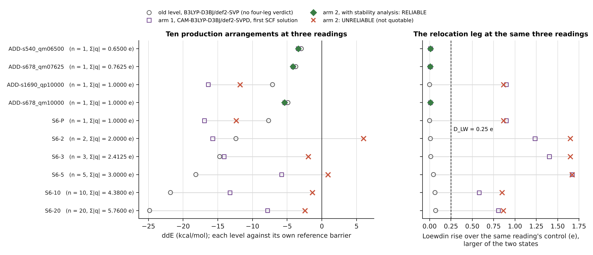

# The charged-sphere design work at one level of theory: a scoped report, conditional on D36

11 November 2026. A second report beside `WRITEUP_CONSOLIDATED_20261111.md`. That document remains the full record of what was tried; it is not superseded, replaced or edited by this one. This report has a narrower job: what can be said at the level of theory the project now runs, and what cannot be said until it is remeasured there.

**This report is conditional on D36.** Its scope is CAM-B3LYP-D3BJ/def2-SVPD on frame 42436. The frame is settled. The level is a convention in use since D30 and not a decision: no amendment adopts it. D36, a DLPNO-CCSD(T)/def2-TZVPD benchmark that could support the choice or overturn it, is running as this is written, with 6 inputs committed and 0 outputs (derived counts). Section 7 names the conclusions that would change. [src: D36P] [dv: SV72, SV73]

| repository | branch | HEAD this document refers to |
|---|---|---|
| chorismate-thesis-results | main | `133e212c140c2d58ac5ce72829fc752eb9cf94ff` |
| chorismate-thesis-code | tier1-realism | `b9c8b72a53cf0e9a903036479a429a29708fc13d` |

**How to read it.** A tag `[src: KEY]` names the committed file in which each number of that paragraph is printed; Appendix C resolves the keys. A tag `[dv: SVnn]` marks a number computed here, with its arithmetic in `scoped/derived.tsv`. A tag `[level: ...]` names the level of theory a claim rests on, and the same level is written in the sentence itself; `comparison` marks a claim whose content is a comparison of methods, and `independent` a fact about the record. Curly quotation marks enclose words copied from a tagged source. `phase2.2/cs_writeup_check.py --scoped` tests all of this mechanically.

## 1. Scope, and what the scope is worth

**The frame is settled.** Inside Stage 6 every run is frame 42436. Checked here on the three directories that hold most of the older runs: all 52 substrate files of `standoff`, all 114 of `qscale` and all 282 of `sitescan` match frame 42436's committed reactant or transition state atom for atom, and 0 match neither (derived). So the frame separates Stage 6 from the earlier stages and filters nothing inside it, and D35 has bridged that gap for the bare reference barrier. [src: D35R] [dv: SV40, SV41, SV42, SV43]

**The level is not settled.** Stage 6 has 5 amendments: the A matrix, the removal of CPCM, one added arrangement, the coordinate system and Hessian, and the stability criterion. The string CAM-B3LYP occurs 0 times in them and in the Stage 6 criteria (derived). D28, which made the case for the functional, says of itself “the production functional is NOT changed by this document”, and D36's pre-registration says “It does not adopt a production level of theory.” CAM-B3LYP-D3BJ/def2-SVPD was first run in D28, as one arm of a comparison, and is the only level of the diagnostics D31 to D34. [src: D28, D36P, A1, A2, A3, A4, A5, CRIT, S1T] [dv: SV50, SV51]

**What the filter keeps.** Of the 36 directories under Stage 6 that hold committed inputs, 5 are at this level throughout (`d31`, `d32`, `d33a`, `d33b`, `d34`), 2 are partly (`d28`, `d30`) and 29 are not at all. That is 220 of 1546 inputs, or 14.2 per cent (derived). Appendix A sets this beside the sweep the brief supplied. [src: S1T] [dv: SV01, SV02, SV03, SV04, SV06, SV05, SV07]

## 2. What D34 measured about the level itself

D34 classified the same ten production arrangements, with the same charges at the same geometries, at both levels. At B3LYP-D3BJ/def2-SVP, 0 of the 10 reach the Loewdin threshold and the largest rise anywhere is 0.0711 e. At CAM-B3LYP-D3BJ/def2-SVPD, 7 of the 10 reach it, with rises up to 1.6692 e, and 7 are UNRELIABLE by the full criterion. [src: T3, D34R, D34T] [dv: SV61, SV68, SV63, SV60, SV62, SV65]

**The relocation is in arm 1 as well as arm 2.** Arm 1 is the first converged solution, with no stability analysis; arm 2 follows that solution to stability. The same 7 arrangements are over the threshold in both arms and the arms differ on 0 of them (derived); arm 2's largest rise is 1.6683 e. So what made the old work look clean is the level of theory and not the stability correction. This is recomputed here from the 44 raw outputs of `d34` and from the old-level outputs, through the committed readers; D34's committed result prints arm 2 only. Two limits. D34 changes the functional and the basis together and cannot say which of the two matters. And its reading of the old outputs is post hoc, by its own words. [src: T3, D34R] [dv: SV60, SV67, SV64, SV28]



**Figure.** Figure F7 of the consolidated write-up, unchanged: the ten production arrangements at the old level and at both of D34's arms. The right-hand panel is the point of this section.

## 3. What is established at this level

Everything in this section was measured at CAM-B3LYP-D3BJ/def2-SVPD, at frozen geometries, in vacuo. It is a short list, and that is the point. [src: D33A] [level: CAM-B3LYP-D3BJ/def2-SVPD]

1. **The reference barrier is 26.8248 kcal/mol at CAM-B3LYP-D3BJ/def2-SVPD.** D33 stage A, bare substrate. Scope: one frame, frozen, in vacuo; it is the number every lowering at this level is quoted against. [src: D33A] [level: CAM-B3LYP-D3BJ/def2-SVPD]

2. **Of the ten production arrangements, 3 are RELIABLE and 7 UNRELIABLE at CAM-B3LYP-D3BJ/def2-SVPD.** D34 arm 2, with the stability analysis. The three quotable lowerings are -3.3985, -4.1567 and -5.3701 kcal/mol, each a single negative sphere. Scope: every sphere sits at 2.85-2.96 A, inside an r_safe of 3.50 A that was itself measured at another level (section 4); a verdict does not transfer to another arrangement. [src: D34R, D34T] [dv: SV66, SV65] [level: CAM-B3LYP-D3BJ/def2-SVPD]

3. **A bare positive unit charge is unreliable at CAM-B3LYP-D3BJ/def2-SVPD at the committed positions.** D31, 62 runs: every condition that carries a positive unit charge is UNRELIABLE. Scope: one frame; D31 held no condition without a positive charge. [src: D31] [dv: SV25] [level: CAM-B3LYP-D3BJ/def2-SVPD]

4. **An argon wall removes the Loewdin relocation in 29 of 30 charged conditions at CAM-B3LYP-D3BJ/def2-SVPD, and is not adopted.** D32, 66 runs. Scope: one species, whose parameters are not validated; nothing above three spheres at unit charge is certified. [src: D32, D32E1, FDV] [dv: SV26] [level: CAM-B3LYP-D3BJ/def2-SVPD]

5. **The design field has been recomputed at CAM-B3LYP-D3BJ/def2-SVPD, and the largest reliable lowering found with it is -14.3612 kcal/mol.** D33 stage A recomputed the A matrix from 16 inputs; stage B measured designs chosen with it in 16 runs, and the largest reliable one is five bare spheres at 0.50 e. Measured lowerings exceed the linear prediction by factors of 1.09 to 1.23. Scope: it is not one of the ten production arrangements; it sits inside r_safe; reliability did not transfer between arrangements in stage B. [src: D33A, D33B, D33E2, FDV] [dv: SV24, SV27] [level: CAM-B3LYP-D3BJ/def2-SVPD]

## 4. What must be remeasured before it can be claimed

A barrier, a lowering, a reliability verdict, a statement about where density goes, a cap or an envelope on the charges, and r_safe all depend on the level. The record's versions of the following were measured at B3LYP-D3BJ/ma-def2-SVP, B3LYP-D3BJ/def2-SVP or B3LYP-D3BJ/def2-SVPD, and none is admissible at the production level until it is remeasured there. They are ordered by what each gates. The run count is a like-for-like repeat: the committed inputs of that diagnostic at the level named, counted in `scoped/S1_inputs_by_directory.tsv`. [src: S2T, S1T] [level: B3LYP-D3BJ/ma-def2-SVP; B3LYP-D3BJ/def2-SVP; B3LYP-D3BJ/def2-SVPD]

| order | claim | measured by | level measured at | runs to repeat | what it gates |
|---|---|---|---|---|---|
| 1 | r_safe = 3.50 A | D11, `standoff` | B3LYP-D3BJ/ma-def2-SVP | 42 | which grid sites are admissible, and so the choice between routes (a) and (b) |
| 2 | which descriptor predicts the artefact; whether moving the grid outward helps | D12, `sitescan` | B3LYP-D3BJ/ma-def2-SVP | 266 | route (a), and any screen applied before a design is run |
| 3 | how the artefact grows with the size of the charge (verdict PARTIAL) | D13, `qscale` | B3LYP-D3BJ/ma-def2-SVP | 114 | any cap on the size of a single charge |
| 4 | whether a designed charge needs Pauli repulsion | D3, `pauli` | B3LYP-D3BJ/def2-SVP and B3LYP-D3BJ/def2-SVPD | 16 | the Lennard-Jones sphere as the representation of a charge |
| 5 | whether the artefact is additive over charges | D14, D16, D17; `additivity`, `d16`, `d17` | B3LYP-D3BJ/def2-SVPD | 258 | any per-site screen or budget built from single-charge runs |
| 6 | how the wall's effect depends on its species | D23, `d23` | B3LYP-D3BJ/def2-SVPD | 50 | the species of wall used by route (b) |
| 7 | the relaxed half of the Stage 6 designs | `relax` | B3LYP-D3BJ/def2-SVP | 42 | Stage 6's own purpose, the relaxation |

Sources for the table: `scoped/S2_remeasure.tsv`, drawn by `scoped/make_scoped.py` from the sweep of committed inputs. [src: S2T] [level: B3LYP-D3BJ/ma-def2-SVP; B3LYP-D3BJ/def2-SVP; B3LYP-D3BJ/def2-SVPD]

**r_safe comes first.** It was measured by D11 along one axis from one site at B3LYP-D3BJ/ma-def2-SVP, and D11's Erratum 1 states it as “r_safe = 3.50 A”. It gates the grid, and through the grid every design in section 3, all of which sit inside it. It has never been measured at the production level. A like-for-like repeat of its ladder is 42 runs; the consolidated write-up's cheaper test, five rungs at both signs and in both states, is 20 (derived there). [src: D11, D11E, FDV] [dv: SV10] [level: B3LYP-D3BJ/ma-def2-SVP]

**Two things have already been remeasured, and both answers moved.** The A matrix was built at B3LYP-D3BJ/def2-SVP from 16 inputs and rebuilt at CAM-B3LYP-D3BJ/def2-SVPD by D33 stage A; the two matrices share 17 of their twenty largest sites. The ten production barriers were measured at B3LYP-D3BJ/def2-SVP and remeasured at CAM-B3LYP-D3BJ/def2-SVPD by D34, with the result of section 2. That is the reason for treating the rest of this list as open and not as probably fine. [src: AREP, D33A, T3, D34R] [dv: SV23] [level: B3LYP-D3BJ/def2-SVP; CAM-B3LYP-D3BJ/def2-SVPD]

**Counterexamples are a different kind of claim.** D29's result, “NO SCALAR IN THE SET ORDERS RELOCATION.”, was shown at B3LYP-D3BJ/def2-SVPD on one pair of runs. A counterexample does not transfer to another level automatically, and it is not a measured barrier either. It is shown at its own level and has not been reshown at the production one, so it is neither established here nor void. [src: D29] [level: B3LYP-D3BJ/def2-SVPD]

## 5. What needs no remeasurement

**Facts about the record.** What the record contains, what was withdrawn and by which erratum, what was never adopted, how many runs exist, where each number comes from, and the labels documents put on themselves do not depend on a level of theory. They are admissible as they stand and are not hedged here. The consolidated write-up holds them: its section 7 for what was withdrawn, its Appendix A for the census. Asking for them to be remeasured would be a category error and not a gap. [src: FIRST]

**Comparisons across methods.** The whole content of each of these is the comparison, and running it at one level would delete the finding. Stage 4e's k is the ratio of barrier changes between four methods and MP2/6-31G(d), and runs from 0.819 to 0.892. D27 is a basis series at B3LYP-D3BJ. D28 is a functional series, which puts the dianion's highest occupied orbital at +1.2307 eV under B3LYP, -0.5918 eV under CAM-B3LYP and -1.3424 eV under wB97X-D3. D30 is the basis convergence at CAM-B3LYP-D3BJ, where the conditions `1.3000e_n10` and `2.8800e_n10` are each marked CONVERGED. D35 is five levels at both frames: the geometry moves the barrier by +1.4992 to +3.6023 kcal/mol, and the order of the levels between the frames is “NOT PRESERVED.” [src: S4E, D27, D28, D30, D35R]

## 6. The decisions this leaves to Jessica

1. **Whether to adopt a production level by amendment.** None does (section 1). D36 supplies evidence for that decision and does not make it.
2. **Route (a) or route (b).** D11's Erratum 1 leaves the choice open. It is gated by an r_safe measured at B3LYP-D3BJ/ma-def2-SVP, which is neither the old production level nor the present one.
3. **Whether r_safe is remeasured before anything else in section 4.** 42 runs like for like, or 20 for the cheaper test.
4. **What becomes of the old-level numbers.** D34 says “Nothing is withdrawn here; withdrawal of a committed number needs its own dated erratum.”
5. **The neutrality constraint,** which D34 records as untaken. [src: D36P, D11E, D34R, FDV] [dv: SV10]

## 7. Conclusions and hypotheses

Each conclusion is one sentence of claim, one of evidence and one of scope, with the level it rests on in the sentence. [level: independent]

1. **The level this report is scoped to is a convention and not a decision.** CAM-B3LYP is named 0 times in the 5 Stage 6 amendments and the criteria (derived), and D28 and D36 each say they do not decide it. Scope: a fact about the record, true whatever D36 finds. [src: D28, D36P] [dv: SV51, SV50] [level: independent]

2. **The level changes the answer, and not only the decimals.** On identical arrangements, 0 of 10 reach the Loewdin threshold at B3LYP-D3BJ/def2-SVP and 7 of 10 at CAM-B3LYP-D3BJ/def2-SVPD, before any stability correction. Scope: functional and basis changed together; the old-level reading is post hoc. [src: T3, D34R] [dv: SV61, SV68, SV60] [level: B3LYP-D3BJ/def2-SVP; CAM-B3LYP-D3BJ/def2-SVPD]

3. **At CAM-B3LYP-D3BJ/def2-SVPD the largest quotable lowering for a production arrangement is -5.3701 kcal/mol, against a reference of 26.8248.** D34 arm 2 and D33 stage A. Scope: one sphere of negative charge, inside an r_safe that was not measured at this level; not a catalytic claim. [src: D34R, D33A] [level: CAM-B3LYP-D3BJ/def2-SVPD]

4. **Most of what gates the design was measured at another level.** Only 220 of the 1546 Stage 6 inputs are at the production level, and r_safe, the artefact's predictors, its dependence on magnitude and its additivity were measured at B3LYP-D3BJ/ma-def2-SVP or B3LYP-D3BJ/def2-SVPD. Scope: a count of inputs and not of their weight; section 4 orders them by what they gate. [src: S1T, S2T] [dv: SV06, SV05] [level: B3LYP-D3BJ/ma-def2-SVP; B3LYP-D3BJ/def2-SVPD]

5. **Where the record has been remeasured, the answer moved.** The A matrix and the ten production barriers were both taken from B3LYP-D3BJ/def2-SVP to CAM-B3LYP-D3BJ/def2-SVPD, and 7 of the ten barriers became not quotable. Scope: two cases; they do not show that every item of section 4 will move, only that none can be assumed to stay. [src: AREP, D33A, T3, D34R] [dv: SV65] [level: B3LYP-D3BJ/def2-SVP; CAM-B3LYP-D3BJ/def2-SVPD]

**H1. Beyond 3.50 A a bare unit charge is reliable at the production level.** *Unblocks:* route (a) and the grid. *Falsified if:* a unit charge at 3.50 A or beyond fires any leg of the criterion there, with the stability analysis. *Cheapest test:* 20 charged runs (derived in the consolidated write-up); 42 like for like. *Against:* at B3LYP-D3BJ/ma-def2-SVP, D12 found 3 of its 4 sites beyond 3.50 A failing D11's tolerance. [src: D11E, D12, FDV] [dv: SV10] [level: B3LYP-D3BJ/ma-def2-SVP]

**H2. Relocation is onto the positive charges.** This is post hoc. *Unblocks:* whether routes (a) and (b) must act on every charge or only on the positive ones. *Falsified if:* an arrangement with no positive charge fires a leg of the criterion at CAM-B3LYP-D3BJ/def2-SVPD with the stability analysis. *Cheapest test:* a sign swap at two sites, 4 runs (derived in the consolidated write-up). *For:* at CAM-B3LYP-D3BJ/def2-SVPD the 3 arrangements of D34 with no positive charge are its 3 RELIABLE ones. *Limit:* in that sample sign is confounded with site. [src: T3, D34T, FDV] [dv: SV66] [level: CAM-B3LYP-D3BJ/def2-SVPD]

**H3. The DLPNO-CCSD(T)/def2-TZVPD barrier lies nearer CAM-B3LYP-D3BJ/def2-TZVPD's 25.7003 kcal/mol than B3LYP-D3BJ/def2-TZVPD's 17.304571.** This is D36's pre-registered reading, stated here as the hypothesis the scope of this report depends on. *Falsified if:* it lies nearer the B3LYP value. *Test:* D36's 6 inputs, running. *A reason not to assume the answer:* D35 measured MP2/6-31G(d) at this frame as 19.4390 kcal/mol. That is another basis and not CCSD(T), so it is not evidence either way. [src: D36P, D35R] [dv: SV72] [level: comparison]

**What D36 could change.** If the benchmark lands nearer B3LYP-D3BJ/def2-TZVPD than CAM-B3LYP-D3BJ/def2-TZVPD, D28's direction is overturned and the following change. The scope of this report loses its reason: section 3 becomes a list of things established at a level the benchmark does not support. The third conclusion stands as a measurement and falls as a basis for design. Section 4 has to be asked again from the start, because the level to remeasure at is itself open. What does not change: the first, second and fourth conclusions, which are about the record and about a comparison; everything in section 5; and D34's finding that the two levels disagree, which would then need explaining in the other direction. If the benchmark lands nearer CAM-B3LYP, nothing here changes and the first decision of section 6 has its evidence. D36 says of itself: “if CCSD(T) lands nearest B3LYP, which would overturn D28's direction, that is the result and it is reported as plainly as the opposite.” [src: D36P] [level: comparison]

## Appendix A. The brief's sweep, recomputed

The brief supplied a sweep from another session and asked for it to be recomputed. `scoped/make_scoped.py` reads every committed `*.inp` under Stage 6 and takes the level from its keyword lines.

| claim in the brief | finding |
|---|---|
| five of thirty-six directories are at the production level throughout | confirmed: `d31` 62, `d32` 66, `d33a` 16, `d33b` 16, `d34` 44 inputs, of 36 directories |
| `d28` is partly at it | confirmed: 8 of 22. It also holds def2-TZVPD and wB97X-D3, as stated, and one input each at CAM-B3LYP-D3BJ/def2-SVP and wB97X-D3/def2-SVP, not stated |
| `d30` is partly at it | confirmed: 8 of 22 |
| `d36` is partly at it, in its control arm | corrected: the control arm is CAM-B3LYP-D3BJ/def2-TZVPD. None of its 6 inputs is at the production level |
| `standoff` is B3LYP/ma-def2-SVP | confirmed for 42 inputs; 10 more are at B3LYP-D3BJ/def2-SVP |
| `qscale`, 114 runs at B3LYP/ma-def2-SVP | confirmed |
| `sitescan`, 266 runs at B3LYP/ma-def2-SVP | confirmed; 16 more are at B3LYP-D3BJ/def2-SVP |
| `pauli` at def2-SVP and def2-SVPD | confirmed: 8 and 8 |
| `additivity`, `d16`, `d17` at B3LYP/def2-SVPD | corrected for `additivity`: 92 at def2-SVPD and 56 at def2-SVP. `d16` 148 and `d17` 18 confirmed |
| `d23` at B3LYP/def2-SVPD | confirmed: 50 |
| `relax` at B3LYP/def2-SVP | confirmed: 42 |

Sources for the table: `scoped/S1_inputs_by_directory.tsv`. Where the brief writes B3LYP, every keyword line in these directories carries D3BJ, so the level is B3LYP-D3BJ. Inputs held only inside archives are not seen by the sweep. [src: S1T] [dv: SV01, SV72]

The brief's other claims were checked as well. The frame: confirmed, with the precision that reactant runs match the committed reactant and transition-state runs the transition state (section 1). The amendments: confirmed (section 1). D34's arm 1: confirmed (section 2). D35's MP2/6-31G(d) barrier of 19.4390 kcal/mol at this frame and the 25.7003 of CAM-B3LYP at def2-TZVPD: confirmed. [src: D35R, D36P]

## Appendix B. Provenance

The record below is `scoped/PROVENANCE.txt` as the validation script wrote it on the staged copies: the two HEAD hashes, the sha256 of every script used, the eight scoped checks and the negative tests.

```
PROVENANCE of WRITEUP_SCOPED_20261111.md

chorismate-thesis-results  main           HEAD 133e212c140c2d58ac5ce72829fc752eb9cf94ff
chorismate-thesis-code     tier1-realism  HEAD b9c8b72a53cf0e9a903036479a429a29708fc13d

sha256 of every script used
   f801e8f136d217ee2f0fb7714b5b6a188e46ed13b1c58244c42d9d78ce3a7851  scoped/make_scoped.py
   3d0b0261f03852b71e9e4fa9dbc2ee1845cd758db1fdad81caaa8a76d49b9ad9  code: phase2.2/cs_writeup_check.py
   6e0d0f90e0e7ab3f2f9da7c527e192c1686a6c77a885df6ccc4caf560665052a  code: phase2.2/cs6_analyse.py  (committed reader, imported)
   1dda394a134b3c7265df1898c9b5dc507d01c41d73aa5e59274495a1e7005dea  code: phase2.2/cs6_audit.py  (committed reader, imported)
   c6a8c3958a4e7532c9e28082b6d8f25c51549c0ea70f06fcf95d1370b3cde2f6  code: phase2.2/cs6_d33b.py  (committed reader, imported)

validation output

   S1 numbers      PASS   (86 sourced in a named committed file, 50 derived (scoped/derived.tsv))
   S2 quotes       PASS   (7 quotations)
   S3 citations    PASS   (32 keys in the source table)
   S4 regeneration PASS   (3 tables regenerated)
   S5 heads        PASS   (two repositories)
   S6 levels       PASS   (21 blocks carry a level tag)
   S7 d34          PASS   (5 values recomputed from raw outputs)
   S8 conditional  PASS   (title and first page)
   RESULT: ALL EIGHT SCOPED CHECKS PASS

   NEGATIVE TESTS (scoped report)
      a number                                             -> check 'numbers' FIRED: section '3. What is established at this level': 26.8348 is in no [src:] file of its block (D33A) and
      a quotation                                          -> check 'quotes' FIRED: section '1. Scope, and what the scope is worth': not verbatim in any [src:] file of its block (D28, 
      a regenerated table                                  -> check 'regeneration' FIRED: S1_inputs_by_directory.tsv differs from the file regenerated from the committed sources
      a HEAD hash                                          -> check 'heads' FIRED: chorismate-thesis-results: the report records 233e212c140c2d58ac5ce72829fc752eb9cf94ff and HEAD is 1
      a conclusion stripped of its level tag               -> check 'levels' FIRED: section '3. What is established at this level': a block carries no [level:] tag: 1. **The reference 
      a level left in the tag but taken out of the sentence -> check 'levels' FIRED: section '3. What is established at this level': CAM-B3LYP-D3BJ/def2-SVPD is named in the tag but not
      r_safe restated at a level it was not measured at    -> check 'levels' FIRED: section '4. What must be remeasured before it can be claimed': CAM-B3LYP-D3BJ/def2-SVPD is not a lev
      a comparison that names one level                    -> check 'levels' FIRED: section '7. Conclusions and hypotheses': tagged a comparison but names fewer than two levels in the 
      the arm 1 count                                      -> check 'd34' FIRED: SV60 is 6 in scoped/derived.tsv; recomputed here from the raw outputs: 7
      the condition in the title                           -> check 'conditional' FIRED: the title does not say the report is conditional on D36
      10 of 10 negative tests fired
```

## Appendix C. Sources

R is the results repository, C the code repository, W a table in `scoped/` beside this report. "Measured in" names the Stage 6 directories whose runs the source reports; the level check reads the levels of those directories from the sweep.

| key | repo | path | measured in |
|---|---|---|---|
| FIRST | R | phase2.2/cs_stage6/WRITEUP_CONSOLIDATED_20261111.md | - |
| FDV | R | phase2.2/cs_stage6/figures/derived.tsv | - |
| T3 | R | phase2.2/cs_stage6/figures/T3_d34_arms.tsv | d34, relax |
| CRIT | R | phase2.2/cs_stage6/STAGE6_CRITERIA.txt | - |
| A1 | R | phase2.2/cs_stage6/STAGE6_AMENDMENT1.txt | - |
| A2 | R | phase2.2/cs_stage6/STAGE6_AMENDMENT2_20261027.txt | - |
| A3 | R | phase2.2/cs_stage6/STAGE6_AMENDMENT3_20261103.txt | - |
| A4 | R | phase2.2/cs_stage6/STAGE6_AMENDMENT4_20261103.txt | - |
| A5 | R | phase2.2/cs_stage6/STAGE6_AMENDMENT5_20261109.txt | - |
| AREP | R | phase2.2/cs_stage6/A_REPORT.txt | a_matrix |
| D3 | R | phase2.2/cs_stage6/pauli/DIAGNOSTIC3_RESULT.txt | pauli |
| D11 | R | phase2.2/cs_stage6/standoff/DIAGNOSTIC11_RESULT.txt | standoff |
| D11E | R | phase2.2/cs_stage6/STAGE6_DIAGNOSTIC11_ERRATUM1_20261027.txt | standoff |
| D12 | R | phase2.2/cs_stage6/sitescan/DIAGNOSTIC12_RESULT.txt | sitescan |
| D13 | R | phase2.2/cs_stage6/qscale/DIAGNOSTIC13_RESULT.txt | qscale |
| D27 | R | phase2.2/cs_stage6/STAGE6_DIAGNOSTIC27_RESULT_20261105.txt | d27 |
| D28 | R | phase2.2/cs_stage6/STAGE6_DIAGNOSTIC28_RESULT_20261105.txt | d27, d28 |
| D29 | R | phase2.2/cs_stage6/STAGE6_DIAGNOSTIC29_RESULT_20261105.txt | transfer |
| D30 | R | phase2.2/cs_stage6/STAGE6_DIAGNOSTIC30_RESULT_20261106.txt | d30 |
| D31 | R | phase2.2/cs_stage6/STAGE6_DIAGNOSTIC31_RESULT_20261107.txt | d31 |
| D32 | R | phase2.2/cs_stage6/STAGE6_DIAGNOSTIC32_RESULT_20261109.txt | d32 |
| D32E1 | R | phase2.2/cs_stage6/STAGE6_DIAGNOSTIC32_ERRATUM1_20261109.txt | d32 |
| D33A | R | phase2.2/cs_stage6/STAGE6_DIAGNOSTIC33_STAGEA_RESULT_20261109.txt | d33a |
| D33B | R | phase2.2/cs_stage6/STAGE6_DIAGNOSTIC33_STAGEB_RESULT_20261109.txt | d33b |
| D33E2 | R | phase2.2/cs_stage6/STAGE6_DIAGNOSTIC33_ERRATUM2_20261109.txt | d33b |
| D34R | R | phase2.2/cs_stage6/STAGE6_DIAGNOSTIC34_RESULT_20261110.txt | d34 |
| D34T | R | phase2.2/cs_stage6/d34.tsv | d34 |
| D35R | R | phase2.2/cs_stage6/STAGE6_DIAGNOSTIC35_RESULT_20261111.txt | d35 |
| D36P | R | phase2.2/cs_stage6/STAGE6_DIAGNOSTIC36_20261111.txt | - |
| S4E | R | phase2.2/cs_stage4e/STAGE4E_REPORT.txt | - |
| S1T | W | S1_inputs_by_directory.tsv | - |
| S2T | W | S2_remeasure.tsv | - |
